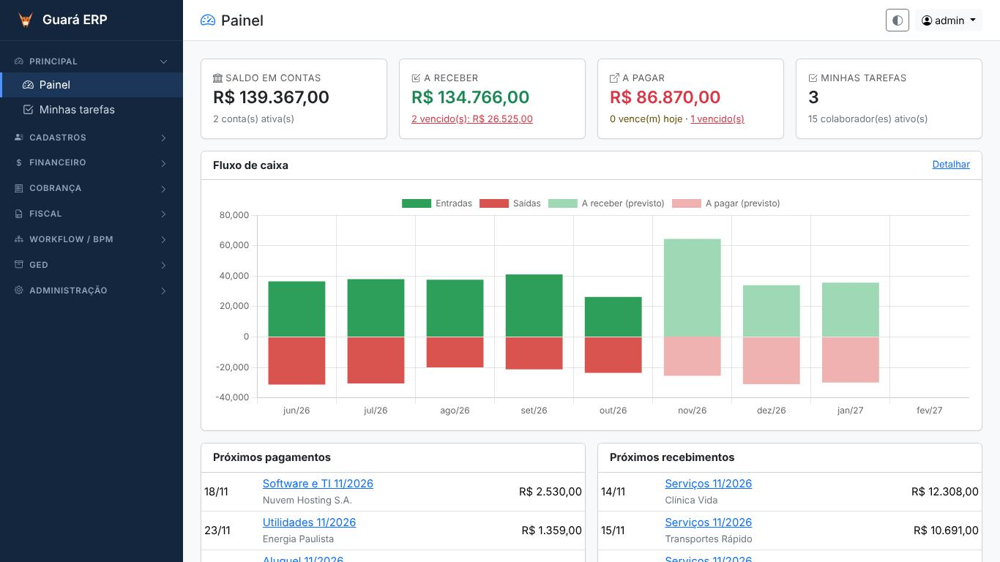

<p align="center"></p>

<h1 align="center">Projeto Guará ERP</h1>
<p align="center"><em>Gestão integrada, colaborativa e livre.</em></p>

<p align="center">
  <a href="LICENSE"></a>
  
  
  
  
</p>

Sistema web de gestão empresarial (ERP) livre, em **Python/Django + PostgreSQL**. Roda em **Linux e Windows**
(com ou sem Docker) e é usado pelo navegador. A interface é em português e pensada para empresas
brasileiras (CPF/CNPJ, PIX, NF-e, plano de contas).

O nome homenageia o **lobo-guará** (*Chrysocyon brachyurus*), o maior canídeo da América do Sul e
símbolo do Cerrado: ele percorre grandes territórios com eficiência, como um ERP que integra todas as
áreas da empresa.



## Documentação

| Documento | Conteúdo |
|---|---|
| [docs/INSTALACAO.md](docs/INSTALACAO.md) | **Requisitos** (hardware, sistemas, software, rede), instalação Docker/Linux/Windows, HTTPS, backup, atualização e solução de problemas |
| [docs/MANUAL.md](docs/MANUAL.md) | **Manual do usuário**: uso de cada módulo, perfis de acesso e perguntas frequentes |
| [SEGURANCA.md](SEGURANCA.md) | Auditoria de segurança, permissões, banco de dados e portas |
| [docs/identidade/IDENTIDADE.md](docs/identidade/IDENTIDADE.md) | Identidade visual: logotipo, selo, paleta de cores e regras de uso |
| [docs/TERCEIROS.md](docs/TERCEIROS.md) | Componentes de terceiros e suas licenças |
| [LICENSE](LICENSE) | Texto integral da GNU GPL versão 3 |

## Módulos

| Módulo | O que faz |
|---|---|
| **Cadastros** | **Várias empresas e filiais** na mesma instalação (acesso por usuário, empresa ativa na barra superior, numeração, série e certificado fiscal por empresa), departamentos (hierarquia), cargos, colaboradores. **Parceiro de negócios único**: cada CPF/CNPJ é cadastrado uma vez e pode ser cliente, fornecedor ou os dois. Validação de CPF/CNPJ e busca de CEP automática. |
| **Compras** | Solicitação de compra por qualquer usuário, **cotação** com vários fornecedores e **mapa de cotação**, pedido de compra com **alçada de aprovação** por departamento e valor (coordenador → gerente → diretor, cadastrados na tela de alçadas, sem aprovação automática), PDF do pedido, recebimento parcial e **conferência em três vias** (pedido × recebimento × nota): a conta a pagar só é liberada quando tudo bate; divergências viram tarefa no Kanban. |
| **Service Desk** | Central de serviços internos para várias áreas (TI, Facilities, RH, Financeiro): catálogo com **SLA** em horário comercial, **aprovação** pelo gestor, **fila de atendimento** com indicadores, **avisos de vencimento**, **chat** entre analista e usuário (com nota interna e "chamar o usuário" que pausa o SLA), **biblioteca de soluções**, **assistente** que sugere a solução antes de abrir o chamado e **gestão de mudanças** (RDM com gestor + CAB). |
| **Vendas e CRM** | Funil de oportunidades com valor ponderado, interações e próximo passo no Kanban, conversão do prospect em cliente. Pedido de venda com **análise de crédito** (liberação só pelo Financeiro), conferência de estoque, desconto máximo e **faturamento** que emite a NF de saída, gera as contas a receber por parcela e baixa o estoque. |
| **Estoque** | Armazéns, saldos com **custo médio**, kardex imutável, transferências, **inventário** com ajuste, reposição pelo estoque mínimo, quarentena para inspeção. |
| **Produção e Qualidade** | Estrutura de produto (lista de materiais com perda), ordem de produção com apontamento que consome componentes e custeia o acabado, MRP simples (falta vira solicitação de compra). Inspeção de recebimento e **não conformidades** com causa raiz, ação corretiva e eficácia. |
| **Manutenção** | Equipamentos, planos preventivos que abrem OS sozinhos, OS corretivas abertas por qualquer usuário, peças baixadas do estoque e custo por equipamento. |
| **Projetos** | EAP com horas e avanço, apontamento de horas com custo-hora, despesas pelo centro de custo e **realizado × orçamento**. |
| **SST / EHS** | Incidentes e acidentes (CAT), inventário de riscos (PGR), entregas de EPI com CA, ASOs (só aptidão, LGPD) e treinamentos de NR com alerta de vencimento. |
| **Financeiro** | Contas a pagar e a receber com parcelamento, juros/desconto, baixa total ou parcial, estorno e cancelamento. Contas bancárias com saldo, extrato, transferências, plano de contas e centros de custo. Fluxo de caixa realizado × previsto com saldo projetado. **Conciliação bancária** por extrato OFX (casamento automático, baixa de título ou lançamento de tarifa pela própria linha) e **pagamento a fornecedores por CNAB 240** (borderô só com títulos aprovados, remessa e retorno com baixa automática). |
| **Contabilidade** | **Razão único**: títulos, baixas, faturamento, impostos e movimentos de estoque geram lançamentos de partidas dobradas na hora, por regras configuráveis. Diário imutável com estorno, balancete, razão, **DRE**, **balanço patrimonial**, fechamento de períodos e lançamentos manuais. |
| **Cobrança** | Cobranças por PIX (gera o **PIX copia-e-cola + QR Code** a partir da chave da empresa), boleto ou link. **Régua de cobrança** automática por e-mail (ex.: 3 dias antes, no dia, 3 e 10 dias após), com histórico de envios. Status sincronizado com o título. |
| **Fiscal** | Produtos/serviços com NCM, CFOP e alíquotas. Notas fiscais (NF-e, NFC-e, NFS-e) com itens e cálculo de ICMS/IPI/PIS/COFINS/ISS. **Importação de XML de NF-e** de fornecedores (cadastra o fornecedor e gera a conta a pagar). Geração de títulos a partir da nota e resumo para apuração. **Transmissão ao fisco** com certificado A1 em cofre cifrado, assinatura XML e emissores plugáveis (SEFAZ, Emissor Nacional da NFS-e, prefeitura de São Paulo): a **simulação interna** e o **Emissor Nacional da NFS-e** (em homologação; produção travada até a liberação) estão disponíveis. SEFAZ e a prefeitura de São Paulo ainda não. |
| **Minhas tarefas (Kanban)** | Quadro com arrastar e soltar (a fazer, em andamento, em revisão, concluída). Atividades individuais ou do grupo, prioridade, prazo, etiquetas e comentários. Visões **Minhas**, **Meus grupos** e **Minha equipe**: o gestor vê o resumo e o quadro das pessoas que gerencia, definidas pelo gestor direto e pelo responsável do departamento. |
| **Jurídico** | Contratos de fornecedores e clientes: cadastro, vigência, valores e reajuste, **aprovação/recusa** por workflow, **assinatura digital**, renovação (manual ou automática), aditivos, encerramento/rescisão e linha do tempo. **Alertas de vencimento** viram cartões no Kanban do gestor do contrato. |
| **Workflow / BPM** | Modelagem de processos com etapas (tarefa ou aprovação), responsável por usuário ou grupo e prazo. Diagrama do fluxo, caixa "Minhas tarefas", histórico completo. Integração pronta: **aprovação de pagamento** de contas a pagar. |
| **GED** | Pastas com controle de acesso por grupo, documentos com **versões**, hash SHA-256, validade (contratos, alvarás), documentos confidenciais, download auditado e visualização no navegador. **Assinatura digital ICP-Brasil** com certificado A1: PAdES em PDF (vários signatários) e CAdES `.p7s` nos demais arquivos. Inclui verificação de assinaturas, também das feitas fora do sistema (gov.br, token A3). |
| **Relatórios e dashboards** | Seis painéis analíticos (executivo, financeiro, comercial, suprimentos, operação e Service Desk) com gráficos, comparação com o período anterior, filtro por empresa/filial e exportação CSV. Cada perfil vê só o que pode consultar. |
| **Assistente de IA** | Pedido em linguagem natural vira formulário preenchido, em **todos os módulos**, pelo chat do ERP ou pelo **Telegram**. Também **consulta** as listas (o ERP executa, com as permissões do usuário) e faz a **triagem do Service Desk**: classifica o chamado, orienta pela biblioteca de soluções e encaminha à equipe quando não resolve. IA local (Ollama) ou na nuvem (API compatível com OpenAI, Anthropic), à escolha do administrador. A IA só propõe: quem salva é o usuário, com as permissões dele. |
| **Administração** | Usuários, grupos e permissões; **auditoria** automática de toda inclusão/alteração/exclusão (com o que mudou); página de **Banco de dados** (tamanho, tabelas, backup `.sql` com um clique, VACUUM) e **pgAdmin** incluso no Docker. |

Toda tela de listagem tem busca, filtros, ordenação, paginação e **exportação para CSV/Excel**.
Painel inicial com saldos, vencidos, próximos pagamentos/recebimentos, tarefas e gráfico de fluxo de caixa.
Tema claro/escuro. Bibliotecas de interface ficam no próprio projeto (funciona em rede sem internet).

## Instalação rápida com Docker (Linux ou Windows)

Requer Docker 24+ com Compose (no Windows: Docker Desktop). Requisitos completos e outras formas de
instalação estão em [docs/INSTALACAO.md](docs/INSTALACAO.md).

```bash
git clone https://github.com/raldineybsantos/guara-erp.git
cd guara-erp
cp .env.example .env        # no Windows: copy .env.example .env
# edite o .env: senhas (POSTGRES_PASSWORD, POSTGRES_ADMIN_PASSWORD, PGADMIN_PASSWORD...) e a chave secreta:
#   python -c "import secrets; print(secrets.token_urlsafe(50))"
docker compose up -d --build
# opcional, HTTPS com o proxy Caddy:  docker compose --profile https up -d
```

| Serviço | Endereço |
|---|---|
| ERP | http://localhost:8000 (usuário/senha do `DJANGO_SUPERUSER_*` do `.env`) |
| pgAdmin | http://localhost:5050, **só no próprio servidor** (`PGADMIN_EMAIL` / `PGADMIN_PASSWORD`; conecte com o usuário `postgres` e a `POSTGRES_ADMIN_PASSWORD`) |

O serviço `agendador` executa a régua de cobrança todo dia às 08:00.

## Instalação sem Docker

### Linux (Debian/Ubuntu)

```bash
sudo ./scripts/instalar_linux.sh
```

Instala PostgreSQL e Python, cria banco e `.env` (com senha gerada), aplica a estrutura e registra os
serviços `erp-web` (gunicorn, porta 8000) e `erp-agendador` no systemd.

### Windows

1. Instale o [Python 3.11+](https://www.python.org/downloads/) (marque "Add to PATH") e o
   [PostgreSQL](https://www.postgresql.org/download/windows/).
2. No PowerShell, dentro da pasta do projeto:
   ```powershell
   Set-ExecutionPolicy -Scope Process Bypass
   .\scripts\instalar_windows.ps1      # 1ª vez cria o .env e abre no Bloco de Notas; ajuste e rode de novo
   .\scripts\iniciar_windows.bat       # inicia em http://localhost:8000
   ```
3. Para a régua de cobrança diária, agende `scripts\regua_windows.bat` no Agendador de Tarefas.

> Para acessar de outros computadores da rede, inclua o IP/nome do servidor em `DJANGO_ALLOWED_HOSTS`
> e `DJANGO_CSRF_TRUSTED_ORIGINS` no `.env`.

## Primeiros passos

1. Entre com o administrador e cadastre sua **empresa** (Cadastros → Empresas), incluindo a **chave PIX**.
2. Cadastre **contas bancárias** com o saldo inicial (Financeiro → Contas bancárias).
3. Crie os **usuários** (Administração → Usuários e grupos) e coloque cada um em um grupo:
   `Administradores`, `Financeiro`, `Fiscal`, `RH`, `Compras` ou `Usuários`. As permissões de cada grupo
   são criadas pelo comando `setup_erp` e podem ser ajustadas no Admin.
4. Ajuste o plano de contas, a régua de cobrança e os processos de workflow conforme sua empresa.

Dados de demonstração (empresa fictícia, colaboradores, títulos, notas, processos e usuários
`financeiro`, `rh`, `fiscal`, `juridico`, `compras`, `coordenador`, `gerente`, `diretor`, `vendedor`, `almoxarife`, `producao`, `sesmt`, `analista`, `contador` com senha `demo1234`). **Só para testes, nunca em produção:**

```bash
python manage.py seed_demo          # Docker: docker compose exec web python manage.py seed_demo
```

## Comandos úteis

| Comando | Para quê |
|---|---|
| `python manage.py setup_erp` | Cria/atualiza grupos, permissões, plano de contas, régua e processos padrão (pode repetir). |
| `python manage.py seed_demo` | Carrega dados fictícios (só em banco vazio). |
| `python manage.py executar_regua` | Envia agora as cobranças previstas pela régua. |
| `python manage.py agendador --hora 08:00` | Fica rodando e executa, todo dia no horário, a régua e as rotinas de contratos. |
| `python manage.py alertar_contratos` | Cria os alertas de vencimento e renova os contratos automáticos. |
| `python manage.py gerar_certificado_teste --nome N --cpf C` | Gera um certificado A1 de **teste** (sem validade jurídica) para experimentar a assinatura. |
| `python manage.py auditoria_verificar` | Sela e confere a integridade da trilha de auditoria. |
| `python manage.py auditoria_exportar arq.csv --de AAAA-MM-DD` | Exporta a trilha (com `.sha256`) para auditoria externa. |
| `python manage.py test tests` | Roda a suíte de testes automatizados. |
| `docker compose exec db pg_dump -U postgres erp > backup.sql` | Backup pelo terminal. |

## Segurança

Resumo do que já vem configurado (detalhes, portas e checklist em **[SEGURANCA.md](SEGURANCA.md)**):

- O ERP conecta ao PostgreSQL com um usuário **sem superusuário**. O banco não fica exposto fora do Docker
  e o pgAdmin só escuta no próprio servidor.
- Bloqueio de login após tentativas erradas, auditoria de logins com IP e sessões que expiram.
- Permissões por grupo e por registro: solicitações de workflow só para os envolvidos, pastas do GED por grupo.
  Dados de colaboradores ficam restritos ao RH.
- Proteção contra injeção de SQL e de template, XSS, XXE, upload de executáveis e fórmulas em CSV.
  Tudo coberto por testes automatizados.
- A página **Administração → Banco de dados** mostra uma verificação de segurança da instalação.

## Desenvolvimento

```bash
python -m venv .venv && source .venv/bin/activate     # Windows: .venv\Scripts\activate
pip install -r requirements.txt
cp .env.example .env    # POSTGRES_HOST=localhost e DJANGO_DEBUG=1
# os testes criam um banco temporário: no ambiente de DESENVOLVIMENTO dê CREATEDB ao usuário
#   ALTER ROLE erp CREATEDB;   (em produção, não)
python manage.py migrate && python manage.py seed_demo && python manage.py createsuperuser
python manage.py runserver
```

### Estrutura

```
config/            configurações Django (settings lidos do .env)
apps/core/         cadastros, auditoria, painel, banco de dados e o motor de telas (crud.py)
apps/financeiro/   títulos, baixas, contas bancárias, extrato, fluxo de caixa
apps/cobranca/     cobranças, PIX (pix.py), régua e histórico
apps/fiscal/       produtos, notas fiscais, importador de XML NF-e
apps/workflow/     processos BPM, etapas, solicitações e histórico
apps/ged/          pastas, documentos, versões e assinatura digital (assinatura.py)
apps/tarefas/      quadro Kanban de atividades e visão do gestor
apps/juridico/     contratos, aditivos, aprovação, vencimentos e renovação
templates/         telas (Bootstrap 5)
docker/            entrypoint, criação do usuário restrito do banco, pgAdmin e proxy HTTPS (Caddy)
scripts/           instaladores Linux/Windows
tests/             testes automatizados
```

**Como adicionar uma tela nova:** crie o modelo, depois uma classe em `telas.py` do módulo:

```python
class VeiculoCrud(Crud):
    model = Veiculo
    list_display = ("placa", "modelo", "responsavel")
    search_fields = ("placa", "modelo")
    filter_fields = ("modelo",)
    menu = "Cadastros"
    icon = "car-front"
```

e inclua `VeiculoCrud` em `crud_urls(...)` no `urls.py` do módulo. Listagem, filtros, exportação,
formulário, detalhe, exclusão, menu e permissões são gerados automaticamente.

## Limites desta versão (MVP)

- **Emissão de NF-e/NFS-e**: o sistema calcula, numera e registra as notas, mas **não transmite à SEFAZ
  ou à prefeitura**. Use seu emissor/certificado A1 e informe chave e protocolo, ou integre um serviço
  (ex.: Focus NFe, PlugNotas, NFE.io) em `apps/fiscal`.
- **Boleto registrado / PIX dinâmico**: o PIX gerado é o copia-e-cola **estático** (sem confirmação automática).
  Boleto e PIX com baixa automática exigem integração com o banco ou um gateway (Asaas, Iugu, Gerencianet etc.).
- **Folha de pagamento** e **estoque** não fazem parte desta versão.
- **Certificado A3** (token ou cartão) não assina direto pelo navegador. Assine no computador (Assinador
  SERPRO, gov.br, Adobe) e envie o PDF: o sistema verifica as assinaturas e ativa o contrato.
- Os cálculos de impostos são gerenciais; a apuração oficial deve ser validada pela contabilidade.

## Licença

Copyright © 2026 Raldiney Santos e colaboradores do Projeto Guará ERP.

Este programa é **software livre**: você pode redistribuí-lo e/ou modificá-lo sob os termos da
**GNU General Public License**, publicada pela Free Software Foundation, na versão 3 da Licença
ou (a seu critério) qualquer versão posterior (`SPDX-License-Identifier: GPL-3.0-or-later`).

Este programa é distribuído na esperança de que seja útil, mas **SEM NENHUMA GARANTIA**, nem mesmo
a garantia implícita de COMERCIABILIDADE ou ADEQUAÇÃO A UM PROPÓSITO ESPECÍFICO. Veja o arquivo
[LICENSE](LICENSE) para mais detalhes.

Em resumo:

- Você pode usar o Guará ERP em quantas empresas quiser, inclusive comercialmente.
- Pode estudar e modificar o código.
- Se **distribuir** o programa, original ou modificado, deve fazê-lo sob a mesma licença GPL e
  disponibilizar o código-fonte.

Os componentes de terceiros mantêm suas próprias licenças, todas compatíveis
(ver [docs/TERCEIROS.md](docs/TERCEIROS.md)).

## Como contribuir

1. Faça um *fork* e crie um *branch* (`git checkout -b minha-melhoria`).
2. Rode os testes: `python manage.py test tests` (todos devem passar).
3. Abra um *pull request* descrevendo a mudança. Contribuições são aceitas sob a GPL-3.0-or-later.

Vulnerabilidades de segurança: não abra *issue* pública. Use o recurso
*Security → Report a vulnerability* do GitHub.
