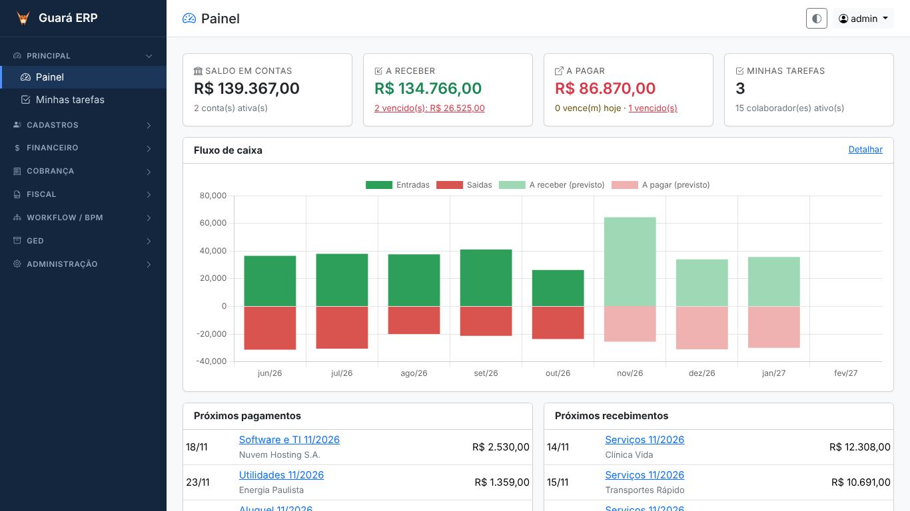
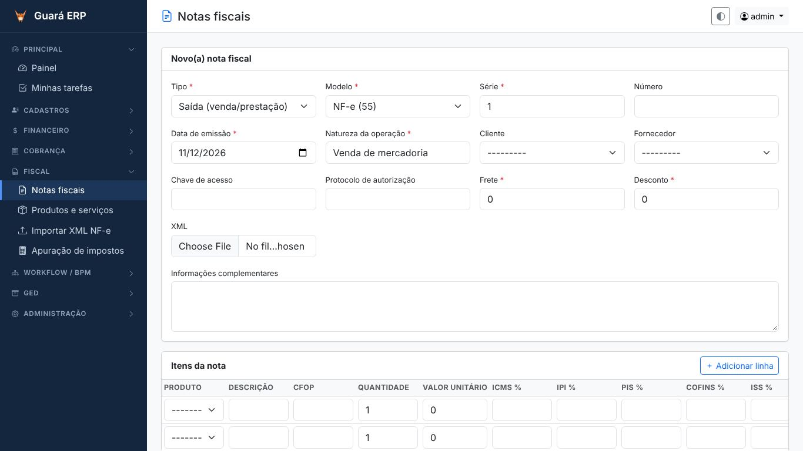
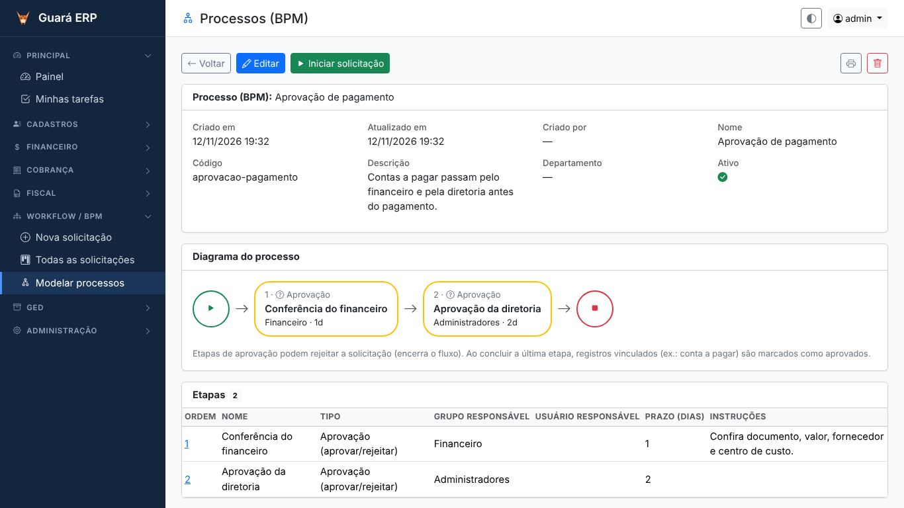
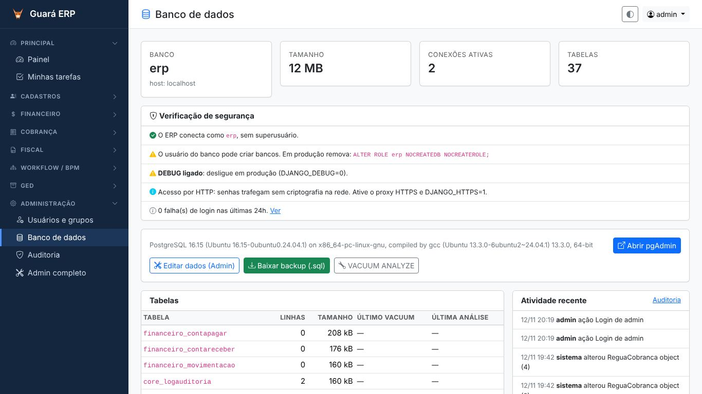

# Manual do usuário — Guará ERP

O **Guará ERP** é um sistema de gestão empresarial usado pelo navegador. O nome homenageia o
lobo-guará, o maior canídeo da América do Sul e símbolo do Cerrado brasileiro.

Este manual explica o uso diário de cada módulo. Para instalar o sistema, veja [INSTALACAO.md](INSTALACAO.md).

**Sumário**

1. [Acesso e navegação](#1-acesso-e-navegação)
2. [Primeiros passos (administrador)](#2-primeiros-passos-administrador)
3. [Perfis de acesso](#3-perfis-de-acesso)
4. [Telas de cadastro: uso comum](#4-telas-de-cadastro-uso-comum)
5. [Cadastros](#5-cadastros)
6. [Financeiro](#6-financeiro)
7. [Cobrança](#7-cobrança)
8. [Fiscal](#8-fiscal)
9. [Workflow / BPM](#9-workflow--bpm)
10. [GED — documentos](#10-ged--documentos)
11. [Administração](#11-administração)
12. [Perguntas frequentes](#12-perguntas-frequentes)

---

## 1. Acesso e navegação

1. Abra o endereço informado pela TI (ex.: `http://192.168.0.10:8000` ou `https://erp.suaempresa.com.br`).
2. Informe **usuário** e **senha** e clique em **Entrar**.

Algumas regras de acesso:

- Depois de **5 senhas erradas**, o acesso fica bloqueado por 15 minutos. Se precisar, peça ao
  administrador para conferir seu usuário.
- A sessão expira em **8 horas** ou quando o navegador é fechado.
- Para trocar a senha, clique no seu nome (canto superior direito) → **Alterar senha**.
  A senha precisa ter pelo menos 10 caracteres e não pode ser uma senha comum.
- Para sair, clique no seu nome → **Sair**. Faça isso sempre em computadores compartilhados.

**Painel:** é a tela inicial. Mostra o saldo das contas, os valores a receber e a pagar (com os
vencidos), suas tarefas pendentes, o gráfico de fluxo de caixa e os próximos vencimentos.
Cada pessoa vê só os quadros que o seu perfil permite.

**Menu lateral:** os módulos ficam agrupados (Cadastros, Financeiro, Cobrança, Fiscal, Workflow/BPM,
GED, Administração). Clique no nome do grupo para abrir ou fechar. No celular, o menu abre pelo
botão ☰.

**Tema escuro:** use o botão ◐ no topo. A preferência fica salva no navegador.

---

## 2. Primeiros passos (administrador)

Siga esta ordem logo depois da instalação:

1. **Empresa** (Cadastros → Empresas): razão social, CNPJ, regime tributário, endereço e a
   **chave PIX**. Sem a chave PIX, as cobranças não geram o PIX copia-e-cola.
2. **Contas bancárias** (Financeiro → Contas bancárias): uma por conta. Informe o **saldo inicial**
   e a data desse saldo. Cadastre também o "Caixa interno", se houver.
3. **Plano de contas** e **centros de custo** (Financeiro): o sistema já traz um plano básico.
   Ajuste ao da sua contabilidade.
4. **Departamentos e cargos** (Cadastros), depois os **colaboradores**.
5. **Usuários** (Administração → Usuários e grupos): crie um usuário para cada pessoa e marque o
   **grupo** dela (veja a seção 3). Para ligar o usuário ao cadastro do colaborador, use o campo
   *Usuário do sistema* no cadastro do colaborador.
6. **Régua de cobrança** (Cobrança → Régua de cobrança): revise os textos dos e-mails.
7. **Processos** (Workflow / BPM → Modelar processos): revise quem aprova cada etapa.
8. **Pastas do GED**: crie as pastas e defina os grupos que podem acessar cada uma.

---

## 3. Perfis de acesso

Cada usuário pertence a um ou mais **grupos**. O grupo define quais menus e ações aparecem.

| Grupo | Indicado para | Pode |
|---|---|---|
| **Administradores** | Diretoria, gestão | Tudo nos módulos, incluindo auditoria, ver todas as solicitações, criar usuários e ver documentos confidenciais |
| **Financeiro** | Contas a pagar e a receber, tesouraria | Financeiro e cobrança completos; consultar e cadastrar clientes e fornecedores; consultar notas |
| **Fiscal** | Departamento fiscal, faturamento | Notas e produtos completos; consultar o financeiro e lançar títulos; cadastrar clientes e fornecedores |
| **RH** | Recursos humanos | Colaboradores, departamentos e cargos; criar pastas no GED |
| **Compras** | Compradores | Fornecedores, lançar contas a pagar e notas de entrada |
| **Usuários** | Demais colaboradores | Abrir e acompanhar solicitações; consultar e enviar documentos no GED |

Todos os grupos podem abrir solicitações de workflow e usar o GED, dentro das pastas permitidas.

Algumas regras valem independentemente do grupo:

- Os dados de **colaboradores** (CPF, salário) só aparecem para RH e Administradores.
- Cada pessoa só vê as **solicitações de workflow** que abriu, as que estão com ela e as que já tratou.
- A página **Banco de dados** e o **Admin completo** são exclusivos do superusuário (TI).

---

## 4. Telas de cadastro: uso comum

Todas as telas de cadastro funcionam do mesmo jeito.

**Na lista:**

- **Buscar:** digite parte do nome, documento etc. e tecle Enter.
- **Filtros:** escolha as opções e clique em **Filtrar**. **Limpar** volta à lista completa.
- **Ordenar:** clique no título da coluna. Clique de novo para inverter a ordem.
- **Exportar:** gera um arquivo CSV com os registros filtrados. Ele abre no Excel com acentos corretos.
- **Novo:** abre o formulário de inclusão.
- Os ícones 👁 e ✏️ em cada linha servem para **ver** e **editar** o registro.

**No formulário:**

- Campos com **\*** são obrigatórios.
- Ao digitar o **CEP**, o endereço é preenchido sozinho (precisa de internet).
- **Salvar e incluir outro** agiliza cadastros em sequência.

**No detalhe:** mostra todos os dados, os registros ligados (por exemplo, as contas a pagar de um
fornecedor) e os botões de ação (**Editar**, **Pagar**, **Gerar cobrança** etc.). O botão 🖨 imprime a tela,
e a lixeira 🗑 exclui o registro. A exclusão é recusada se houver registros vinculados.

> Toda inclusão, alteração e exclusão fica registrada na **auditoria**, com usuário, data e o que mudou.

---

## 5. Cadastros

| Tela | Para que serve | Observações |
|---|---|---|
| **Empresas** | Dados da empresa e das filiais | A empresa marcada como *matriz* é a padrão nos lançamentos |
| **Departamentos** | Estrutura da empresa | Pode ter um *departamento superior* (hierarquia) e um responsável |
| **Cargos** | Funções e salário base | Código CBO opcional |
| **Colaboradores** | Ficha do funcionário | CPF validado; tipo de contrato (CLT, PJ, estágio...); situação (ativo, férias, afastado, desligado); dados bancários e PIX; gestor direto |
| **Fornecedores** | Quem vende para a empresa | CPF ou CNPJ validado; prazo de pagamento padrão (usado ao importar XML); dados bancários e PIX |
| **Clientes** | Quem compra da empresa | E-mail de cobrança separado (opcional); limite de crédito |

---

## 6. Financeiro

### 6.1 Contas a pagar e a receber

A lista abre em **Situação: Em aberto**. Use o filtro para ver **Vencidos**, **Pagos**,
**Cancelados** ou **Todos**.

**Lançar uma conta:** clique em **Novo** e informe fornecedor/cliente, descrição, valor, vencimento,
categoria (plano de contas) e centro de custo.

- **Parcelar:** na inclusão, informe o número de **parcelas** e o **intervalo em dias**. O sistema
  cria uma conta para cada parcela (1/3, 2/3, 3/3). Os centavos que sobram da divisão ficam na primeira parcela.
- **Juros/multa** e **desconto** alteram o *valor total* a pagar.

**Pagar ou receber (baixa):** abra a conta → **Pagar** (ou **Receber**) → informe valor, data, conta
bancária e forma de pagamento → **Confirmar**.

- Pagando **menos que o saldo**, o título fica como *Pago parcialmente* e o restante continua em aberto.
- Cada baixa gera uma **movimentação** no extrato da conta bancária e atualiza o saldo.

Outras ações no título:

- **Estornar pagamentos:** desfaz todas as baixas do título e apaga as movimentações. O título volta a *Em aberto*.
- **Cancelar título:** só é possível sem pagamentos (estorne antes).
- **Enviar para aprovação** (contas a pagar): abre uma solicitação no processo *Aprovação de pagamento*
  (seção 9). Quando todas as etapas aprovam, a conta fica marcada como **Aprovado**.
- **Gerar cobrança** (contas a receber): veja a seção 7.

### 6.2 Contas bancárias, extrato e transferências

- **Contas bancárias:** a lista mostra o **saldo atual** de cada conta (saldo inicial + entradas − saídas).
- **Extrato / movimentações:** todas as entradas e saídas. Aqui você também lança movimentações
  avulsas, como tarifas bancárias e rendimentos. O campo **Conciliado** marca o que já foi conferido
  com o extrato do banco.
- **Transferência:** move valor entre duas contas da empresa, gerando a saída numa e a entrada na outra.

### 6.3 Fluxo de caixa

Mostra, mês a mês:

- **Realizado:** entradas e saídas que já aconteceram.
- **Previsto:** o que está a receber e a pagar em aberto. Os vencidos entram no mês atual.
- **Saldo projetado:** saldo de hoje somado às previsões, acumulado mês a mês. Fica vermelho se ficar negativo.

### 6.4 Plano de contas e centros de custo

- **Plano de contas:** classifica receitas e despesas em níveis (ex.: `2.02.01 Aluguel`).
  Use códigos com pontos para a hierarquia.
- **Centros de custo:** separam as despesas por área, normalmente ligadas a um departamento.

---

## 7. Cobrança

**Gerar uma cobrança:** abra a conta a receber → **Gerar cobrança** → confirme.

- O sistema cria a cobrança com o **PIX copia-e-cola** e o **QR Code**, usando a chave PIX da empresa.
- O botão **Copiar** facilita mandar o PIX por WhatsApp ou e-mail.
- Para boleto ou link de pagamento gerados no banco ou em outro sistema, edite a cobrança e preencha
  a **linha digitável** ou o **link**.
- Quando o título é pago, a cobrança muda sozinha para **Paga**.

**Enviar por e-mail:** no detalhe da cobrança → **Enviar por e-mail**. O e-mail vai para o
*e-mail de cobrança* do cliente; se ele estiver vazio, para o e-mail principal.

**Régua de cobrança:** são envios automáticos em relação ao vencimento. O padrão é:
3 dias antes, no dia, 3 dias depois e 10 dias depois.

- Cada regra tem o número de **dias** (negativo = antes do vencimento), o **assunto** e a **mensagem**.
- Nos textos, use só estas variáveis: `{{ cliente }}`, `{{ titulo.descricao }}`, `{{ titulo.documento }}`,
  `{{ valor }}`, `{{ vencimento }}`, `{{ dias_atraso }}`, `{{ dados_pagamento }}` (PIX, linha digitável
  e link juntos), `{{ cobranca.pix_copia_cola }}`, `{{ cobranca.linha_digitavel }}`,
  `{{ cobranca.url_pagamento }}` e `{{ empresa }}`.
- A régua roda sozinha todo dia às 08:00. Para disparar na hora, use **Executar régua agora**.
- Cada regra envia no máximo um e-mail por cobrança.
- O resultado de cada envio aparece em **Histórico de envios**, inclusive o motivo das falhas
  (ex.: cliente sem e-mail).

---

## 8. Fiscal

### 8.1 Produtos e serviços

Cadastre código, descrição, unidade, **NCM**, **CFOP padrão**, preço e as alíquotas de ICMS, IPI,
PIS, COFINS e ISS. Esses valores são sugeridos automaticamente nos itens das notas.

### 8.2 Notas fiscais

**Emitir uma nota de saída:**

1. Em **Notas fiscais → Novo**, escolha o tipo **Saída**, o modelo (NF-e, NFC-e, NFS-e), o cliente e a natureza da operação.
2. Na grade **Itens da nota**, escolha o produto (descrição, CFOP, preço e alíquotas são preenchidos
   automaticamente) e informe a quantidade. Use **Adicionar linha** para mais itens.
3. Clique em **Salvar**: o sistema calcula os totais e os impostos.
4. No detalhe da nota, clique em **Emitir**. A nota recebe o próximo número da série e o status *Emitida*.
5. Clique em **Gerar título financeiro** para criar a conta a receber da nota.

> **Importante:** o Guará ERP calcula, numera e registra as notas, mas **não transmite à SEFAZ nem à
> prefeitura**. Faça a transmissão no seu emissor (com certificado digital) e depois informe a
> **chave de acesso** e o **protocolo** na nota.

**Notas de entrada (compras) por XML:**

1. Vá em **Fiscal → Importar XML NF-e** e escolha o arquivo `.xml` enviado pelo fornecedor.
2. Mantenha marcado **Gerar conta a pagar automaticamente**, se quiser o lançamento financeiro.
3. O sistema:
   - lê o XML e cadastra o fornecedor, se ele ainda não existir;
   - cria a nota com os itens e impostos;
   - gera a conta a pagar, com vencimento pelo prazo de pagamento do fornecedor.
4. A mesma nota não é importada duas vezes, porque a chave de acesso é conferida.

**Apuração de impostos:** mostra, por mês, o total das notas emitidas e de cada imposto, separando
entradas (créditos) e saídas (débitos). É um resumo gerencial: a apuração oficial deve ser conferida
pela contabilidade.

---

## 9. Workflow / BPM

O módulo organiza processos que passam por várias pessoas, como aprovações, admissões e solicitações
internas.

### 9.1 Modelar um processo (administrador)

Em **Modelar processos → Novo**, informe o nome e um código. Depois, na grade **Etapas**, cadastre cada passo:

- **Ordem:** a sequência das etapas.
- **Tipo:**
  - *Tarefa:* o responsável executa e clica em **Concluir**.
  - *Aprovação:* o responsável **aprova** (segue para a próxima etapa) ou **rejeita** (encerra a solicitação; o motivo é obrigatório).
- **Responsável:** um grupo (qualquer pessoa do grupo pode agir) e/ou um usuário específico.
- **Prazo (dias):** solicitações com o prazo vencido aparecem como **Atrasada**.
- **Instruções:** orientação que aparece para o responsável.

O detalhe do processo mostra o **diagrama do fluxo**. O sistema já vem com dois processos:

- **Aprovação de pagamento:** conferência do Financeiro, depois aprovação da diretoria.
- **Admissão de colaborador:** documentos (RH), depois acessos de TI, depois integração.

### 9.2 Usar no dia a dia

- **Nova solicitação:** escolha o processo, dê um título e descreva o pedido.
- **Minhas tarefas:** lista o que está aguardando você e as solicitações que você abriu.
- Ao abrir uma solicitação, você vê:
  - o fluxo, com a etapa atual destacada;
  - o histórico completo (quem fez o quê e quando);
  - à direita, os botões de ação da sua etapa.
- O solicitante pode **cancelar** a solicitação enquanto ela estiver em andamento.

---

## 10. GED — documentos

**Pastas:**

- Organize em pastas e subpastas.
- Em cada pasta, o campo **Grupos com acesso** define quem pode vê-la. Vazio significa todos os usuários.
- As subpastas herdam a restrição da pasta acima.

**Enviar um documento:**

1. Clique em **Documentos → Novo**.
2. Preencha pasta, título, tipo e, se quiser, descrição, palavras-chave e **validade**.
3. Escolha o arquivo e salve.

**Regras dos arquivos:**

- Tamanho máximo: 50 MB (configurável pela TI).
- Por segurança, não são aceitos executáveis (`.exe`, `.bat`, `.ps1`, `.js`...), páginas `.html`
  e imagens `.svg`. Se precisar mesmo guardar um desses, compacte em `.zip`.

**Versões:**

- No detalhe do documento, envie uma **nova versão** com um comentário (ex.: "contrato assinado").
- Todas as versões ficam guardadas, com quem enviou, a data e um código de verificação (SHA-256).

**Visualizar e baixar:**

- PDFs, imagens e TXT podem ser **visualizados** no navegador. Os demais tipos são sempre baixados.
- Todo download fica registrado na auditoria.

**Outros recursos:**

- **Validade:** documentos vencidos (contratos, alvarás, certidões) mostram um alerta vermelho.
- **Confidencial:** só quem enviou e quem tem a permissão especial (Administradores) podem ver.
- **Busca:** a busca procura no título, na descrição, nas palavras-chave e no nome do arquivo.

---

## 11. Administração

| Tela | Uso |
|---|---|
| **Usuários e grupos** | Criar usuários, redefinir senhas, desativar quem saiu da empresa e definir grupos. Prefira **desativar** (desmarcar *Ativo*) a excluir, para manter o histórico |
| **Auditoria** | Quem incluiu, alterou ou excluiu cada registro, com os valores antes e depois. Também registra logins, falhas de login (com IP) e downloads do GED. Não pode ser alterada nem apagada |
| **Banco de dados** | Somente superusuário (veja abaixo) |
| **Admin completo** | Edição direta de qualquer tabela (Django Admin). Uso técnico; prefira as telas normais |

A página **Banco de dados** mostra:

- tamanho do banco, conexões e tabelas;
- uma **verificação de segurança** da instalação;
- a atividade recente;
- os botões **Baixar backup (.sql)**, **VACUUM ANALYZE** (manutenção) e **Abrir pgAdmin**.
  O pgAdmin abre só no próprio servidor ou por túnel SSH.

> O backup contém **todos** os dados da empresa. Guarde o arquivo em local seguro e criptografado.

---

## 12. Perguntas frequentes

**Não vejo um menu que meu colega vê.**
O menu depende do grupo do usuário. Peça ao administrador para conferir seus grupos.

**Apareceu "403 Proibido".**
Você não tem permissão para aquela ação. Fale com o administrador.

**Paguei um título errado.**
Abra o título → **Estornar pagamentos** e faça a baixa correta.

**Lancei uma conta em duplicidade.**
Se não houver pagamento, use **Cancelar título**. Excluir só é possível sem vínculos.

**O cliente não recebeu o e-mail de cobrança.**
Veja em **Cobrança → Histórico de envios**: o motivo aparece em *Erro* (ex.: cliente sem e-mail
ou servidor de e-mail não configurado).

**A nota foi emitida aqui, mas não aparece na SEFAZ.**
O Guará ERP não transmite notas. Use o seu emissor e depois registre chave e protocolo na nota.

**Esqueci minha senha.**
Peça ao administrador para definir uma senha temporária em *Usuários e grupos*. Troque-a depois do primeiro acesso.

**Fiquei bloqueado no login.**
Aguarde 15 minutos. O bloqueio acontece após 5 tentativas erradas.
