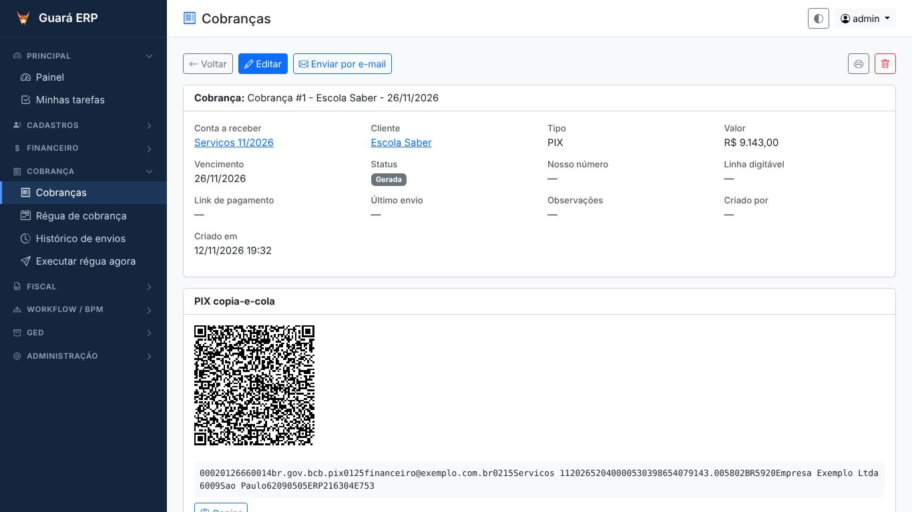
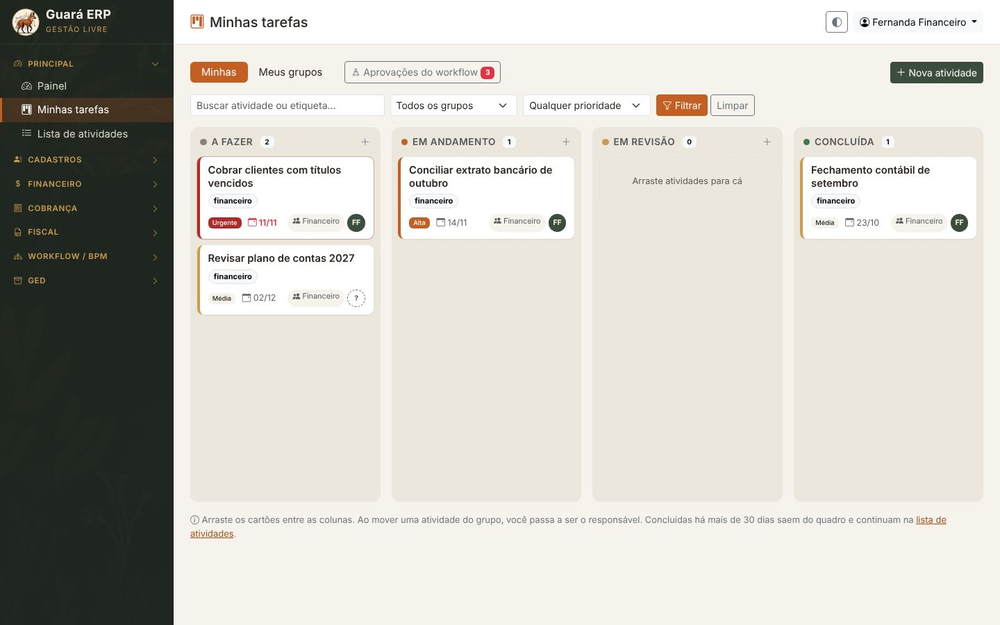
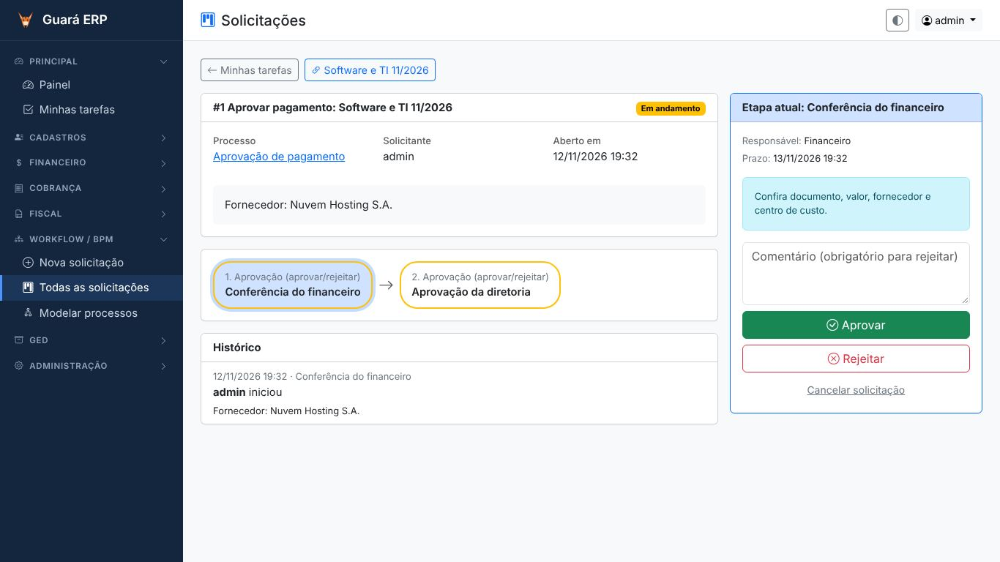
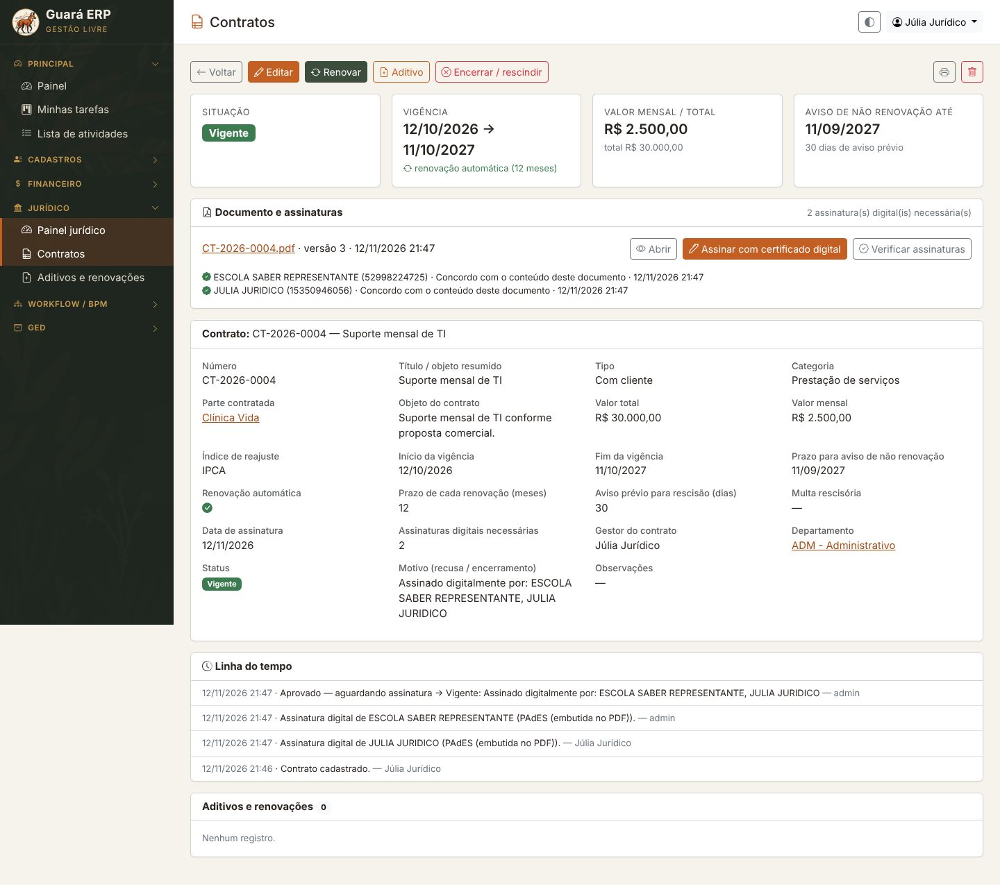

# Manual do usuário — Guará ERP

O **Guará ERP** é um sistema de gestão empresarial usado pelo navegador. O nome homenageia o
lobo-guará, o maior canídeo da América do Sul e símbolo do Cerrado brasileiro.

Este manual explica o uso diário de cada módulo. Para instalar o sistema, veja [INSTALACAO.md](INSTALACAO.md).

**Sumário**

1. [Acesso e navegação](#1-acesso-e-navegação)
2. [Primeiros passos (administrador)](#2-primeiros-passos-administrador)
3. [Perfis de acesso](#3-perfis-de-acesso)
4. [Telas de cadastro: uso comum](#4-telas-de-cadastro-uso-comum)
5. [Cadastros](#5-cadastros)
6. [Compras](#6-compras)
7. [Vendas e CRM](#7-vendas-e-crm)
8. [Estoque](#8-estoque)
9. [Produção e Qualidade](#9-produção-e-qualidade)
10. [Manutenção](#10-manutenção)
11. [Projetos](#11-projetos)
12. [SST / EHS — saúde, segurança e meio ambiente](#12-sst--ehs--saúde-segurança-e-meio-ambiente)
13. [Service Desk](#13-service-desk)
14. [Financeiro](#14-financeiro)
15. [Cobrança](#15-cobrança)
16. [Fiscal](#16-fiscal)
17. [Minhas tarefas — quadro Kanban](#17-minhas-tarefas--quadro-kanban)
18. [Workflow / BPM](#18-workflow--bpm)
19. [Jurídico — contratos](#19-jurídico--contratos)
20. [GED — documentos e assinatura digital](#20-ged--documentos-e-assinatura-digital)
21. [Administração](#21-administração)
22. [Perguntas frequentes](#22-perguntas-frequentes)

---

## 1. Acesso e navegação


1. Abra o endereço informado pela TI (ex.: `http://192.168.0.10:8000` ou `https://erp.suaempresa.com.br`).
2. Informe **usuário** e **senha** e clique em **Entrar**.

Algumas regras de acesso:

- Depois de **5 senhas erradas**, o acesso fica bloqueado por 15 minutos. Se precisar, peça ao
  administrador para conferir seu usuário.
- A sessão expira em **8 horas** ou quando o navegador é fechado.
- Para trocar a senha, clique no seu nome (canto superior direito) → **Alterar senha**.
  A senha precisa ter pelo menos 10 caracteres e não pode ser uma senha comum.
- Para sair, clique no seu nome → **Sair**. Faça isso sempre em computadores compartilhados.


**Painel:** é a tela inicial. Mostra o saldo das contas, os valores a receber e a pagar (com os
vencidos), suas tarefas pendentes, o gráfico de fluxo de caixa e os próximos vencimentos.
Cada pessoa vê só os quadros que o seu perfil permite.

**Menu lateral:** os módulos ficam agrupados (Cadastros, Financeiro, Cobrança, Fiscal, Workflow/BPM,
GED, Administração). Clique no nome do grupo para abrir ou fechar. No celular, o menu abre pelo
botão ☰.

**Tema escuro:** use o botão ◐ no topo. A preferência fica salva no navegador.

---

## 2. Primeiros passos (administrador)

Siga esta ordem logo depois da instalação:

1. **Empresa** (Cadastros → Empresas): razão social, CNPJ, regime tributário, endereço e a
   **chave PIX**. Sem a chave PIX, as cobranças não geram o PIX copia-e-cola.
2. **Contas bancárias** (Financeiro → Contas bancárias): uma por conta. Informe o **saldo inicial**
   e a data desse saldo. Cadastre também o "Caixa interno", se houver.
3. **Plano de contas** e **centros de custo** (Financeiro): o sistema já traz um plano básico.
   Ajuste ao da sua contabilidade.
4. **Departamentos e cargos** (Cadastros), depois os **colaboradores**.
5. **Usuários** (Administração → Usuários e grupos): crie um usuário para cada pessoa e marque o
   **grupo** dela (veja a seção 3). Para ligar o usuário ao cadastro do colaborador, use o campo
   *Usuário do sistema* no cadastro do colaborador.
6. **Régua de cobrança** (Cobrança → Régua de cobrança): revise os textos dos e-mails.
7. **Processos** (Workflow / BPM → Modelar processos): revise quem aprova cada etapa.
8. **Pastas do GED**: crie as pastas e defina os grupos que podem acessar cada uma.
9. **Gestores e assinaturas:**
   - No cadastro de cada colaborador, preencha **Usuário do sistema** e **Gestor**.
   - Nos departamentos, preencha o **Responsável**.
   - Isso define quem vê a aba *Minha equipe* do quadro de tarefas e permite conferir o CPF nas
     assinaturas digitais.
   - Para quem assina pela empresa com **e-CNPJ**, dê a permissão *Pode assinar com o certificado da
     empresa* em Usuários e grupos.

---

## 3. Perfis de acesso

Cada usuário pertence a um ou mais **grupos**. O grupo define quais menus e ações aparecem.

| Grupo | Indicado para | Pode |
|---|---|---|
| **Administradores** | Diretoria, gestão | Tudo nos módulos, incluindo auditoria, ver todas as solicitações, criar usuários e ver documentos confidenciais |
| **Financeiro** | Contas a pagar e a receber, tesouraria | Financeiro e cobrança completos; consultar e cadastrar clientes e fornecedores; consultar notas |
| **Fiscal** | Departamento fiscal, faturamento | Notas e produtos completos; consultar o financeiro e lançar títulos; cadastrar clientes e fornecedores |
| **RH** | Recursos humanos | Colaboradores, departamentos e cargos; criar pastas no GED |
| **Vendas** | Vendedores | Pedidos de venda (sem liberar crédito), CRM e funil, clientes, consulta de estoque |
| **Estoque** | Almoxarifado | Saldos, movimentos, inventário, armazéns, recebimento de compras |
| **Produção** | PCP e fábrica | Estruturas, ordens de produção e apontamento, solicitar compras |
| **Qualidade** | Inspetores | Inspeções e não conformidades |
| **Manutenção** | Técnicos | Equipamentos, planos e ordens de serviço |
| **Projetos** | Gerentes de projeto | Projetos, EAP e horas de todos |
| **SESMT** | Segurança do trabalho | Todo o módulo SST/EHS |
| **Service Desk** | Equipe de TI / central de serviços | Atende os chamados da área TI, cadastra áreas, catálogo, biblioteca e mudanças |
| **CAB** | Comitê de mudanças | Aprova as mudanças (RDM) |
| **Compras** | Compradores | Módulo de Compras (cotação, pedido, recebimento, conferência); consulta as alçadas; fornecedores e produtos; notas de entrada |
| **Jurídico** | Advogados, analistas de contratos | Contratos completos (cadastro, aprovação, renovação, aditivos, encerramento); pasta Jurídico do GED; cadastrar clientes e fornecedores |
| **Usuários** | Demais colaboradores | Abrir e acompanhar solicitações (workflow e compras); abrir chamados no Service Desk e usar o assistente; registrar não conformidade, incidente e pedido de manutenção; apontar horas em projetos; consultar e enviar documentos no GED |

Todos os grupos podem usar o quadro de tarefas, abrir solicitações de workflow, usar o GED (dentro das
pastas permitidas) e assinar documentos com o próprio certificado digital.

**Gestores** não são um grupo: o sistema reconhece o gestor pela estrutura cadastrada. São gestores
quem consta como *gestor* no cadastro de colaboradores e quem é *responsável* por um departamento
(inclusive os subdepartamentos). Para isso funcionar, o usuário de cada pessoa precisa estar ligado ao
cadastro de colaborador (campo *Usuário do sistema*).

Algumas regras valem independentemente do grupo:

- Os dados de **colaboradores** (CPF, salário) só aparecem para RH e Administradores.
- Cada pessoa só vê as **solicitações de workflow** que abriu, as que estão com ela e as que já tratou.
- A página **Banco de dados** e o **Admin completo** são exclusivos do superusuário (TI).

---

## 4. Telas de cadastro: uso comum

Todas as telas de cadastro funcionam do mesmo jeito.


**Na lista:**

- **Buscar:** digite parte do nome, documento etc. e tecle Enter.
- **Filtros:** escolha as opções e clique em **Filtrar**. **Limpar** volta à lista completa.
- **Ordenar:** clique no título da coluna. Clique de novo para inverter a ordem.
- **Exportar:** gera um arquivo CSV com os registros filtrados. Ele abre no Excel com acentos corretos.
- **Novo:** abre o formulário de inclusão.
- Os ícones 👁 e ✏️ em cada linha servem para **ver** e **editar** o registro.

**No formulário:**

- Campos com **\*** são obrigatórios.
- Ao digitar o **CEP**, o endereço é preenchido sozinho (precisa de internet).
- **Salvar e incluir outro** agiliza cadastros em sequência.

**No detalhe:** mostra todos os dados, os registros ligados (por exemplo, as contas a pagar de um
fornecedor) e os botões de ação (**Editar**, **Pagar**, **Gerar cobrança** etc.). O botão 🖨 imprime a tela,
e a lixeira 🗑 exclui o registro. A exclusão é recusada se houver registros vinculados.

> Toda inclusão, alteração e exclusão fica registrada na **auditoria**, com usuário, data e o que mudou.

---

## 5. Cadastros

| Tela | Para que serve | Observações |
|---|---|---|
| **Empresas** | Dados da empresa e das filiais | A empresa marcada como *matriz* é a padrão nos lançamentos |
| **Departamentos** | Estrutura da empresa | Pode ter um *departamento superior* (hierarquia) e um responsável |
| **Cargos** | Funções e salário base | Código CBO opcional |
| **Colaboradores** | Ficha do funcionário | CPF validado; tipo de contrato (CLT, PJ, estágio...); situação (ativo, férias, afastado, desligado); dados bancários e PIX; gestor direto |
| **Fornecedores** | Quem vende para a empresa | CPF ou CNPJ validado; prazo de pagamento padrão (usado ao importar XML); dados bancários e PIX |
| **Clientes** | Quem compra da empresa | E-mail de cobrança separado (opcional); limite de crédito |
| **Parceiros de negócios** | Visão única de clientes e fornecedores | Cada CPF/CNPJ aparece uma vez, com a coluna *Papéis* (Cliente, Fornecedor ou os dois) |

### 5.1 Parceiro de negócios único

Nome, CPF/CNPJ, endereço e contato ficam em **um só cadastro**, o *parceiro de negócios*. Ser cliente ou
fornecedor são **papéis** desse cadastro, cada um com seus dados próprios: prazo de pagamento e conta
bancária no fornecedor; limite de crédito e e-mail de cobrança no cliente.

- **Mesma empresa nos dois lados:** abra a ficha do fornecedor e clique em **Tornar cliente** (ou, na ficha do
  cliente, **Tornar fornecedor**). O ERP cria o papel novo usando o mesmo cadastro. Não é preciso redigitar nada.
- **CPF/CNPJ repetido:** se você tentar cadastrar um CNPJ que já existe, o ERP recusa e indica o botão acima.
  O documento é comparado só pelos dígitos, com ou sem pontuação.
- **Endereço e contato valem para os dois papéis:** alterar a cidade na ficha do fornecedor também atualiza a
  ficha do cliente.
- **Excluir:** remove só o papel. O cadastro-mãe continua enquanto o outro papel existir.
- **Importar XML de NF-e:** se o emitente já é cliente, ele ganha o papel de fornecedor automaticamente.

Na atualização para esta versão, clientes e fornecedores com o mesmo CNPJ são unificados automaticamente.
Se houver dois fornecedores com o mesmo CNPJ, o segundo fica sem documento e recebe uma observação pedindo
revisão. Para encontrá-los, filtre a lista de fornecedores pela palavra *duplicado*.

---

## 6. Compras

O ciclo de compras segue cinco passos. Cada passo pode ser feito por uma pessoa diferente:

```
Solicitação  →  Cotação  →  Pedido (alçada)  →  Recebimento  →  Conferência em três vias  →  Pagamento
```

### 6.1 Solicitação de compra

Qualquer usuário pode pedir uma compra em **Compras → Solicitações de compra → Novo**. Informe a
justificativa, a data em que precisa do material e os itens (produto do cadastro ou descrição livre, com
quantidade e unidade). Cada solicitação recebe um número `SC-ano-sequência`.

Quem não é do setor de Compras vê só as próprias solicitações. A solicitação pode ser alterada enquanto
estiver *Aberta*.

### 6.2 Cotação e mapa

1. Na solicitação, o comprador clica em **Gerar cotação** e escolhe os fornecedores. O ERP cria uma linha por
   item para cada fornecedor.
2. Na cotação, preencha **valor unitário** e **prazo de entrega** de cada fornecedor. Itens sem preço contam
   como não cotados.
3. Clique em **Mapa de cotação**. O ERP mostra um cartão por fornecedor, com o total, o prazo e a condição de
   pagamento. O fornecedor que cotou todos os itens pelo menor total recebe a etiqueta **Menor preço**.
4. Clique em **Escolher e gerar pedido** no fornecedor vencedor. A cotação é concluída e a solicitação fica
   *Atendida*.

Também é possível criar um pedido direto, sem solicitação nem cotação, em **Pedidos de compra → Novo**.

### 6.3 Pedido de compra e alçada de aprovação

Revise o pedido (departamento, centro de custo, categoria, frete, condição de pagamento) e clique em
**Enviar para aprovação**. **Todo pedido é aprovado por pessoas.** Não há aprovação automática. O
**departamento** do pedido, que vem da solicitação quando existe, indica a alçada usada. O **valor
total** indica até que nível o pedido sobe:

| Valor total do pedido | Quem aprova, em ordem |
|---|---|
| Até o limite do coordenador | Coordenador |
| Acima do coordenador, até o limite do gerente | Coordenador → Gerente |
| Acima do limite do gerente | Coordenador → Gerente → Diretor |

Cada aprovador recebe o pedido em **Workflow → Aprovações pendentes**. Só a pessoa designada pode aprovar
a etapa dela: nem o grupo Compras nem outro gestor podem. A descrição da aprovação traz o fornecedor, o valor
e os itens. Se alguém recusar, o pedido volta a ser editável e mostra o motivo. Depois de aprovado, o
pedido não pode mais ser alterado. Para mudar itens ou valores, cancele-o e gere outro.

A ficha do pedido mostra o coordenador, o gerente e o diretor definidos no envio. Se a alçada mudar
depois, os pedidos que já estão em aprovação seguem com os aprovadores do envio.

**Condição de pagamento:** informe os dias após a nota, separados por barra. Por exemplo, `28` gera uma
parcela e `30/60/90` gera três. O botão **PDF para o fornecedor** gera o pedido para enviar por e-mail.

#### Alçadas de aprovação (tela de atualização)

Em **Compras → Alçadas de aprovação**, a administração cadastra quem aprova e até quanto:

| Campo | Para que serve |
|---|---|
| **Departamento** | Em branco = **alçada padrão da empresa**, usada pelos departamentos sem alçada própria |
| **Coordenador** e **coordenador aprova até (R$)** | Primeiro aprovador de todos os pedidos. Acima do limite, o pedido sobe ao gerente |
| **Gerente** e **gerente aprova até (R$)** | Segundo nível. Acima do limite, sobe ao diretor. Não pode ser menor que o limite do coordenador |
| **Diretor** | Último nível, sem limite |

- **Os três níveis em todos os pedidos:** coloque `0` nos dois limites.
- **Mesma pessoa em dois níveis:** se o gerente também for o coordenador, ele aprova uma vez só.
- **Quem altera as alçadas:** só o grupo *Administradores*. O grupo *Compras* apenas consulta, para quem
  compra não definir quem aprova. Toda alteração fica na auditoria.
- **Sem alçada:** se não houver alçada padrão nem alçada do departamento, o ERP não deixa enviar o pedido e
  avisa onde cadastrar.

### 6.4 Recebimento

Quando a mercadoria chega, clique em **Registrar recebimento** no pedido. Informe a data, as quantidades
efetivamente recebidas (o ERP sugere o saldo de cada item) e, se já houver, a nota fiscal de entrada.
Importe antes o XML em **Fiscal → Importar XML NF-e**. Se a importação já gerou a conta a pagar, o ERP usa
essa conta, e quem decide se ela fica aprovada para pagamento é a conferência.

Recebimentos parciais são aceitos. O pedido fica *Recebido parcialmente* até todo o saldo chegar. Não é
possível receber mais do que o saldo.

### 6.5 Conferência em três vias

Ao registrar o recebimento com nota, ou ao vincular a nota depois (botão **Editar** do recebimento), o ERP
compara:

- **Pedido × nota:** o fornecedor e o preço unitário de cada produto. A tolerância padrão é de 2%.
- **Recebimento × nota:** a quantidade faturada de cada produto contra a recebida.
- **Total:** o valor dos produtos na nota contra o esperado pelo pedido e pelo recebimento.

| Resultado | O que acontece |
|---|---|
| **Conferido** | A conta a pagar é criada (uma por parcela) e já fica **aprovada para pagamento** |
| **Divergente** | A conta a pagar fica **bloqueada** (não aprovada), as divergências aparecem no recebimento e uma tarefa de prioridade alta é aberta no Kanban do grupo Compras |
| **Aguardando nota** | Nada vai para o financeiro até a nota ser vinculada |

Depois de resolver a divergência com o fornecedor (nota corrigida, carta de correção ou acordo), clique em
**Conferir de novo**. Se o pagamento for aceito mesmo com a diferença, o Financeiro pode aprovar a conta
manualmente, e isso fica registrado na auditoria.

## 7. Vendas e CRM

### 7.1 Funil de oportunidades (CRM)

Em **CRM → Funil de vendas**, cada oportunidade é um cartão numa coluna: *Prospecção → Qualificação →
Proposta → Negociação*. As setas do cartão movem a oportunidade entre as colunas. O topo da tela mostra o
total em aberto e o valor **ponderado** (valor × probabilidade do estágio: 10%, 25%, 50% e 75%).

- **Nova oportunidade:** escolha um cliente ou, se ainda não for cliente, preencha a empresa e o CNPJ do
  *prospect*.
- **Registrar interação:** ligação, e-mail, reunião ou visita. Se você informar um **próximo passo** com
  data, ele vira cartão no seu Kanban.
- **Ganhar:** o prospect vira cliente (se o CNPJ já for de um fornecedor, o cadastro é reaproveitado) e um
  **pedido de venda em rascunho** é aberto para você incluir os itens.
- **Perder:** informe o motivo (preço, prazo, concorrente). Esse motivo alimenta a análise de perdas.

### 7.2 Pedido de venda

1. **Vendas → Pedidos de venda → Novo:** cliente, condição de pagamento (`0`, `30` ou `30/60/90`), itens
   (o preço vem do cadastro do produto; o desconto por item tem limite, padrão 10%).
2. **Confirmar:** o ERP confere o **estoque disponível** e o **limite de crédito** do cliente (títulos em
   aberto + pedidos aprovados + este pedido). Dentro do limite, o pedido fica *Aprovado*. Acima, fica
   *Bloqueado (crédito)*.
3. **Liberar crédito:** só o **Financeiro** pode liberar, com justificativa registrada. O vendedor não
   libera o próprio pedido.
4. **Faturar:** numa operação só, o ERP emite a **nota fiscal de saída** (numerada, com os impostos do
   cadastro), gera as **contas a receber** (uma por parcela) e **baixa o estoque** pelo custo médio. A
   transmissão da NF-e à SEFAZ é feita pelo seu emissor.

Pedido faturado não pode ser alterado. Para devolução, emita a nota de devolução.

## 8. Estoque

| Tela | Para que serve |
|---|---|
| **Saldos** | Quantidade e **custo médio** de cada produto em cada armazém, com o valor em estoque |
| **Movimentos (kardex)** | Toda entrada e saída, com origem (compra, venda, produção, inventário...), documento, usuário e saldo após o movimento. Movimentos não se editam nem se apagam: um erro se corrige com outro movimento |
| **Movimentação manual** | Entrada (ajuste), saída (consumo interno) ou transferência entre armazéns, sempre com motivo |
| **Inventários** | Contagem física: ao criar, o ERP lista os produtos do armazém com a quantidade do sistema. Preencha o **contado** e clique em **Encerrar e ajustar saldos** |
| **Reposição** | Produtos abaixo do **estoque mínimo** (campo do cadastro do produto). O botão gera uma solicitação de compra com a sugestão |
| **Armazéns** | Locais de estoque. Um é o **padrão**. O armazém do tipo *quarentena* guarda o que aguarda inspeção e não conta como disponível |

As entradas acontecem sozinhas no **recebimento de compras** (pelo preço do pedido) e na **produção**. As
saídas acontecem no **faturamento**, no **consumo da produção**, nas **peças de manutenção** e nas
**entregas de EPI**. O ERP não deixa o saldo ficar negativo.

## 9. Produção e Qualidade

### 9.1 Estrutura e ordem de produção

1. **Produção → Estruturas:** para cada produto fabricado, cadastre os componentes, a quantidade e a
   perda (%). Exemplo: uma mesa = 1 tampo + 4 pés com 2,5% de perda.
2. **Ordens de produção → Novo:** produto e quantidade. A ficha mostra os **componentes necessários,
   o disponível e o que falta**.
3. **Comprar o que falta:** abre uma solicitação de compra com as faltas.
4. **Liberar** e, a cada lote pronto, **Apontar produção**. O ERP baixa os componentes pelo custo médio e
   dá entrada no produto acabado pelo **custo apurado**. A ordem encerra sozinha ao atingir a quantidade.

### 9.2 Inspeção de recebimento

Marque **inspecionar no recebimento** no cadastro do produto. Ao receber a compra, o material entra no
armazém de **quarentena** e uma **inspeção** fica pendente. Em **Registrar resultado**, informe a
quantidade aprovada e o laudo: o aprovado vai para o armazém principal; o reprovado fica na quarentena e
abre uma **não conformidade** para o fornecedor.

### 9.3 Não conformidades

Qualquer usuário pode registrar uma não conformidade (problema de processo, reclamação de cliente,
auditoria). O prazo é definido pela gravidade (crítica 2 dias, alta 7, média 15, baixa 30), e a não
conformidade vira tarefa no Kanban do responsável. Para **encerrar**, é obrigatório preencher a causa
raiz, a ação corretiva e a verificação de eficácia.

## 10. Manutenção

- **Equipamentos:** cadastro com patrimônio, série, localização e se é **crítico**. A ficha mostra os
  planos, o histórico de ordens e as horas parado em corretivas.
- **Planos preventivos:** tarefa, periodicidade em dias, próxima data e roteiro. A rotina diária abre a
  **OS preventiva** 7 dias antes (configurável). Ao concluir a OS, a próxima data é reprogramada.
- **Ordens de serviço:** qualquer usuário pode abrir uma **corretiva** ("o ar não gela"). O técnico clica
  em **Iniciar** e depois em **Concluir**, informando o serviço executado, as horas e o custo de mão de
  obra. As **peças** listadas na OS são baixadas do estoque na conclusão, e o custo total fica na OS.

## 11. Projetos

- **Projeto:** gerente, cliente, prazo, **orçamento** e, se houver, o **centro de custo**. As contas a
  pagar lançadas nesse centro de custo contam como despesa do projeto.
- **EAP:** as tarefas (1, 1.1, 1.2...) com responsável, datas, horas previstas e % concluído. O avanço
  do projeto é ponderado pelas horas.
- **Minhas horas:** cada pessoa aponta as próprias horas por projeto e tarefa, e vê e corrige só as suas.
  O custo da hora (salário × fator de encargos ÷ horas do mês) é registrado no dia do apontamento.
- A ficha do projeto mostra o **custo realizado** (mão de obra + despesas) contra o orçamento e o saldo.

## 12. SST / EHS — saúde, segurança e meio ambiente

| Tela | Para que serve |
|---|---|
| **Incidentes e acidentes** | Qualquer usuário relata (inclusive quase acidente e ocorrência ambiental) e vê os próprios relatos; o **SESMT** vê todos. Acidente de trabalho gera tarefa **urgente** ao SESMT e só pode ser encerrado com causas, ações e **CAT registrada** |
| **Inventário de riscos (PGR)** | Perigos por atividade, com probabilidade × severidade (1 a 5), nível, classificação (trivial a intolerável) e medidas de controle |
| **Entregas de EPI** | Ficha de entrega com o **CA**. Se o EPI for um produto do estoque, a entrega baixa o saldo. Entregas não podem ser excluídas |
| **ASOs** | Exames ocupacionais com **apenas a aptidão** (apto, apto com restrição, inapto), sem diagnóstico (LGPD). Acesso restrito ao SESMT e ao RH |
| **Treinamentos (NRs)** | NR-10, NR-12, NR-35, brigada etc., com validade da reciclagem |

A rotina diária avisa o SESMT, pelo Kanban, sobre **ASOs e reciclagens que vencem nos próximos 30 dias**.

## 13. Service Desk

O Service Desk recebe as solicitações internas de **todas as áreas** (TI, Facilities, RH, Financeiro...) num
só lugar, com prazo de atendimento (SLA), aprovação quando necessário e conversa direta entre quem pede e
quem atende.

### 13.1 Para quem pede

1. **Service Desk → Assistente:** descreva o problema com suas palavras. O assistente procura na
   **biblioteca de soluções** e mostra os artigos que podem resolver na hora. Se não resolver, ele indica o
   **serviço certo** e abre o formulário já preenchido.
2. **Service Desk → Abrir chamado:** o catálogo mostra os serviços de cada área, com o prazo e se precisa de
   aprovação. Escolha, descreva e envie.
3. Acompanhe pelo **sino de avisos** (canto superior direito) e pela **conversa** dentro do chamado. Quando
   o analista **chamar você**, chega aviso na tela e por e-mail. O prazo fica parado até você responder.
4. Quando o chamado for **resolvido**, clique em **Confirmar e avaliar** (1 a 5 estrelas) ou em **Não
   resolveu, reabrir**. Sem resposta em 3 dias, ele fecha sozinho.

Serviços com aprovação (por exemplo, *Novo equipamento*) vão antes para o **seu gestor** (o *gestor
direto* do cadastro de colaborador). Ele aprova em **Workflow → Aprovações pendentes**. Se recusar, você
recebe o motivo.

### 13.2 Para quem atende

A **Fila de atendimento** mostra os chamados das áreas da sua equipe, ordenados pelo prazo, com as abas
*Não atribuídos, Meus, Em risco, Vencidos, Aguardando usuário* e os indicadores (em andamento, SLA vencido,
% resolvido no prazo no mês, satisfação média).

| Ação | O que faz |
|---|---|
| **Assumir** | O chamado passa a ser seu e conta como 1ª resposta |
| **Conversa** | Mensagens com o usuário, atualizadas a cada 5 segundos. Marque **nota interna** para escrever só para a equipe |
| **Chamar o usuário** | Pede uma informação: o usuário recebe aviso na tela e por e-mail e o **SLA fica pausado** até ele responder |
| **Transferir** | Manda para outra área quando o pedido não é da sua equipe |
| **Resolver** | Registra a solução, com o artigo da biblioteca usado ou criando um artigo novo a partir dela |

Cada equipe vê **somente os chamados da sua área**. Pedidos de RH ou do Financeiro não aparecem para a TI.

### 13.3 SLA e avisos de vencimento

Cada serviço tem dois prazos: **1ª resposta** e **solução**. Eles valem para a prioridade *média*: a *alta*
tem metade do prazo, a *crítica* um quarto e a *baixa* uma vez e meia. Os prazos contam em **horário
comercial** (segunda a sexta, 8h às 18h, configurável) e param enquanto o chamado aguarda o usuário.

A cada 15 minutos, o ERP verifica os prazos e avisa (no sino e, nos casos graves, por e-mail):

- **1ª resposta vencida:** o analista ou a equipe da área;
- **em risco** (80% do prazo consumido): o analista ou a equipe;
- **vencido:** o analista ou a equipe **e o gestor da área**.

### 13.4 Biblioteca de soluções

Artigos com o **problema** (como o usuário descreve) e a **solução passo a passo**. Artigos *visíveis para
os usuários* aparecem no assistente; os desmarcados são **procedimentos internos**, só para as equipes. Cada
artigo conta leituras e votos "resolveu / não resolveu", que melhoram a ordem das sugestões. Ao resolver
um chamado, marque *transformar esta solução em artigo* para alimentar a biblioteca.

### 13.5 Gestão de mudanças (RDM)

Toda alteração em sistema, rede ou instalação que possa afetar outras pessoas passa por uma **requisição
de mudança**:

| Tipo | Aprovação |
|---|---|
| **Padrão** | Pré-aprovada (rotina conhecida e de baixo risco, ex.: troca de toner) |
| **Normal** | Gestor da área → **CAB** (comitê de mudanças) |
| **Emergencial** | Direto ao CAB |

Na RDM informe o que muda, a justificativa, o impacto, os planos de **implantação**, **testes** (obrigatório
para risco alto) e **retorno/rollback** (obrigatório para normal e emergencial) e a **janela**. Se outra
mudança da mesma área usar a mesma janela, o ERP avisa. Depois de aprovada: **Iniciar execução** e
**Registrar resultado** (concluída ou falhou com retorno). O resultado é comunicado aos **chamados
relacionados**.

### 13.6 Configuração (administrador)

1. **Áreas de atendimento:** nome, **equipe** (um grupo de usuários: TI = *Service Desk*, Facilities =
   *Manutenção*, RH, Financeiro...) e **gestor**.
2. **Catálogo de serviços:** área, nome, palavras-chave (ajudam o assistente), o que pedir ao usuário,
   prioridade padrão, SLAs e quem aprova (ninguém, gestor do solicitante, gestor da área ou um usuário).
3. **CAB:** coloque no grupo *CAB* quem aprova mudanças.

## 14. Financeiro

### 14.1 Contas a pagar e a receber

A lista abre em **Situação: Em aberto**. Use o filtro para ver **Vencidos**, **Pagos**,
**Cancelados** ou **Todos**.

**Lançar uma conta:** clique em **Novo** e informe fornecedor/cliente, descrição, valor, vencimento,
categoria (plano de contas) e centro de custo.

- **Parcelar:** na inclusão, informe o número de **parcelas** e o **intervalo em dias**. O sistema
  cria uma conta para cada parcela (1/3, 2/3, 3/3). Os centavos que sobram da divisão ficam na primeira parcela.
- **Juros/multa** e **desconto** alteram o *valor total* a pagar.


**Pagar ou receber (baixa):** abra a conta → **Pagar** (ou **Receber**) → informe valor, data, conta
bancária e forma de pagamento → **Confirmar**.

- Pagando **menos que o saldo**, o título fica como *Pago parcialmente* e o restante continua em aberto.
- Cada baixa gera uma **movimentação** no extrato da conta bancária e atualiza o saldo.

Outras ações no título:

- **Estornar pagamentos:** desfaz todas as baixas do título e apaga as movimentações. O título volta a *Em aberto*.
- **Cancelar título:** só é possível sem pagamentos (estorne antes).
- **Enviar para aprovação** (contas a pagar): abre uma solicitação no processo *Aprovação de pagamento*
  (seção 18). Quando todas as etapas aprovam, a conta fica marcada como **Aprovado**.
- **Gerar cobrança** (contas a receber): veja a seção 15.

### 14.2 Contas bancárias, extrato e transferências

- **Contas bancárias:** a lista mostra o **saldo atual** de cada conta (saldo inicial + entradas − saídas).
- **Extrato / movimentações:** todas as entradas e saídas. Aqui você também lança movimentações
  avulsas, como tarifas bancárias e rendimentos. O campo **Conciliado** marca o que já foi conferido
  com o extrato do banco.
- **Transferência:** move valor entre duas contas da empresa, gerando a saída numa e a entrada na outra.

### 14.3 Fluxo de caixa


Mostra, mês a mês:

- **Realizado:** entradas e saídas que já aconteceram.
- **Previsto:** o que está a receber e a pagar em aberto. Os vencidos entram no mês atual.
- **Saldo projetado:** saldo de hoje somado às previsões, acumulado mês a mês. Fica vermelho se ficar negativo.

### 14.4 Plano de contas e centros de custo

- **Plano de contas:** classifica receitas e despesas em níveis (ex.: `2.02.01 Aluguel`).
  Use códigos com pontos para a hierarquia.
- **Centros de custo:** separam as despesas por área, normalmente ligadas a um departamento.

---

## 15. Cobrança



**Gerar uma cobrança:** abra a conta a receber → **Gerar cobrança** → confirme.

- O sistema cria a cobrança com o **PIX copia-e-cola** e o **QR Code**, usando a chave PIX da empresa.
- O botão **Copiar** facilita mandar o PIX por WhatsApp ou e-mail.
- Para boleto ou link de pagamento gerados no banco ou em outro sistema, edite a cobrança e preencha
  a **linha digitável** ou o **link**.
- Quando o título é pago, a cobrança muda sozinha para **Paga**.

**Enviar por e-mail:** no detalhe da cobrança → **Enviar por e-mail**. O e-mail vai para o
*e-mail de cobrança* do cliente; se ele estiver vazio, para o e-mail principal.

**Régua de cobrança:** são envios automáticos em relação ao vencimento. O padrão é:
3 dias antes, no dia, 3 dias depois e 10 dias depois.

- Cada regra tem o número de **dias** (negativo = antes do vencimento), o **assunto** e a **mensagem**.
- Nos textos, use só estas variáveis: `{{ cliente }}`, `{{ titulo.descricao }}`, `{{ titulo.documento }}`,
  `{{ valor }}`, `{{ vencimento }}`, `{{ dias_atraso }}`, `{{ dados_pagamento }}` (PIX, linha digitável
  e link juntos), `{{ cobranca.pix_copia_cola }}`, `{{ cobranca.linha_digitavel }}`,
  `{{ cobranca.url_pagamento }}` e `{{ empresa }}`.
- A régua roda sozinha todo dia às 08:00. Para disparar na hora, use **Executar régua agora**.
- Cada regra envia no máximo um e-mail por cobrança.
- O resultado de cada envio aparece em **Histórico de envios**, inclusive o motivo das falhas
  (ex.: cliente sem e-mail).

---

## 16. Fiscal

### 16.1 Produtos e serviços

Cadastre código, descrição, unidade, **NCM**, **CFOP padrão**, preço e as alíquotas de ICMS, IPI,
PIS, COFINS e ISS. Esses valores são sugeridos automaticamente nos itens das notas.

### 16.2 Notas fiscais


**Emitir uma nota de saída:**

1. Em **Notas fiscais → Novo**, escolha o tipo **Saída**, o modelo (NF-e, NFC-e, NFS-e), o cliente e a natureza da operação.
2. Na grade **Itens da nota**, escolha o produto (descrição, CFOP, preço e alíquotas são preenchidos
   automaticamente) e informe a quantidade. Use **Adicionar linha** para mais itens.
3. Clique em **Salvar**: o sistema calcula os totais e os impostos.
4. No detalhe da nota, clique em **Emitir**. A nota recebe o próximo número da série e o status *Emitida*.
5. Clique em **Gerar título financeiro** para criar a conta a receber da nota.

> **Importante:** o Guará ERP calcula, numera e registra as notas, mas **não transmite à SEFAZ nem à
> prefeitura**. Faça a transmissão no seu emissor (com certificado digital) e depois informe a
> **chave de acesso** e o **protocolo** na nota.

**Notas de entrada (compras) por XML:**

1. Vá em **Fiscal → Importar XML NF-e** e escolha o arquivo `.xml` enviado pelo fornecedor.
2. Mantenha marcado **Gerar conta a pagar automaticamente**, se quiser o lançamento financeiro.
3. O sistema:
   - lê o XML e cadastra o fornecedor, se ele ainda não existir;
   - cria a nota com os itens e impostos;
   - gera a conta a pagar, com vencimento pelo prazo de pagamento do fornecedor.
4. A mesma nota não é importada duas vezes, porque a chave de acesso é conferida.

**Apuração de impostos:** mostra, por mês, o total das notas emitidas e de cada imposto, separando
entradas (créditos) e saídas (débitos). É um resumo gerencial: a apuração oficial deve ser conferida
pela contabilidade.

---

## 17. Minhas tarefas — quadro Kanban



O menu **Minhas tarefas** abre o quadro de atividades, com quatro colunas: **A fazer**, **Em andamento**,
**Em revisão** e **Concluída**.

**Criar uma atividade:** clique em **Nova atividade** (ou no **+** de uma coluna). Informe:

- título e descrição;
- prioridade (baixa, média, alta, urgente);
- prazo e etiquetas (separadas por vírgula, ex.: `cliente x, urgente`);
- **para quem** é a atividade:
  - *Responsável* (uma pessoa): atividade individual.
  - *Grupo* sem responsável: atividade do grupo. Qualquer membro pode assumir. Ao arrastá-la para
    "Em andamento", você passa a ser o responsável.
  - Responsável **e** grupo: atividade individual que também aparece para o grupo.

**Mover:** arraste o cartão para outra coluna ou para cima e para baixo, para priorizar. A mudança é
salva na hora e fica no histórico da atividade.

**Ler o cartão:**

- A cor da borda indica a prioridade: verde é baixa, dourado é média, laranja é alta e vermelho é urgente.
- O prazo fica vermelho quando está atrasado.
- O círculo com as iniciais é o responsável; um **?** indica atividade do grupo, ainda sem responsável.

Clique no título para abrir a atividade, ver o histórico e **comentar**.

**Visões** (abas no topo):

| Aba | Mostra |
|---|---|
| **Minhas** | O que é seu, o que você criou e as atividades sem responsável dos seus grupos |
| **Meus grupos** | Todas as atividades dos grupos de que você participa |
| **Minha equipe** | Só para gestores: atividades das pessoas que você gerencia |
| **Todas** | Só para quem tem a permissão *ver todas as atividades* (Administradores) |


**Gestão pelos gerentes:** na aba **Minha equipe**, o gestor vê:

- um resumo por pessoa: a fazer, em andamento, atrasadas e concluídas nos últimos 30 dias;
- o quadro da equipe, que pode ser filtrado por pessoa, grupo ou prioridade.

O gestor pode mover, reatribuir e comentar as atividades de quem ele gerencia.

As atividades concluídas saem do quadro depois de 30 dias e continuam em **Lista de atividades**,
que tem busca, filtros e exportação.

O botão **Aprovações do workflow** leva às aprovações que aguardam você (seção 18). Os **alertas de
contratos a vencer** chegam como cartões no quadro do responsável pelo contrato (seção 19).

---

## 18. Workflow / BPM

O módulo organiza processos que passam por várias pessoas, como aprovações, admissões e solicitações
internas.

### 18.1 Modelar um processo (administrador)


Em **Modelar processos → Novo**, informe o nome e um código. Depois, na grade **Etapas**, cadastre cada passo:

- **Ordem:** a sequência das etapas.
- **Tipo:**
  - *Tarefa:* o responsável executa e clica em **Concluir**.
  - *Aprovação:* o responsável **aprova** (segue para a próxima etapa) ou **rejeita** (encerra a solicitação; o motivo é obrigatório).
- **Responsável:** um grupo (qualquer pessoa do grupo pode agir) e/ou um usuário específico.
- **Prazo (dias):** solicitações com o prazo vencido aparecem como **Atrasada**.
- **Instruções:** orientação que aparece para o responsável.

O detalhe do processo mostra o **diagrama do fluxo**. O sistema já vem com três processos:

- **Aprovação de pagamento:** conferência do Financeiro, depois aprovação da diretoria.
- **Aprovação de contrato:** análise jurídica, depois aprovação da diretoria (seção 19).
- **Admissão de colaborador:** documentos (RH), depois acessos de TI, depois integração.

### 18.2 Usar no dia a dia



- **Nova solicitação:** escolha o processo, dê um título e descreva o pedido.
- **Aprovações pendentes** (no menu Workflow, ou pelo botão no quadro de tarefas): lista o que está aguardando você e as solicitações que você abriu.
- Ao abrir uma solicitação, você vê:
  - o fluxo, com a etapa atual destacada;
  - o histórico completo (quem fez o quê e quando);
  - à direita, os botões de ação da sua etapa.
- O solicitante pode **cancelar** a solicitação enquanto ela estiver em andamento.

---

## 19. Jurídico — contratos


O **Painel jurídico** mostra:

- os contratos vigentes;
- os que estão na janela de alerta de vencimento;
- os vencidos que ainda constam como vigentes;
- os que aguardam aprovação ou assinatura;
- a atividade recente.

### 19.1 Cadastrar um contrato

Em **Jurídico → Contratos → Novo**, preencha:

- **Parte:** tipo *com fornecedor*, *com cliente* ou *outro* (parceria, locação etc.), e o cadastro
  correspondente. Os contratos ficam ligados à ficha do fornecedor ou do cliente.
- **Termos:** categoria, objeto, valor mensal e total, e índice de reajuste.
- **Vigência:** início e fim (vazio = prazo indeterminado). Diga também se há **renovação
  automática**, o prazo de cada renovação, o **aviso prévio** para rescisão e com **quantos dias de
  antecedência** o sistema deve alertar.
- **Assinaturas digitais necessárias:** quantas assinaturas o PDF precisa ter para o contrato ficar
  vigente (normalmente 2: a empresa e a outra parte).
- **Gestor do contrato:** quem recebe os alertas de vencimento.
- **Arquivo do contrato:** de preferência em PDF. Ele fica guardado no GED, na pasta *Jurídico*,
  com controle de versões.

O número é gerado sozinho, no formato `CT-2026-0001`.

### 19.2 Ciclo de vida

```
Rascunho → Em aprovação → Aprovado (aguardando assinatura) → Vigente → Encerrado / Rescindido
                       ↘ Recusado → (corrige) → Em aprovação
```

1. **Enviar para aprovação:** o contrato entra no processo *Aprovação de contrato*, com a análise
   jurídica e depois a diretoria (seção 18).
   - Quem aprova ou recusa faz isso na própria solicitação.
   - A **recusa** exige o motivo, que aparece no contrato. Corrija e envie de novo.
2. **Aprovado:** com o contrato aprovado, os termos (partes, valores, vigência) ficam **travados**. A
   partir daqui, eles só mudam por aditivo.
3. **Assinatura:**
   - **Digital** (recomendado): no quadro *Documento e assinaturas*, cada signatário clica em
     **Assinar com certificado digital** (seção 20.2).
   - A outra parte pode assinar pelo gov.br ou por outra plataforma. Envie o PDF assinado como nova
     versão (editando o contrato) e clique em **Conferir e ativar**.
   - Quando o PDF tiver o número de assinaturas válidas exigido, o contrato passa a **Vigente**
     sozinho, e a data de assinatura é registrada.
   - **Em papel:** use **Registrar assinatura em papel/externa**, informando a data.
4. **Vigente:** use **Renovar** (prazo e % de reajuste), **Aditivo** (prazo, valor, escopo ou
   reajuste) ou **Encerrar / rescindir** (motivo obrigatório).
   - Renovações e aditivos atualizam a vigência e o valor do contrato.
   - Todos ficam registrados em *Aditivos e renovações*.



A **linha do tempo** registra cada mudança de situação, assinatura, alerta e renovação, com data e usuário.

### 19.3 Vencimentos e renovação

Todo dia às 08:00, o sistema verifica os contratos (no Docker, pelo serviço `agendador`):

- **Contrato entrando na janela de alerta** (ex.: 60 dias antes do fim):
  - cria um cartão **"Contrato a vencer"** no quadro de tarefas do gestor do contrato (ou do grupo
    Jurídico, se não houver gestor);
  - o prazo do cartão é a data limite do **aviso prévio**, o último dia para avisar a outra parte, caso
    não queira renovar;
  - o cartão é criado uma vez por vencimento.
- **Contrato com renovação automática que passou do fim:** é renovado sozinho pelo prazo definido, com
  registro na linha do tempo.

Na lista de contratos, o filtro **Vencimento** mostra os que vencem em 30, 60 ou 90 dias e os vencidos.

---

## 20. GED — documentos e assinatura digital


### 20.1 Pastas, documentos e versões

**Pastas:**

- Organize em pastas e subpastas.
- Em cada pasta, o campo **Grupos com acesso** define quem pode vê-la. Vazio significa todos os usuários.
- As subpastas herdam a restrição da pasta acima.

**Enviar um documento:**

1. Clique em **Documentos → Novo**.
2. Preencha pasta, título, tipo e, se quiser, descrição, palavras-chave e **validade**.
3. Escolha o arquivo e salve.

**Regras dos arquivos:**

- Tamanho máximo: 50 MB (configurável pela TI).
- Por segurança, não são aceitos executáveis (`.exe`, `.bat`, `.ps1`, `.js`...), páginas `.html`
  e imagens `.svg`. Se precisar mesmo guardar um desses, compacte em `.zip`.

**Versões:**

- No detalhe do documento, envie uma **nova versão** com um comentário (ex.: "contrato assinado").
- Todas as versões ficam guardadas, com quem enviou, a data e um código de verificação (SHA-256).

**Visualizar e baixar:**

- PDFs, imagens e TXT podem ser **visualizados** no navegador. Os demais tipos são sempre baixados.
- Todo download fica registrado na auditoria.

**Outros recursos:**

- **Validade:** documentos vencidos (contratos, alvarás, certidões) mostram um alerta vermelho.
- **Confidencial:** só quem enviou e quem tem a permissão especial (Administradores) podem ver.
- **Busca:** a busca procura no título, na descrição, nas palavras-chave e no nome do arquivo.


### 20.2 Assinatura digital com certificado ICP-Brasil


**Para assinar:**

1. No detalhe do documento, clique em **Assinar digitalmente**. Em contratos, use **Assinar com
   certificado digital**.
2. Escolha o arquivo do certificado **A1** (`.pfx` ou `.p12`) e digite a senha dele.
3. Escolha o motivo (ex.: "Sou parte deste contrato").
4. Confirme que leu o documento e clique em **Assinar digitalmente**.

O tipo de assinatura depende do arquivo:

| Tipo de arquivo | Assinatura gerada | Onde fica |
|---|---|---|
| **PDF** | **PAdES**, embutida no próprio PDF | O PDF assinado vira uma **nova versão**. Outras pessoas podem assinar depois, e as assinaturas anteriores continuam válidas |
| Outros (Word, planilha, imagem...) | **CAdES** destacada (`.p7s`) | Guardada junto ao documento, para baixar no quadro *Assinaturas digitais*. O arquivo original não muda |

**Regras de segurança:**

- **e-CPF:** o CPF do certificado precisa ser o **mesmo do seu cadastro de colaborador**. Ninguém
  assina com o certificado de outra pessoa.
- **e-CNPJ** (certificado da empresa): exige a permissão *Pode assinar com o certificado da empresa*,
  dada aos representantes legais. O CNPJ precisa ser de uma empresa cadastrada.
- O certificado precisa estar dentro da validade e permitir assinatura.
- O arquivo do certificado e a senha **não são guardados** no servidor: são usados só durante a operação.
- Antes de assinar, o sistema confere se o arquivo armazenado é o mesmo enviado originalmente (hash SHA-256).
- Toda assinatura fica registrada na auditoria, com titular, CPF/CNPJ, autoridade certificadora e IP.

**Certificado A3 (token ou cartão):**

1. Assine o PDF no seu computador, por exemplo pelo Assinador SERPRO, pelo gov.br ou pelo Adobe Reader.
2. Envie o PDF assinado como **nova versão**.

O sistema reconhece e verifica as assinaturas embutidas.

### 20.3 Verificar assinaturas


O botão **Verificar assinaturas** lista todas as assinaturas digitais da versão, inclusive as feitas
fora do sistema. Para cada uma, mostra:

- o titular, o CPF/CNPJ e a autoridade certificadora;
- a data;
- a **integridade**: se o arquivo foi alterado depois da assinatura, ela aparece como *Inválida / alterada*;
- a **cadeia ICP-Brasil**: aparece como *Confiável* quando o servidor tem os certificados raiz da
  ICP-Brasil configurados (veja o guia de instalação).

Para a validação oficial de conformidade, use também o verificador do ITI: https://verificador.iti.gov.br.


---

## 21. Administração

| Tela | Uso |
|---|---|
| **Usuários e grupos** | Criar usuários, redefinir senhas, desativar quem saiu da empresa e definir grupos. Prefira **desativar** (desmarcar *Ativo*) a excluir, para manter o histórico |
| **Auditoria** | Quem incluiu, alterou ou excluiu cada registro, com os valores antes e depois. Também registra logins, falhas de login (com IP) e downloads do GED. Não pode ser alterada nem apagada |
| **Banco de dados** | Somente superusuário (veja abaixo) |
| **Admin completo** | Edição direta de qualquer tabela (Django Admin). Uso técnico; prefira as telas normais |


A página **Banco de dados** mostra:

- tamanho do banco, conexões e tabelas;
- uma **verificação de segurança** da instalação;
- a atividade recente;
- os botões **Baixar backup (.sql)**, **VACUUM ANALYZE** (manutenção) e **Abrir pgAdmin**.
  O pgAdmin abre só no próprio servidor ou por túnel SSH.

> O backup contém **todos** os dados da empresa. Guarde o arquivo em local seguro e criptografado.

---

## 22. Perguntas frequentes

**Não vejo um menu que meu colega vê.**
O menu depende do grupo do usuário. Peça ao administrador para conferir seus grupos.

**Apareceu "403 Proibido".**
Você não tem permissão para aquela ação. Fale com o administrador.

**Paguei um título errado.**
Abra o título → **Estornar pagamentos** e faça a baixa correta.

**Lancei uma conta em duplicidade.**
Se não houver pagamento, use **Cancelar título**. Excluir só é possível sem vínculos.

**O cliente não recebeu o e-mail de cobrança.**
Veja em **Cobrança → Histórico de envios**: o motivo aparece em *Erro* (ex.: cliente sem e-mail
ou servidor de e-mail não configurado).

**A nota foi emitida aqui, mas não aparece na SEFAZ.**
O Guará ERP não transmite notas. Use o seu emissor e depois registre chave e protocolo na nota.

**Esqueci minha senha.**
Peça ao administrador para definir uma senha temporária em *Usuários e grupos*. Troque-a depois do primeiro acesso.

**Como faço para assinar com meu certificado digital?**
Você precisa de um certificado ICP-Brasil **A1** (arquivo `.pfx`). Peça ao RH ou à TI para ligar seu
usuário ao seu cadastro de colaborador, porque o CPF precisa conferir. Veja a seção 20.2.

**Assinei, mas aparece "Cadeia ICP-Brasil: não verificada".**
A assinatura é íntegra. Só falta a TI instalar os certificados raiz da ICP-Brasil no servidor (guia de
instalação, seção "Assinatura digital").

**O contrato não ficou vigente depois de assinado.**
Confira se ele estava **aprovado** e se o PDF tem o número de assinaturas exigido. Use **Conferir e ativar**.

**Não vejo a aba "Minha equipe" no quadro.**
Ela aparece para quem é gestor no cadastro de colaboradores ou responsável por um departamento, e
precisa que o seu usuário esteja ligado ao seu cadastro de colaborador.

**Fiquei bloqueado no login.**
Aguarde 15 minutos. O bloqueio acontece após 5 tentativas erradas.
