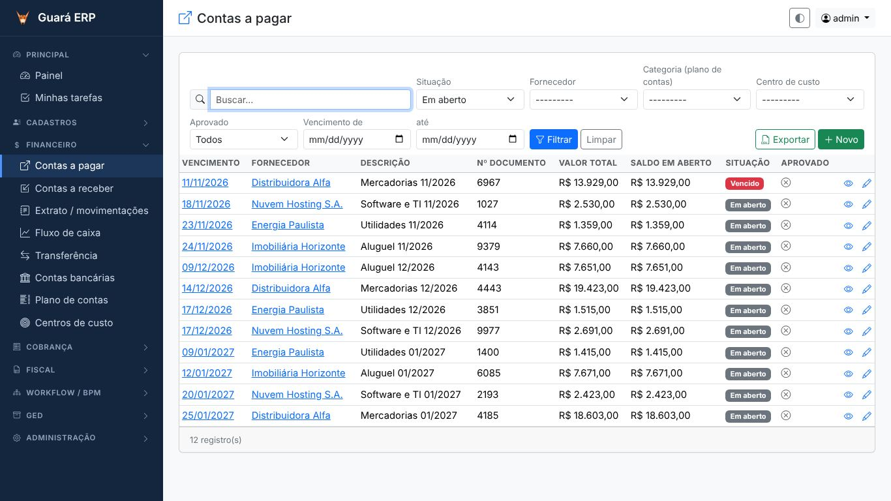
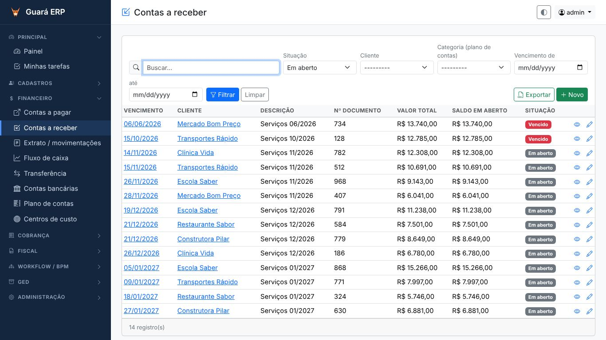
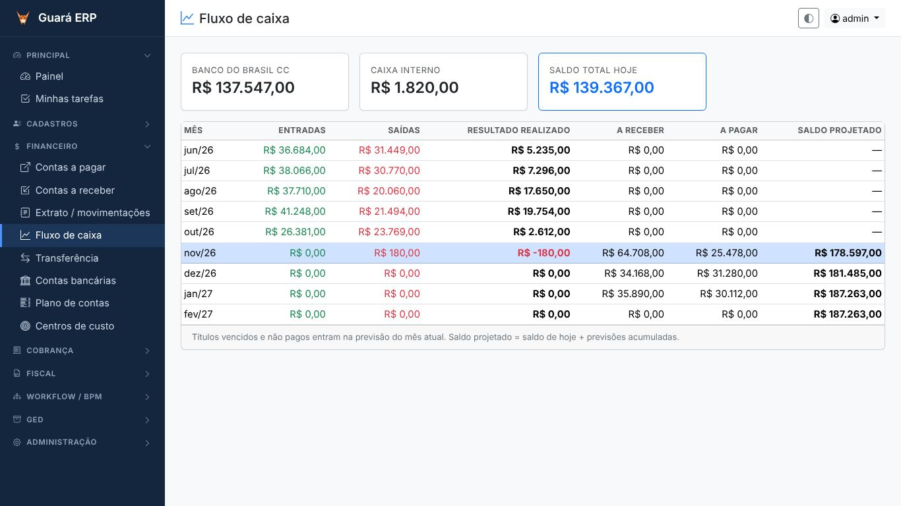
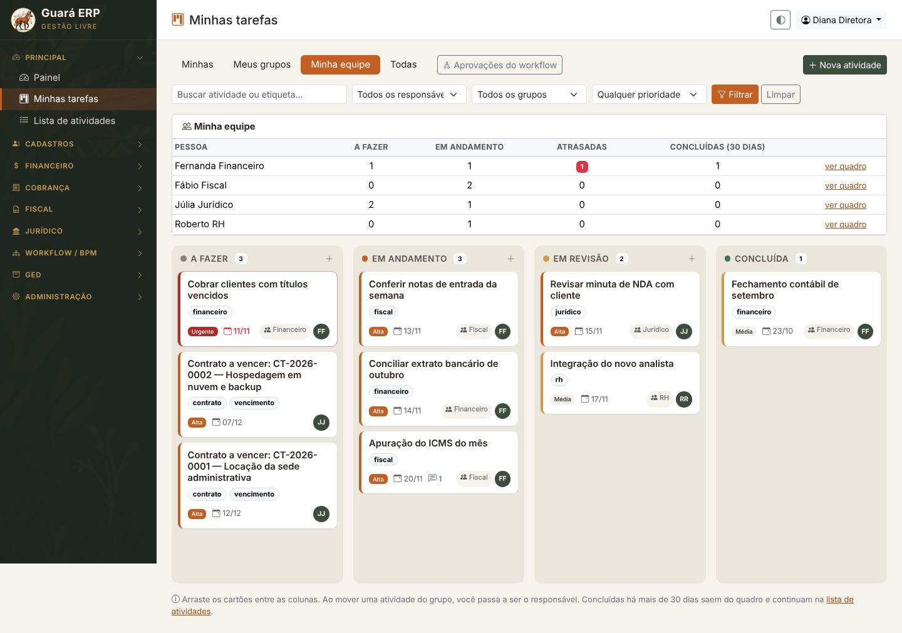
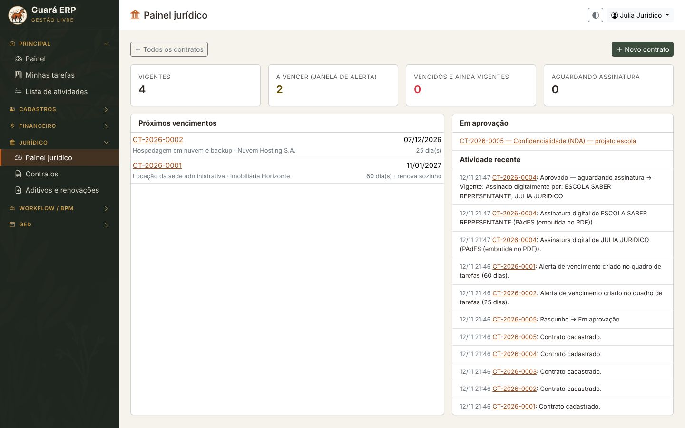
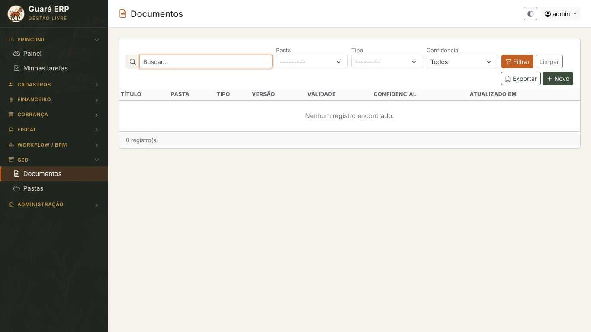
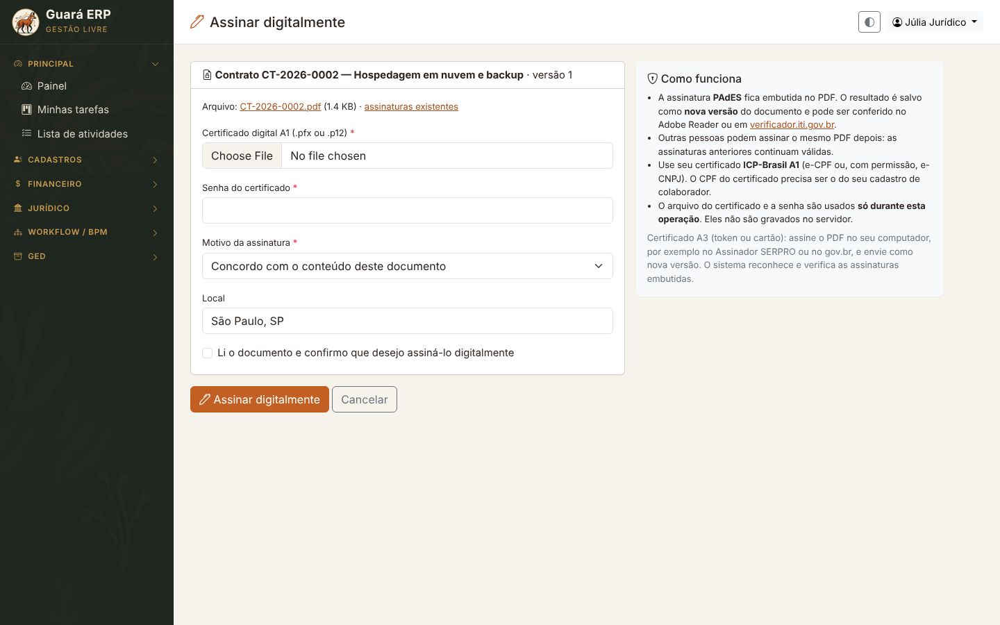
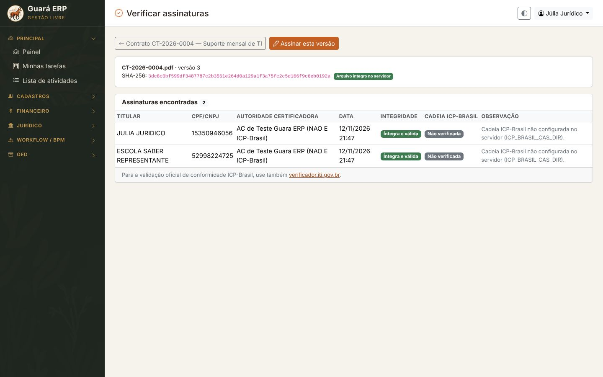

# Manual do usuário — Guará ERP

O **Guará ERP** é um sistema de gestão empresarial usado pelo navegador. O nome homenageia o
lobo-guará, o maior canídeo da América do Sul e símbolo do Cerrado brasileiro.

Este manual explica o uso diário de cada módulo. Para instalar o sistema, veja [INSTALACAO.md](INSTALACAO.md).

**Sumário**

1. [Acesso e navegação](#1-acesso-e-navegação)
2. [Primeiros passos (administrador)](#2-primeiros-passos-administrador)
3. [Perfis de acesso](#3-perfis-de-acesso)
4. [Telas de cadastro: uso comum](#4-telas-de-cadastro-uso-comum)
5. [Cadastros](#5-cadastros)
6. [Compras](#6-compras)
7. [Vendas e CRM](#7-vendas-e-crm)
8. [Estoque](#8-estoque)
9. [Produção e Qualidade](#9-produção-e-qualidade)
10. [Manutenção](#10-manutenção)
11. [Projetos](#11-projetos)
12. [SST / EHS — saúde, segurança e meio ambiente](#12-sst--ehs--saúde-segurança-e-meio-ambiente)
13. [Service Desk](#13-service-desk)
14. [Financeiro](#14-financeiro)
15. [Contabilidade](#15-contabilidade)
16. [Cobrança](#16-cobrança)
17. [Fiscal](#17-fiscal)
18. [Minhas tarefas — quadro Kanban](#18-minhas-tarefas--quadro-kanban)
19. [Workflow / BPM](#19-workflow--bpm)
20. [Jurídico — contratos](#20-jurídico--contratos)
21. [GED — documentos e assinatura digital](#21-ged--documentos-e-assinatura-digital)
22. [Administração](#22-administração)
23. [Perguntas frequentes](#23-perguntas-frequentes)
24. [Relatórios e dashboards](#24-relatórios-e-dashboards)
25. [Auditoria e logs de erro](#25-auditoria-e-logs-de-erro)
26. [Recursos Humanos](#26-recursos-humanos)
27. [Segurança da conta e backups](#27-segurança-da-conta-e-backups)
28. [Login corporativo: LDAP/AD, login único (OIDC, SAML) e SCIM](#28-login-corporativo-ldapad-e-login-único-microsoft-google)
29. [Antivírus nos uploads](#29-antivírus-nos-uploads)
30. [Boleto, PIX e cartão com baixa automática](#30-boleto-pix-e-cartão-com-baixa-automática)

---

## 1. Acesso e navegação


1. Abra o endereço informado pela TI (ex.: `http://192.168.0.10:8000` ou `https://erp.suaempresa.com.br`).
2. Informe **usuário** e **senha** e clique em **Entrar**.

Algumas regras de acesso:

- Depois de **5 senhas erradas**, o acesso fica bloqueado por 15 minutos. Se precisar, peça ao
  administrador para conferir seu usuário.
- A sessão expira em **8 horas** ou quando o navegador é fechado.
- Para trocar a senha, clique no seu nome (canto superior direito) → **Alterar senha**.
  A senha precisa ter pelo menos 10 caracteres e não pode ser uma senha comum.
- Para sair, clique no seu nome → **Sair**. Faça isso sempre em computadores compartilhados.


**Painel:** é a tela inicial. Mostra o saldo das contas, os valores a receber e a pagar (com os
vencidos), suas tarefas pendentes, o gráfico de fluxo de caixa e os próximos vencimentos.
Cada pessoa vê só os quadros que o seu perfil permite.

**Menu lateral:** os módulos ficam agrupados (Cadastros, Financeiro, Cobrança, Fiscal, Workflow/BPM,
GED, Administração). Clique no nome do grupo para abrir ou fechar. No celular, o menu abre pelo
botão ☰.

**Tema escuro:** use o botão ◐ no topo. A preferência fica salva no navegador.

---

## 2. Primeiros passos (administrador)

Siga esta ordem logo depois da instalação:

1. **Empresa** (Cadastros → Empresas): razão social, CNPJ, regime tributário, endereço e a
   **chave PIX**. Sem a chave PIX, as cobranças não geram o PIX copia-e-cola.
2. **Contas bancárias** (Financeiro → Contas bancárias): uma por conta. Informe o **saldo inicial**
   e a data desse saldo. Cadastre também o "Caixa interno", se houver.
3. **Plano de contas** e **centros de custo** (Financeiro): o sistema já traz um plano básico.
   Ajuste ao da sua contabilidade.
4. **Departamentos e cargos** (Cadastros), depois os **colaboradores**.
5. **Usuários** (Administração → Usuários e grupos): crie um usuário para cada pessoa e marque o
   **grupo** dela (veja a seção 3). Para ligar o usuário ao cadastro do colaborador, use o campo
   *Usuário do sistema* no cadastro do colaborador.
6. **Régua de cobrança** (Cobrança → Régua de cobrança): revise os textos dos e-mails.
7. **Processos** (Workflow / BPM → Modelar processos): revise quem aprova cada etapa.
8. **Pastas do GED**: crie as pastas e defina os grupos que podem acessar cada uma.
9. **Gestores e assinaturas:**
   - No cadastro de cada colaborador, preencha **Usuário do sistema** e **Gestor**.
   - Nos departamentos, preencha o **Responsável**.
   - Isso define quem vê a aba *Minha equipe* do quadro de tarefas e permite conferir o CPF nas
     assinaturas digitais.
   - Para quem assina pela empresa com **e-CNPJ**, dê a permissão *Pode assinar com o certificado da
     empresa* em Usuários e grupos.

---

## 3. Perfis de acesso

Cada usuário pertence a um ou mais **grupos**. O grupo define quais menus e ações aparecem.

| Grupo | Indicado para | Pode |
|---|---|---|
| **Administradores** | Diretoria, gestão | Tudo nos módulos, incluindo auditoria, ver todas as solicitações, criar usuários e ver documentos confidenciais |
| **Financeiro** | Contas a pagar e a receber, tesouraria | Financeiro e cobrança completos; consultar e cadastrar clientes e fornecedores; consultar notas |
| **Fiscal** | Departamento fiscal, faturamento | Notas e produtos completos; consultar o financeiro e lançar títulos; cadastrar clientes e fornecedores |
| **RH** | Recursos humanos | Colaboradores, departamentos e cargos; criar pastas no GED |
| **Vendas** | Vendedores | Pedidos de venda (sem liberar crédito), CRM e funil, clientes, consulta de estoque |
| **Estoque** | Almoxarifado | Saldos, movimentos, inventário, armazéns, recebimento de compras |
| **Produção** | PCP e fábrica | Estruturas, ordens de produção e apontamento, solicitar compras |
| **Qualidade** | Inspetores | Inspeções e não conformidades |
| **Manutenção** | Técnicos | Equipamentos, planos e ordens de serviço |
| **Projetos** | Gerentes de projeto | Projetos, EAP e horas de todos |
| **SESMT** | Segurança do trabalho | Todo o módulo SST/EHS |
| **Contabilidade** | Contador | Lançamentos, plano de contas, regras, relatórios e fechamento; consulta financeiro, fiscal e estoque |
| **Service Desk** | Equipe de TI / central de serviços | Atende os chamados da área TI, cadastra áreas, catálogo, biblioteca e mudanças |
| **CAB** | Comitê de mudanças | Aprova as mudanças (RDM) |
| **Compras** | Compradores | Módulo de Compras (cotação, pedido, recebimento, conferência); consulta as alçadas; fornecedores e produtos; notas de entrada |
| **Jurídico** | Advogados, analistas de contratos | Contratos completos (cadastro, aprovação, renovação, aditivos, encerramento); pasta Jurídico do GED; cadastrar clientes e fornecedores |
| **Usuários** | Demais colaboradores | Abrir e acompanhar solicitações (workflow e compras); abrir chamados no Service Desk e usar o assistente; registrar não conformidade, incidente e pedido de manutenção; apontar horas em projetos; consultar e enviar documentos no GED |

Todos os grupos podem usar o quadro de tarefas, abrir solicitações de workflow, usar o GED (dentro das
pastas permitidas) e assinar documentos com o próprio certificado digital.

**Gestores** não são um grupo: o sistema reconhece o gestor pela estrutura cadastrada. São gestores
quem consta como *gestor* no cadastro de colaboradores e quem é *responsável* por um departamento
(inclusive os subdepartamentos). Para isso funcionar, o usuário de cada pessoa precisa estar ligado ao
cadastro de colaborador (campo *Usuário do sistema*).

Algumas regras valem independentemente do grupo:

- Os dados de **colaboradores** (CPF, salário) só aparecem para RH e Administradores.
- Cada pessoa só vê as **solicitações de workflow** que abriu, as que estão com ela e as que já tratou.
- A página **Banco de dados** e o **Admin completo** são exclusivos do superusuário (TI).

---

## 4. Telas de cadastro: uso comum

Todas as telas de cadastro funcionam do mesmo jeito.



**Na lista:**

- **Buscar:** digite parte do nome, documento etc. e tecle Enter.
- **Filtros:** escolha as opções e clique em **Filtrar**. **Limpar** volta à lista completa.
- **Ordenar:** clique no título da coluna. Clique de novo para inverter a ordem.
- **Exportar:** gera um arquivo CSV com os registros filtrados. Ele abre no Excel com acentos corretos.
- **Novo:** abre o formulário de inclusão.
- Os ícones 👁 e ✏️ em cada linha servem para **ver** e **editar** o registro.

**No formulário:**

- Campos com **\*** são obrigatórios.
- Ao digitar o **CEP**, o endereço é preenchido sozinho (precisa de internet).
- **Salvar e incluir outro** agiliza cadastros em sequência.

**No detalhe:** mostra todos os dados, os registros ligados (por exemplo, as contas a pagar de um
fornecedor) e os botões de ação (**Editar**, **Pagar**, **Gerar cobrança** etc.). O botão 🖨 imprime a tela,
e a lixeira 🗑 exclui o registro. A exclusão é recusada se houver registros vinculados.

> Toda inclusão, alteração e exclusão fica registrada na **auditoria**, com usuário, data e o que mudou.

---

## 5. Cadastros

| Tela | Para que serve | Observações |
|---|---|---|
| **Empresas** | Dados da empresa e das filiais | A empresa marcada como *matriz* é a padrão nos lançamentos |
| **Departamentos** | Estrutura da empresa | Pode ter um *departamento superior* (hierarquia) e um responsável |
| **Cargos** | Funções e salário base | Código CBO opcional |
| **Colaboradores** | Ficha do funcionário | CPF validado; tipo de contrato (CLT, PJ, estágio...); situação (ativo, férias, afastado, desligado); dados bancários e PIX; gestor direto |
| **Fornecedores** | Quem vende para a empresa | CPF ou CNPJ validado; prazo de pagamento padrão (usado ao importar XML); dados bancários e PIX |
| **Clientes** | Quem compra da empresa | E-mail de cobrança separado (opcional); limite de crédito |
| **Parceiros de negócios** | Visão única de clientes e fornecedores | Cada CPF/CNPJ aparece uma vez, com a coluna *Papéis* (Cliente, Fornecedor ou os dois) |

### 5.1 Parceiro de negócios único

Nome, CPF/CNPJ, endereço e contato ficam em **um só cadastro**, o *parceiro de negócios*. Ser cliente ou
fornecedor são **papéis** desse cadastro, cada um com seus dados próprios: prazo de pagamento e conta
bancária no fornecedor; limite de crédito e e-mail de cobrança no cliente.

- **Mesma empresa nos dois lados:** abra a ficha do fornecedor e clique em **Tornar cliente** (ou, na ficha do
  cliente, **Tornar fornecedor**). O ERP cria o papel novo usando o mesmo cadastro. Não é preciso redigitar nada.
- **CPF/CNPJ repetido:** se você tentar cadastrar um CNPJ que já existe, o ERP recusa e indica o botão acima.
  O documento é comparado só pelos dígitos, com ou sem pontuação.
- **Endereço e contato valem para os dois papéis:** alterar a cidade na ficha do fornecedor também atualiza a
  ficha do cliente.
- **Excluir:** remove só o papel. O cadastro-mãe continua enquanto o outro papel existir.
- **Importar XML de NF-e:** se o emitente já é cliente, ele ganha o papel de fornecedor automaticamente.

Na atualização para esta versão, clientes e fornecedores com o mesmo CNPJ são unificados automaticamente.
Se houver dois fornecedores com o mesmo CNPJ, o segundo fica sem documento e recebe uma observação pedindo
revisão. Para encontrá-los, filtre a lista de fornecedores pela palavra *duplicado*.

---

### 5.2 Várias empresas e filiais

O ERP atende várias empresas na mesma instalação: um grupo com matriz e filiais, ou empresas
independentes (por exemplo, um escritório que cuida de vários clientes).

- **Cadastrar:** em **Cadastros → Empresas**, crie cada CNPJ com seu regime tributário (MEI, Simples
  Nacional, Lucro Presumido ou Lucro Real), endereço, **código IBGE do município** e inscrições. Na filial,
  preencha **Filial de** com a matriz.
- **Quem acessa:** o campo **Usuários com acesso** define quem pode trabalhar naquela empresa. Em branco,
  todos os usuários podem. Quem não tem acesso não vê os registros dela nas listas, nem o nome dela nos
  filtros, e não consegue transmitir nem cancelar as notas dela.
- **Empresa ativa:** quem acessa mais de uma empresa vê um **seletor na barra superior**. A empresa
  escolhida é a padrão dos novos lançamentos e das notas emitidas.
- **Notas fiscais por empresa:** cada empresa tem a sua **Configuração fiscal** (ambiente, emissor, série
  da NF-e e da NFS-e, certificado). A numeração é própria de cada empresa e série. A filial pode marcar
  **usar o certificado da matriz**: a SEFAZ aceita, porque a raiz do CNPJ é a mesma; o Emissor Nacional da
  NFS-e exige o certificado do próprio CNPJ.
- **Desativar:** desmarque **Ativa** para tirar uma empresa de uso sem apagar o histórico.

> **O que é separado por empresa:** financeiro, vendas, compras, produção, notas fiscais, contabilidade
> (razão, balancete, DRE e balanço), CRM, estoque (armazéns, saldos, kardex e inventários), Service Desk,
> manutenção, qualidade, SST e projetos. Cada registro pertence a uma empresa e só aparece para quem tem
> acesso a ela. Armazéns podem repetir o código entre empresas (cada empresa tem o seu armazém padrão).
> **Compartilhados:** clientes, fornecedores, produtos, plano de contas e períodos contábeis fechados.
> Os painéis de Relatórios respeitam o filtro de empresa em todos os quadros.

## 6. Compras

O ciclo de compras segue cinco passos. Cada passo pode ser feito por uma pessoa diferente:

```
Solicitação  →  Cotação  →  Pedido (alçada)  →  Recebimento  →  Conferência em três vias  →  Pagamento
```

### 6.1 Solicitação de compra

Qualquer usuário pode pedir uma compra em **Compras → Solicitações de compra → Novo**. Informe a
justificativa, a data em que precisa do material e os itens (produto do cadastro ou descrição livre, com
quantidade e unidade). Cada solicitação recebe um número `SC-ano-sequência`.

Quem não é do setor de Compras vê só as próprias solicitações. A solicitação pode ser alterada enquanto
estiver *Aberta*.

### 6.2 Cotação e mapa

1. Na solicitação, o comprador clica em **Gerar cotação** e escolhe os fornecedores. O ERP cria uma linha por
   item para cada fornecedor.
2. Na cotação, preencha **valor unitário** e **prazo de entrega** de cada fornecedor. Itens sem preço contam
   como não cotados.
3. Clique em **Mapa de cotação**. O ERP mostra um cartão por fornecedor, com o total, o prazo e a condição de
   pagamento. O fornecedor que cotou todos os itens pelo menor total recebe a etiqueta **Menor preço**.
4. Clique em **Escolher e gerar pedido** no fornecedor vencedor. A cotação é concluída e a solicitação fica
   *Atendida*.

Também é possível criar um pedido direto, sem solicitação nem cotação, em **Pedidos de compra → Novo**.

### 6.3 Pedido de compra e alçada de aprovação

Revise o pedido (departamento, centro de custo, categoria, frete, condição de pagamento) e clique em
**Enviar para aprovação**. **Todo pedido é aprovado por pessoas.** Não há aprovação automática. O
**departamento** do pedido, que vem da solicitação quando existe, indica a alçada usada. O **valor
total** indica até que nível o pedido sobe:

| Valor total do pedido | Quem aprova, em ordem |
|---|---|
| Até o limite do coordenador | Coordenador |
| Acima do coordenador, até o limite do gerente | Coordenador → Gerente |
| Acima do limite do gerente | Coordenador → Gerente → Diretor |

Cada aprovador recebe o pedido em **Workflow → Aprovações pendentes**. Só a pessoa designada pode aprovar
a etapa dela: nem o grupo Compras nem outro gestor podem. A descrição da aprovação traz o fornecedor, o valor
e os itens. Se alguém recusar, o pedido volta a ser editável e mostra o motivo. Depois de aprovado, o
pedido não pode mais ser alterado. Para mudar itens ou valores, cancele-o e gere outro.

A ficha do pedido mostra o coordenador, o gerente e o diretor definidos no envio. Se a alçada mudar
depois, os pedidos que já estão em aprovação seguem com os aprovadores do envio.

**Condição de pagamento:** informe os dias após a nota, separados por barra. Por exemplo, `28` gera uma
parcela e `30/60/90` gera três. O botão **PDF para o fornecedor** gera o pedido para enviar por e-mail.

#### Alçadas de aprovação (tela de atualização)

Em **Compras → Alçadas de aprovação**, a administração cadastra quem aprova e até quanto:

| Campo | Para que serve |
|---|---|
| **Departamento** | Em branco = **alçada padrão da empresa**, usada pelos departamentos sem alçada própria |
| **Coordenador** e **coordenador aprova até (R$)** | Primeiro aprovador de todos os pedidos. Acima do limite, o pedido sobe ao gerente |
| **Gerente** e **gerente aprova até (R$)** | Segundo nível. Acima do limite, sobe ao diretor. Não pode ser menor que o limite do coordenador |
| **Diretor** | Último nível, sem limite |

- **Os três níveis em todos os pedidos:** coloque `0` nos dois limites.
- **Mesma pessoa em dois níveis:** se o gerente também for o coordenador, ele aprova uma vez só.
- **Quem altera as alçadas:** só o grupo *Administradores*. O grupo *Compras* apenas consulta, para quem
  compra não definir quem aprova. Toda alteração fica na auditoria.
- **Sem alçada:** se não houver alçada padrão nem alçada do departamento, o ERP não deixa enviar o pedido e
  avisa onde cadastrar.

### 6.4 Recebimento

Quando a mercadoria chega, clique em **Registrar recebimento** no pedido. Informe a data, as quantidades
efetivamente recebidas (o ERP sugere o saldo de cada item) e, se já houver, a nota fiscal de entrada.
Importe antes o XML em **Fiscal → Importar XML NF-e**. Se a importação já gerou a conta a pagar, o ERP usa
essa conta, e quem decide se ela fica aprovada para pagamento é a conferência.

Recebimentos parciais são aceitos. O pedido fica *Recebido parcialmente* até todo o saldo chegar. Não é
possível receber mais do que o saldo.

### 6.5 Conferência em três vias

Ao registrar o recebimento com nota, ou ao vincular a nota depois (botão **Editar** do recebimento), o ERP
compara:

- **Pedido × nota:** o fornecedor e o preço unitário de cada produto. A tolerância padrão é de 2%.
- **Recebimento × nota:** a quantidade faturada de cada produto contra a recebida.
- **Total:** o valor dos produtos na nota contra o esperado pelo pedido e pelo recebimento.

| Resultado | O que acontece |
|---|---|
| **Conferido** | A conta a pagar é criada (uma por parcela) e já fica **aprovada para pagamento** |
| **Divergente** | A conta a pagar fica **bloqueada** (não aprovada), as divergências aparecem no recebimento e uma tarefa de prioridade alta é aberta no Kanban do grupo Compras |
| **Aguardando nota** | Nada vai para o financeiro até a nota ser vinculada |

Depois de resolver a divergência com o fornecedor (nota corrigida, carta de correção ou acordo), clique em
**Conferir de novo**. Se o pagamento for aceito mesmo com a diferença, o Financeiro pode aprovar a conta
manualmente, e isso fica registrado na auditoria.

## 7. Vendas e CRM

### 7.1 Funil de oportunidades (CRM)

Em **CRM → Funil de vendas**, cada oportunidade é um cartão numa coluna: *Prospecção → Qualificação →
Proposta → Negociação*. As setas do cartão movem a oportunidade entre as colunas. O topo da tela mostra o
total em aberto e o valor **ponderado** (valor × probabilidade do estágio: 10%, 25%, 50% e 75%).

- **Nova oportunidade:** escolha um cliente ou, se ainda não for cliente, preencha a empresa e o CNPJ do
  *prospect*.
- **Registrar interação:** ligação, e-mail, reunião ou visita. Se você informar um **próximo passo** com
  data, ele vira cartão no seu Kanban.
- **Ganhar:** o prospect vira cliente (se o CNPJ já for de um fornecedor, o cadastro é reaproveitado) e um
  **pedido de venda em rascunho** é aberto para você incluir os itens.
- **Perder:** informe o motivo (preço, prazo, concorrente). Esse motivo alimenta a análise de perdas.

### 7.1.1 Metas de venda e campanhas

- **Metas de venda** (CRM → Metas de venda): uma meta por vendedor e mês. A tela compara com o
  **faturado** (pedidos faturados do vendedor naquele mês), mostra o **atingimento %** e o **pipeline
  ponderado** (oportunidades abertas dele com fechamento previsto no mês × probabilidade). A projeção é o
  realizado mais o pipeline. Não pode haver duas metas do mesmo vendedor no mesmo mês.
- **Campanhas** (CRM → Campanhas): nome, canal (e-mail, evento, anúncio...), período, orçamento e custo
  realizado. Em cada oportunidade, escolha a **campanha** que originou o contato. A campanha mostra
  oportunidades, ganhas, **conversão %**, valor ganho, **custo por oportunidade** e o retorno (valor ganho ÷
  custo). O custo realizado é digitado: o ERP não busca gasto em plataformas de anúncio.
- **Fora do escopo:** televendas e telecobrança (discador, scripts) não existem; a régua de cobrança
  cobre só o envio automático por e-mail.

### 7.2 Pedido de venda

1. **Vendas → Pedidos de venda → Novo:** cliente, condição de pagamento (`0`, `30` ou `30/60/90`), itens
   (o preço vem da **tabela de preço** do pedido ou, sem ela, do cadastro do produto — veja 7.3; o desconto
   por item tem limite, padrão 10%).
2. **Confirmar:** o ERP confere o **estoque disponível** e o **limite de crédito** do cliente (títulos em
   aberto + pedidos aprovados + este pedido). Dentro do limite, o pedido fica *Aprovado*. Acima, fica
   *Bloqueado (crédito)*.
3. **Liberar crédito:** só o **Financeiro** pode liberar, com justificativa registrada. O vendedor não
   libera o próprio pedido.
4. **Faturar:** numa operação só, o ERP emite a **nota fiscal de saída** (numerada, com os impostos do
   cadastro), gera as **contas a receber** (uma por parcela) e **baixa o estoque** pelo custo médio. A
   transmissão da NF-e à SEFAZ é feita pelo seu emissor.

Pedido faturado não pode ser alterado. Para devolução, emita a nota de devolução.

### 7.3 Tabelas de preço

**Vendas → Tabelas de preço → Nova.** Cada tabela tem vigência (início e, se quiser, fim) e uma lista de
preços por produto. Para dar desconto por volume, cadastre o mesmo produto com mais de uma **faixa de
quantidade** (ex.: R$ 150 a partir de 1 unidade e R$ 120 a partir de 10): vale a maior faixa que a
quantidade do item alcança.

- **Tabela padrão:** marque "tabela padrão" e deixe os clientes em branco; vale para quem não tem tabela própria.
- **Tabela exclusiva:** escolha os clientes em "exclusiva dos clientes". Para esses clientes, ela vence a padrão.
- Ao salvar o pedido, o ERP escolhe a tabela vigente na data do pedido (você pode trocá-la no pedido).
  O item sem preço digitado recebe o da tabela; **produto que não está na tabela usa o preço do cadastro**.
- O preço é gravado no item na hora: mudar a tabela depois **não altera pedidos já lançados**.
- Um preço digitado à mão no item sempre prevalece sobre a tabela.

### 7.4 Comissão de vendedores

1. **Vendas → Regras de comissão** (Financeiro): informe o percentual e **quando a comissão é devida** —
   *no faturamento* ou *conforme o cliente paga*. Uma regra **sem vendedor** é a geral; a regra de um
   vendedor vale sobre a geral. Sem regra (ou com regra inativa), não há comissão.
2. Ao **faturar** o pedido, o ERP cria a comissão do vendedor do pedido: base = total dos itens (sem o
   frete), percentual da regra vigente naquele momento.
3. No modo *conforme o cliente paga*, a parte **devida** cresce na proporção do que o cliente já pagou
   dos títulos do pedido (e diminui se um recebimento for estornado).
4. **Vendas → Comissões → Lançar no contas a pagar** (Financeiro): cria a conta a pagar do que já é devido e
   ainda não foi lançado. Pode ser repetido a cada novo recebimento, sem duplicar. A conta a pagar segue o
   fluxo normal (aprovação, borderô, baixa).

O **vendedor vê só as próprias comissões**; a lista completa e o lançamento ficam com o Financeiro.

## 8. Estoque

| Tela | Para que serve |
|---|---|
| **Saldos** | Quantidade e **custo médio** de cada produto em cada armazém, com o valor em estoque |
| **Movimentos (kardex)** | Toda entrada e saída, com origem (compra, venda, produção, inventário...), documento, usuário e saldo após o movimento. Movimentos não se editam nem se apagam: um erro se corrige com outro movimento |
| **Movimentação manual** | Entrada (ajuste), saída (consumo interno) ou transferência entre armazéns, sempre com motivo |
| **Inventários** | Contagem física: ao criar, o ERP lista os produtos do armazém com a quantidade do sistema. Preencha o **contado** e clique em **Encerrar e ajustar saldos** |
| **Reposição** | Produtos abaixo do **estoque mínimo** (campo do cadastro do produto). O botão gera uma solicitação de compra com a sugestão |
| **Armazéns** | Locais de estoque. Um é o **padrão**. O armazém do tipo *quarentena* guarda o que aguarda inspeção e não conta como disponível |

As entradas acontecem sozinhas no **recebimento de compras** (pelo preço do pedido) e na **produção**. As
saídas acontecem no **faturamento**, no **consumo da produção**, nas **peças de manutenção** e nas
**entregas de EPI**. O ERP não deixa o saldo ficar negativo.

### 8.1 Lote, validade e endereço

No cadastro do produto (Fiscal → Produtos), marque **controla lote e validade** e/ou **controla endereço**.
Produtos assim passam a ter o saldo dividido por lote e por endereço; os demais continuam como antes.

- **Entrada:** informe o lote e a validade (no recebimento do pedido de compra, na produção ou na
  movimentação manual). Sem lote informado, o ERP cria um com o documento e a data. Um lote existente não pode
  mudar de validade.
- **Saída:** sem indicar o lote, sai primeiro o que **vence antes** (FEFO); lote sem validade sai por último.
  **Lote vencido ou bloqueado não é vendido nem consumido** e não conta como saldo disponível; uma saída que só
  poderia ser atendida por eles é recusada. Transferência, inventário e ajuste podem mexer nesses lotes (para
  descartar, transfira o vencido para um armazém de quarentena). A transferência preserva os lotes.
- **Bloqueio:** em *Estoque → Lotes*, marque **bloqueado** e informe o motivo (por exemplo, análise da Qualidade).
- **Endereços:** cadastre as posições do armazém (*Estoque → Endereços*). Informe o endereço na entrada, ou use
  *Mudar endereço* para mover o saldo de uma posição para outra (não altera quantidade nem custo).
- **Consultas:** *Saldos por lote/endereço* mostra onde está cada quantidade; *Lotes a vencer* lista o que vence
  em até N dias, com os vencidos em vermelho.

Limites: o **inventário** ajusta o total do armazém, sem contar lote por lote (uma sobra vira um lote
automático "inventário-data" e uma falta sai pelo FEFO); não há coletor de código de barras (ACD) nem
rastreabilidade de lote nas notas fiscais.

## 9. Produção e Qualidade

### 9.1 Estrutura e ordem de produção

1. **Produção → Estruturas:** para cada produto fabricado, cadastre os componentes, a quantidade e a
   perda (%). Exemplo: uma mesa = 1 tampo + 4 pés com 2,5% de perda.
2. **Ordens de produção → Novo:** produto e quantidade. A ficha mostra os **componentes necessários,
   o disponível e o que falta**.
3. **Comprar o que falta:** abre uma solicitação de compra com as faltas.
4. **Liberar** e, a cada lote pronto, **Apontar produção**. O ERP baixa os componentes pelo custo médio e
   dá entrada no produto acabado pelo **custo apurado**. A ordem encerra sozinha ao atingir a quantidade.

**Roteiro de operações** (Produção → Roteiro de operações): para cada estrutura, cadastre as operações
na ordem (corte, montagem, pintura), com a máquina ou posto, o **tempo de preparação** (fixo por ordem), o
**tempo por unidade** e o **custo da hora**. A ordem de produção mostra o **tempo previsto** (preparação +
tempo × quantidade) e o **custo estimado do roteiro**. Esse custo é **informativo**: não entra no custo
apurado do produto acabado, que continua sendo só o dos componentes. Não há planejamento de capacidade
(carga por máquina e calendário).

### 9.2 Inspeção de recebimento e plano de inspeção

Marque **inspecionar no recebimento** no cadastro do produto. Ao receber a compra, o material entra no
armazém de **quarentena** e uma **inspeção** fica pendente. Em **Registrar resultado**, informe a
quantidade aprovada e o laudo: o aprovado vai para o armazém principal; o reprovado fica na quarentena e
abre uma **não conformidade** para o fornecedor.

**Plano de inspeção** (Qualidade → Planos de inspeção): liste as características do produto. Cada uma é
uma **medida** (faixa de mínimo e máximo, com unidade) ou uma **verificação** (atende / não atende). Ao
criar uma inspeção desse produto, o ERP já gera uma linha por característica. Preencha os resultados
editando a inspeção; o ERP só deixa concluir quando todas estão preenchidas, e **não permite aprovar o lote
inteiro** se alguma estiver fora da faixa: reprove tudo ou libere só a parte conforme. O ERP não controla a
calibração dos instrumentos de medição.

### 9.3 Não conformidades

Qualquer usuário pode registrar uma não conformidade (problema de processo, reclamação de cliente,
auditoria). O prazo é definido pela gravidade (crítica 2 dias, alta 7, média 15, baixa 30), e a não
conformidade vira tarefa no Kanban do responsável. Para **encerrar**, é obrigatório preencher a causa
raiz, a ação corretiva e a verificação de eficácia.

## 10. Manutenção

- **Equipamentos:** cadastro com patrimônio, série, localização e se é **crítico**. A ficha mostra os
  planos, o histórico de ordens e as horas parado em corretivas.
- **Planos preventivos:** tarefa, periodicidade em dias, próxima data e roteiro. A rotina diária abre a
  **OS preventiva** 7 dias antes (configurável). Ao concluir a OS, a próxima data é reprogramada.
- **Ordens de serviço:** qualquer usuário pode abrir uma **corretiva** ("o ar não gela"). O técnico clica
  em **Iniciar** e depois em **Concluir**, informando o serviço executado, as horas e o custo de mão de
  obra. As **peças** listadas na OS são baixadas do estoque na conclusão, e o custo total fica na OS.

## 11. Projetos

- **Projeto:** gerente, cliente, prazo, **orçamento** e, se houver, o **centro de custo**. As contas a
  pagar lançadas nesse centro de custo contam como despesa do projeto.
- **EAP:** as tarefas (1, 1.1, 1.2...) com responsável, datas, horas previstas e % concluído. O avanço
  do projeto é ponderado pelas horas.
- **Minhas horas:** cada pessoa aponta as próprias horas por projeto e tarefa, e vê e corrige só as suas.
  O custo da hora (salário × fator de encargos ÷ horas do mês) é registrado no dia do apontamento.
- A ficha do projeto mostra o **custo realizado** (mão de obra + despesas) contra o orçamento e o saldo.
- **Compras por projeto:** no pedido de compra, escolha o **projeto**. Se o centro de custo ficar vazio,
  o ERP usa o do projeto, e as contas a pagar da compra caem nele. A ficha mostra as **compras aprovadas**
  (aprovadas, parcialmente recebidas e recebidas).
- **Vendas por projeto:** no pedido de venda, escolha o **projeto**. Ao faturar, as contas a receber ficam
  no centro de custo do projeto. A ficha mostra **vendas faturadas**, **vendas a faturar** e o
  **resultado** (faturado − custo realizado).
- O cronograma não tem dependências entre tarefas nem caminho crítico.

## 12. SST / EHS — saúde, segurança e meio ambiente

| Tela | Para que serve |
|---|---|
| **Incidentes e acidentes** | Qualquer usuário relata (inclusive quase acidente e ocorrência ambiental) e vê os próprios relatos; o **SESMT** vê todos. Acidente de trabalho gera tarefa **urgente** ao SESMT e só pode ser encerrado com causas, ações e **CAT registrada** |
| **Inventário de riscos (PGR)** | Perigos por atividade, com probabilidade × severidade (1 a 5), nível, classificação (trivial a intolerável) e medidas de controle |
| **Entregas de EPI** | Ficha de entrega com o **CA**. Se o EPI for um produto do estoque, a entrega baixa o saldo. Entregas não podem ser excluídas |
| **ASOs** | Exames ocupacionais com **apenas a aptidão** (apto, apto com restrição, inapto), sem diagnóstico (LGPD). Acesso restrito ao SESMT e ao RH |
| **Treinamentos (NRs)** | NR-10, NR-12, NR-35, brigada etc., com validade da reciclagem |
| **CIPA — membros** | Titulares e suplentes, representantes do empregador e dos empregados, com o mandato (início e fim) |
| **CIPA — reuniões** | Data, pauta, ata e presentes de cada reunião, ordinária ou extraordinária |
| **Licenças ambientais** | Licença, órgão, número, validade e condicionantes |
| **Resíduos** | Inventário de resíduos gerados: classe (I, IIA, IIB), quantidade, destinadora, MTR e certificado. Resíduo classe I exige o **número do MTR** |

A rotina diária avisa o SESMT, pelo Kanban, sobre **ASOs e reciclagens que vencem nos próximos 30 dias**,
**mandatos da CIPA que terminam**, **reunião mensal da CIPA em atraso** (mais de 35 dias sem reunião, com
mandato vigente) e **licenças ambientais a vencer**.

O ERP não calcula taxa de frequência e de gravidade de acidentes, não gera o MTR (digite o número emitido
no sistema do órgão ambiental) e não controla eleição da CIPA nem estabilidade dos membros.

## 13. Service Desk

O Service Desk recebe as solicitações internas de **todas as áreas** (TI, Facilities, RH, Financeiro...) num
só lugar, com prazo de atendimento (SLA), aprovação quando necessário e conversa direta entre quem pede e
quem atende.

### 13.1 Para quem pede

1. **Service Desk → Assistente:** descreva o problema com suas palavras. O assistente procura na
   **biblioteca de soluções** e mostra os artigos que podem resolver na hora. Se não resolver, ele indica o
   **serviço certo** e abre o formulário já preenchido.
2. **Service Desk → Abrir chamado:** o catálogo mostra os serviços de cada área, com o prazo e se precisa de
   aprovação. Escolha, descreva e envie.
3. Acompanhe pelo **sino de avisos** (canto superior direito) e pela **conversa** dentro do chamado. Quando
   o analista **chamar você**, chega aviso na tela e por e-mail. O prazo fica parado até você responder.
4. Quando o chamado for **resolvido**, clique em **Confirmar e avaliar** (1 a 5 estrelas) ou em **Não
   resolveu, reabrir**. Sem resposta em 3 dias, ele fecha sozinho.

Serviços com aprovação (por exemplo, *Novo equipamento*) vão antes para o **seu gestor** (o *gestor
direto* do cadastro de colaborador). Ele aprova em **Workflow → Aprovações pendentes**. Se recusar, você
recebe o motivo.

### 13.2 Para quem atende

A **Fila de atendimento** mostra os chamados das áreas da sua equipe, ordenados pelo prazo, com as abas
*Não atribuídos, Meus, Em risco, Vencidos, Aguardando usuário* e os indicadores (em andamento, SLA vencido,
% resolvido no prazo no mês, satisfação média).

| Ação | O que faz |
|---|---|
| **Assumir** | O chamado passa a ser seu e conta como 1ª resposta |
| **Conversa** | Mensagens com o usuário, atualizadas a cada 5 segundos. Marque **nota interna** para escrever só para a equipe |
| **Chamar o usuário** | Pede uma informação: o usuário recebe aviso na tela e por e-mail e o **SLA fica pausado** até ele responder |
| **Transferir** | Manda para outra área quando o pedido não é da sua equipe |
| **Resolver** | Registra a solução, com o artigo da biblioteca usado ou criando um artigo novo a partir dela |

Cada equipe vê **somente os chamados da sua área**. Pedidos de RH ou do Financeiro não aparecem para a TI.

### 13.3 SLA e avisos de vencimento

Cada serviço tem dois prazos: **1ª resposta** e **solução**. Eles valem para a prioridade *média*: a *alta*
tem metade do prazo, a *crítica* um quarto e a *baixa* uma vez e meia. Os prazos contam em **horário
comercial** (segunda a sexta, 8h às 18h, configurável) e param enquanto o chamado aguarda o usuário.

A cada 15 minutos, o ERP verifica os prazos e avisa (no sino e, nos casos graves, por e-mail):

- **1ª resposta vencida:** o analista ou a equipe da área;
- **em risco** (80% do prazo consumido): o analista ou a equipe;
- **vencido:** o analista ou a equipe **e o gestor da área**.

### 13.4 Biblioteca de soluções

Artigos com o **problema** (como o usuário descreve) e a **solução passo a passo**. Artigos *visíveis para
os usuários* aparecem no assistente; os desmarcados são **procedimentos internos**, só para as equipes. Cada
artigo conta leituras e votos "resolveu / não resolveu", que melhoram a ordem das sugestões. Ao resolver
um chamado, marque *transformar esta solução em artigo* para alimentar a biblioteca.

### 13.5 Gestão de mudanças (RDM)

Toda alteração em sistema, rede ou instalação que possa afetar outras pessoas passa por uma **requisição
de mudança**:

| Tipo | Aprovação |
|---|---|
| **Padrão** | Pré-aprovada (rotina conhecida e de baixo risco, ex.: troca de toner) |
| **Normal** | Gestor da área → **CAB** (comitê de mudanças) |
| **Emergencial** | Direto ao CAB |

Na RDM informe o que muda, a justificativa, o impacto, os planos de **implantação**, **testes** (obrigatório
para risco alto) e **retorno/rollback** (obrigatório para normal e emergencial) e a **janela**. Se outra
mudança da mesma área usar a mesma janela, o ERP avisa. Depois de aprovada: **Iniciar execução** e
**Registrar resultado** (concluída ou falhou com retorno). O resultado é comunicado aos **chamados
relacionados**.

### 13.6 Configuração (administrador)

1. **Áreas de atendimento:** nome, **equipe** (um grupo de usuários: TI = *Service Desk*, Facilities =
   *Manutenção*, RH, Financeiro...) e **gestor**.
2. **Catálogo de serviços:** área, nome, palavras-chave (ajudam o assistente), o que pedir ao usuário,
   prioridade padrão, SLAs e quem aprova (ninguém, gestor do solicitante, gestor da área ou um usuário).
3. **CAB:** coloque no grupo *CAB* quem aprova mudanças.

### 13.7 Atendimento inicial pela IA

Com a opção **Triagem do Service Desk pela IA** ligada (Administração → Configuração da IA), o assistente
faz o primeiro atendimento:

1. **Classifica.** Em *Abrir chamado*, o botão **Abrir chamado com a IA** aceita o problema em texto livre.
   A IA escolhe o serviço do catálogo, e com ele a **fila da equipe certa** e os SLAs, e sugere a
   prioridade (nunca *crítica*). Se não identificar o serviço, você volta ao catálogo para escolher.
2. **Lê o chamado e orienta.** Para qualquer chamado novo, aberto pela IA ou pelo catálogo, ela procura
   na **biblioteca de soluções** os artigos que você pode ver e responde na conversa com o passo a passo.
   A mensagem aparece como *Assistente (IA)*.
3. **Resolveu?** No alto do chamado aparecem dois botões. **Resolveu, pode encerrar** fecha o chamado, e
   **Não resolveu, quero atendimento** manda para a equipe. Você também pode responder na conversa: a IA
   tenta de novo até 3 vezes e depois encaminha sozinha.
4. **Encaminha.** Sem artigo que sirva, se a IA falhar ou estiver fora do ar, o chamado segue direto para
   a fila e a equipe é avisada no sino.

O que a IA **não** faz: não encerra chamado por conta própria (só você confirma), não usa artigos internos
da equipe, não inventa solução fora da biblioteca e não atende chamado que espera aprovação. O **SLA
continua contando** durante a conversa com a IA, e a resposta dela não vale como 1ª resposta. Quando um
analista assume, a IA sai da conversa. Na fila, a equipe vê os selos *com a IA* e *IA encaminhou* e o
indicador **Resolvidos com a IA (mês)**. A qualidade do atendimento depende da biblioteca: artigo bom,
resposta boa.

## 14. Financeiro

### 14.1 Contas a pagar e a receber

A lista abre em **Situação: Em aberto**. Use o filtro para ver **Vencidos**, **Pagos**,
**Cancelados** ou **Todos**.

**Lançar uma conta:** clique em **Novo** e informe fornecedor/cliente, descrição, valor, vencimento,
categoria (plano de contas) e centro de custo.

- **Parcelar:** na inclusão, informe o número de **parcelas** e o **intervalo em dias**. O sistema
  cria uma conta para cada parcela (1/3, 2/3, 3/3). Os centavos que sobram da divisão ficam na primeira parcela.
- **Juros/multa** e **desconto** alteram o *valor total* a pagar.



**Pagar ou receber (baixa):** abra a conta → **Pagar** (ou **Receber**) → informe valor, data, conta
bancária e forma de pagamento → **Confirmar**.

- Pagando **menos que o saldo**, o título fica como *Pago parcialmente* e o restante continua em aberto.
- Cada baixa gera uma **movimentação** no extrato da conta bancária e atualiza o saldo.

Outras ações no título:

- **Estornar pagamentos:** desfaz todas as baixas do título e apaga as movimentações. O título volta a *Em aberto*.
- **Cancelar título:** só é possível sem pagamentos (estorne antes).
- **Enviar para aprovação** (contas a pagar): abre uma solicitação no processo *Aprovação de pagamento*
  (seção 19). Quando todas as etapas aprovam, a conta fica marcada como **Aprovado**.
- **Gerar cobrança** (contas a receber): veja a seção 16.

### 14.2 Contas bancárias, extrato e transferências

- **Contas bancárias:** a lista mostra o **saldo atual** de cada conta (saldo inicial + entradas − saídas).
- **Extrato / movimentações:** todas as entradas e saídas. Aqui você também lança movimentações
  avulsas, como tarifas bancárias e rendimentos. O campo **Conciliado** marca o que já foi conferido
  com o extrato do banco.
- **Transferência:** move valor entre duas contas da empresa, gerando a saída numa e a entrada na outra.

### 14.3 Fluxo de caixa



Mostra, mês a mês:

- **Realizado:** entradas e saídas que já aconteceram.
- **Previsto:** o que está a receber e a pagar em aberto. Os vencidos entram no mês atual.
- **Saldo projetado:** saldo de hoje somado às previsões, acumulado mês a mês. Fica vermelho se ficar negativo.

### 14.4 Plano de contas e centros de custo

- **Plano de contas:** classifica receitas e despesas em níveis (ex.: `2.02.01 Aluguel`).
  Use códigos com pontos para a hierarquia.
- **Centros de custo:** separam as despesas por área, normalmente ligadas a um departamento.
- **Rateio:** num título que atende a várias áreas, use **Ratear por centro de custo** e divida em
  percentuais que somem 100% (deixe em branco para remover). O rateio alimenta **Financeiro → Resultado por
  centro de custo**, que soma despesas ou receitas por centro no período (pelo vencimento; cancelados ficam
  de fora; título sem rateio entra inteiro no centro do título). É uma análise **gerencial**: os lançamentos
  contábeis continuam no centro de custo do próprio título.

---

### 14.5 Conciliação bancária (extrato OFX)

1. No internet banking, exporte o extrato em **OFX** (alguns bancos chamam de "Money").
2. **Financeiro → Importar extrato (OFX):** escolha a conta e o arquivo. Pode importar períodos que se
   sobrepõem: o que já entrou é ignorado.
3. O ERP **concilia sozinho** cada linha do banco com a movimentação de mesmo valor e sentido, com até 3
   dias de diferença na data.
4. O que sobrar aparece em **No banco, mas não no ERP**, com três saídas por linha:
   - **Baixar este título:** o ERP sugere as contas em aberto com exatamente aquele valor. Um clique baixa
     o título na data do banco e concilia.
   - **Lançar sem título:** para tarifas, juros e IOF. Cria a movimentação e concilia.
   - **Ignorar:** para linhas que não interessam (ex.: aplicação automática e resgate no mesmo dia).
5. O quadro **No ERP, mas não no banco** mostra o que foi lançado e o banco não confirmou: data ou valor
   errado, cheque não compensado ou pagamento que não saiu.

### 14.6 Pagamento a fornecedores por arquivo (CNAB 240)

Em vez de digitar cada pagamento no banco, monte um **borderô** e envie um arquivo:

1. **Financeiro → Borderôs de pagamentos → Novo:** conta pagadora e data de pagamento.
2. **Adicionar títulos:** só aparecem contas **em aberto e aprovadas para pagamento** (pela conferência de
   compras, pelo workflow ou manualmente) que não estejam em outro borderô. Título com código de barras
   vai como **boleto**; os demais, como **crédito em conta (TED)** nos dados bancários do fornecedor.
3. **Gerar arquivo de remessa:** baixa o arquivo `.rem`. Envie-o pelo internet banking da empresa. Se
   faltar algum dado (agência do fornecedor, convênio da conta), o ERP lista o que completar.
4. Quando o banco devolver o arquivo de **retorno**, use **Financeiro → Importar retorno do banco**. Os
   títulos **pagos** são baixados na data do retorno; os **rejeitados** mostram o motivo e voltam a ficar
   disponíveis para outro borderô. Importar o mesmo retorno duas vezes não baixa em dobro.

Cadastros necessários: na **conta bancária**, código do banco, agência, conta e **convênio**; no
**fornecedor**, o campo *Banco* começando pelo código de 3 dígitos (ex.: `341 Itaú`), agência e conta.

> O arquivo segue o padrão FEBRABAN CNAB 240. Cada banco tem particularidades e **exige homologação**:
> antes de usar de verdade, envie um arquivo de teste ao seu gerente e valide o retorno. PIX por arquivo e
> contas de consumo (código de 48 dígitos) ainda não entram na remessa.

### 14.7 Tributos retidos na fonte (contas a pagar)

Ao pagar um fornecedor de serviços, a empresa pode ter de **reter** IRRF, PIS, COFINS e CSLL e recolhê-los
ao Fisco. O ERP controla isso assim:

1. **Regras de retenção** (Financeiro): vêm cadastradas IRRF 1,5% (código 1708) e PIS 0,65%, COFINS 3% e CSLL
   1% (código 5952), todos com vencimento no dia 20 do mês seguinte. **São pontos de partida: a alíquota, o
   código de receita, o prazo e a base mínima dependem do tipo de serviço e do fornecedor, e quem confere
   é o contador.** Altere na tela, sem mexer no sistema.
2. No título a pagar, **Tributos retidos → marque o que se aplica** e informe a base de cálculo. Só dá para
   definir antes do primeiro pagamento; refazer substitui o que estava marcado.
3. Ao **pagar**, informe o valor do título que está sendo quitado: o dinheiro que sai da conta é menor (valor
   menos a retenção) e o tributo vai para uma **guia a recolher**. Pagamento parcial retém na proporção, e o
   último pagamento leva o que sobrou, sem perder centavo.
4. **Financeiro → Guias de tributos retidos:** uma guia por mês e código de receita (PIS, COFINS e CSLL
   caem juntos no 5952). **Registrar recolhimento** lança a saída no banco.
5. **Estornar** o pagamento desfaz a retenção e ajusta a guia — exceto se a guia já foi recolhida: estorne
   antes o recolhimento.

A contabilidade acompanha: a retenção debita Fornecedores e credita *Impostos a recolher* (2.1.3), e o
recolhimento baixa essa conta contra o banco. Conciliação de extrato, borderô e retorno CNAB já tratam o
valor líquido (o borderô paga o líquido; o extrato é casado pelo líquido). **O ERP não gera DARF nem o
arquivo da DCTFWeb/EFD-Reinf**: a guia é o controle interno do que recolher.

### 14.8 Compensação entre contas a pagar e a receber

Quando um parceiro é ao mesmo tempo cliente e fornecedor (mesmo CPF/CNPJ), as duas dívidas podem ser
quitadas por **encontro de contas**, sem mexer no banco.

1. Abra a conta a pagar (ou a receber) e clique em **Compensar**.
2. Escolha o título do mesmo parceiro e confirme o valor. O máximo é o **menor dos dois saldos**; a baixa
   pode ser parcial nos dois.
3. Os dois títulos recebem a baixa (ficam *pagos* ou *pagos parcialmente*), sem movimentação bancária. A
   contabilidade debita Fornecedores e credita Clientes; juros e descontos são reconhecidos quando o título
   é quitado, como numa baixa normal.
4. **Financeiro → Compensações** lista os encontros. **Estornar compensação** devolve o valor aos dois títulos.

Regras: os títulos precisam estar em aberto, ser da mesma empresa e do mesmo parceiro; conta a pagar com
tributos a reter na fonte deve ser paga pela baixa normal. Enquanto houver compensação ativa, o título não
pode ser estornado pela baixa normal (estorne a compensação antes).

### 14.9 Renegociação de títulos a receber

Para cobrar um cliente inadimplente por um acordo, em vez de manter os títulos vencidos:

1. Abra um dos títulos do cliente e clique em **Renegociar títulos do cliente**. Os vencidos já vêm marcados.
2. Informe 1º vencimento, número de parcelas, intervalo, **juros/multa** a cobrar e **desconto** concedido.
3. Os títulos originais ficam **Renegociados** (o histórico é preservado), as cobranças pendentes deles são
   canceladas e nascem as novas parcelas (documento `RENEG-nº`), somando o saldo + juros − desconto.
   Título parcialmente pago entra pelo saldo.
4. **Financeiro → Renegociações** mostra o acordo, os originais e as novas parcelas.
5. **Desfazer renegociação** cancela as novas parcelas e reabre os originais — só se nenhuma parcela nova foi
   paga.

Contabilmente o título original é baixado contra a receita e as novas parcelas a reconhecem de novo; o efeito
líquido na receita é só o juros menos o desconto. **Limite:** boletos já registrados em banco ou gateway não
são cancelados lá — cancele-os no próprio banco.

### 14.10 Aging e provisão para devedores duvidosos (PDD)

**Aging.** *Financeiro → Aging de títulos* mostra, por cliente (ou fornecedor), o saldo em aberto em seis
faixas: a vencer, 1–30, 31–60, 61–90, 91–180 e mais de 180 dias de atraso, na data escolhida. Título pago
parcialmente entra só pelo saldo; cancelado, pago e renegociado ficam de fora.

**PDD.** Cada faixa de atraso tem um percentual de provisão (*Financeiro → Faixas de PDD*). O sistema
traz seis faixas como ponto de partida (1%, 5%, 10%, 30%, 50% e 100%); **o contador deve conferir e ajustar**
conforme a política da empresa.

1. *Financeiro → Apurar PDD* calcula, na data escolhida, o saldo vencido × percentual da faixa e compara com a
   provisão já constituída.
2. **Registrar apuração** lança só a diferença: constituição (despesa 4.9 contra a conta redutora 1.1.4) ou
   reversão. Se nada mudou, registra a apuração sem lançamento.
3. Para desfazer, **Estornar apuração** — só da mais recente. Não é possível apurar em data anterior a uma
   apuração ativa.

Limites: a PDD é apurada sobre contas a receber (não sobre outros créditos), e o ERP não baixa o título como
perda efetiva nem calcula o efeito fiscal da provisão (dedutibilidade).

## 15. Contabilidade

A contabilidade do Guará é um **razão único**: ninguém "roda a contabilização" no fim do mês. Cada evento
dos outros módulos grava o lançamento de débito e crédito **na hora em que acontece**.

| Quando acontece | Debita | Credita |
|---|---|---|
| Conta a pagar lançada | Despesa (da categoria) | Fornecedores |
| Compra recebida no estoque | Estoques | Compras a faturar |
| Compra recebida sem estoque (serviço) | Despesas operacionais | Compras a faturar |
| Conta a pagar de pedido de compra | Compras a faturar | Fornecedores |
| Pagamento | Fornecedores | Caixa e bancos |
| Faturamento de venda | Clientes | Receita de vendas |
| Impostos da nota de venda | (−) Impostos sobre vendas | Impostos a recolher |
| Saída do estoque pela venda | Custo das mercadorias vendidas | Estoques |
| Recebimento do cliente | Caixa e bancos | Clientes |
| Consumo interno, peça de manutenção, EPI | Consumo de materiais | Estoques |
| Ajuste de inventário | Estoques ou Ajustes de inventário | o inverso |
| Juros e descontos na quitação | Despesas ou receitas financeiras | Fornecedores ou Clientes |

Produção e transferências entre armazéns ou entre contas bancárias não geram lançamento, porque o valor
não sai da mesma conta contábil.

**Compras a faturar** é uma conta de passagem: recebe o valor da mercadoria na entrada e é zerada pela
nota do fornecedor. Saldo nela indica diferença entre o que foi recebido e o que foi faturado (preço
divergente, frete, nota pendente) e deve ser analisado.

### 15.1 Telas

| Tela | Para que serve |
|---|---|
| **Lançamentos (diário)** | Todos os lançamentos, com a origem (evento automático ou manual) e o registro que o gerou |
| **Novo lançamento** | Lançamento manual de uma conta a débito e outra a crédito (capital, provisões, ajustes) |
| **Balancete** | Saldo anterior, débitos, créditos e saldo final de cada conta no período, somando nas contas sintéticas |
| **Razão** | Extrato de uma conta com saldo corrido |
| **DRE** | Receita bruta, deduções, custos, despesas e o resultado do período (regime de competência) |
| **Balanço patrimonial** | Ativo, passivo e patrimônio líquido em uma data, com o resultado acumulado |
| **Plano de contas contábil** | Contas *sintéticas* (somam) e *analíticas* (recebem lançamento) |
| **Regras de contabilização** | Qual conta debitar e creditar em cada evento. Desmarque *ativo* para não contabilizar um evento |
| **Fechamento de períodos** | Trava o mês para lançamentos manuais |

### 15.2 Regras importantes

- **Lançamento não se edita nem se apaga.** Para corrigir, use **Estornar**: o ERP grava o lançamento
  inverso e mantém os dois no diário.
- **Título alterado ou cancelado:** o ERP estorna a provisão e, se for alteração, lança de novo pelo valor
  novo. Baixa estornada no financeiro também estorna o pagamento na contabilidade.
- **Despesa por conta:** em *Financeiro → Plano de contas*, cada categoria pode apontar para uma **conta
  contábil**. Títulos dessa categoria vão para essa conta; sem isso, vão para a conta padrão da regra.
- **Período fechado:** lançamentos manuais são recusados. Eventos automáticos com data em mês fechado
  entram no primeiro dia do mês aberto seguinte, com a competência original no histórico.
- **Encerramento do exercício:** o balanço mostra o resultado acumulado em linha própria. A transferência
  para *Lucros acumulados* é feita por lançamento manual do contador.

O plano de contas inicial é enxuto e serve de ponto de partida. Peça ao seu contador para adequá-lo. Esta
versão não gera ECD/ECF (SPED contábil).

### 15.3 Ativo imobilizado e depreciação

Em **Contabilidade → Ativo fixo**, cadastre cada bem (máquina, veículo, computador, móvel,
imóvel, software): data e valor de aquisição, valor residual, **vida útil** (sugerida pela categoria),
início da depreciação, centro de custo e fornecedor.

- **Aquisição:** ao salvar, o ERP lança *Imobilizado (D) × contrapartida (C)*. Informe a contrapartida
  (caixa, banco ou fornecedores) para o lançamento sair completo.
- **Depreciação:** linear, mensal, mês cheio. Rode em **Contabilidade → Depreciar mês** (ou
  `python manage.py depreciar_bens`, opcionalmente com `--ate AAAA-MM`). O ERP recupera meses atrasados e
  não duplica: cada bem tem uma depreciação por competência. Lança *Despesa de depreciação (D) × (-)
  Depreciação acumulada (C)*. O estorno só vale para o último mês lançado.
- **Baixa:** em **Baixar**, informe a data, o motivo (venda, perda, sucata) e o valor da venda. O ERP
  deprecia até o mês anterior e lança a baixa, com **ganho ou perda** na venda. A baixa não pode ser
  desfeita.
- **Travas:** depois da primeira depreciação, valor, vida útil e datas do bem não mudam.

A depreciação **não** roda sozinha no agendador: a rotina mensal fica com o contador. O ERP não faz
CIAP, nem controla depreciação fiscal diferente da contábil.

### 15.4 Orçamento e orçado × realizado (Controladoria)

Em **Contabilidade → Orçamentos**, crie um orçamento por ano com linhas por **categoria (plano de
contas)** e/ou **centro de custo**, tipo *receita* ou *despesa*. Informe o valor anual (distribuído em
12 parcelas iguais) ou ajuste mês a mês.

- **Orçado × realizado:** abra o orçamento e clique em **Orçado × realizado**. O realizado vem dos
  títulos a pagar e a receber (competência, ou emissão se não houver; cancelados ficam de fora; o rateio
  por centro de custo é respeitado). A linha mais específica (categoria + centro) vence; a categoria
  inclui as subcategorias.
- **Controle de orçamento:** no orçamento, escolha *Nenhum*, *Alertar* ou *Bloquear*. Compara o acumulado
  do ano com o orçado: *alertar* notifica o responsável quando um novo título estoura; *bloquear*
  impede o lançamento da conta a pagar na tela.
- **Limites:** o bloqueio vale para o cadastro pela tela (não para importações e integrações); o
  realizado é gerencial, não contábil.


## 16. Cobrança


**Gerar uma cobrança:** abra a conta a receber → **Gerar cobrança** → confirme.

- O sistema cria a cobrança com o **PIX copia-e-cola** e o **QR Code**, usando a chave PIX da empresa.
- O botão **Copiar** facilita mandar o PIX por WhatsApp ou e-mail.
- Para boleto ou link de pagamento gerados no banco ou em outro sistema, edite a cobrança e preencha
  a **linha digitável** ou o **link**.
- Quando o título é pago, a cobrança muda sozinha para **Paga**.

**Enviar por e-mail:** no detalhe da cobrança → **Enviar por e-mail**. O e-mail vai para o
*e-mail de cobrança* do cliente; se ele estiver vazio, para o e-mail principal.

**Régua de cobrança:** são envios automáticos em relação ao vencimento. O padrão é:
3 dias antes, no dia, 3 dias depois e 10 dias depois.

- Cada regra tem o número de **dias** (negativo = antes do vencimento), o **assunto** e a **mensagem**.
- Nos textos, use só estas variáveis: `{{ cliente }}`, `{{ titulo.descricao }}`, `{{ titulo.documento }}`,
  `{{ valor }}`, `{{ vencimento }}`, `{{ dias_atraso }}`, `{{ dados_pagamento }}` (PIX, linha digitável
  e link juntos), `{{ cobranca.pix_copia_cola }}`, `{{ cobranca.linha_digitavel }}`,
  `{{ cobranca.url_pagamento }}` e `{{ empresa }}`.
- A régua roda sozinha todo dia às 08:00. Para disparar na hora, use **Executar régua agora**.
- Cada regra envia no máximo um e-mail por cobrança.
- O resultado de cada envio aparece em **Histórico de envios**, inclusive o motivo das falhas
  (ex.: cliente sem e-mail).

---

## 17. Fiscal

### 17.1 Produtos e serviços

Cadastre código, descrição, unidade, **NCM**, **CFOP padrão**, preço e as alíquotas de ICMS, IPI,
PIS, COFINS e ISS. Esses valores são sugeridos automaticamente nos itens das notas.

### 17.2 Notas fiscais


**Emitir uma nota de saída:**

1. Em **Notas fiscais → Novo**, escolha o tipo **Saída**, o modelo (NF-e, NFC-e, NFS-e), o cliente e a natureza da operação.
2. Na grade **Itens da nota**, escolha o produto (descrição, CFOP, preço e alíquotas são preenchidos
   automaticamente) e informe a quantidade. Use **Adicionar linha** para mais itens.
3. Clique em **Salvar**: o sistema calcula os totais e os impostos.
4. No detalhe da nota, clique em **Emitir**. A nota recebe o próximo número da série e o status *Emitida*.
5. Clique em **Gerar título financeiro** para criar a conta a receber da nota.

> **Importante:** o Guará ERP calcula, numera e registra as notas, mas **não transmite à SEFAZ nem à
> prefeitura**. Faça a transmissão no seu emissor (com certificado digital) e depois informe a
> **chave de acesso** e o **protocolo** na nota.

**Notas de entrada (compras) por XML:**

1. Vá em **Fiscal → Importar XML NF-e** e escolha o arquivo `.xml` enviado pelo fornecedor.
2. Mantenha marcado **Gerar conta a pagar automaticamente**, se quiser o lançamento financeiro.
3. O sistema:
   - lê o XML e cadastra o fornecedor, se ele ainda não existir;
   - cria a nota com os itens e impostos;
   - gera a conta a pagar, com vencimento pelo prazo de pagamento do fornecedor.
4. A mesma nota não é importada duas vezes, porque a chave de acesso é conferida.

**Apuração de impostos:** mostra, por mês, o total das notas emitidas e de cada imposto, separando
entradas (créditos) e saídas (débitos). É um resumo gerencial: a apuração oficial deve ser conferida
pela contabilidade.

---

### 17.3 Transmissão ao fisco

O ERP assina a nota com o **certificado A1 da empresa** e a transmite por um *emissor*, que é o canal de
cada tipo de nota:

| Nota | Emissores previstos | Situação nesta versão |
|---|---|---|
| NF-e / NFC-e (mercadoria) | SEFAZ do estado | Em construção |
| NFS-e (serviço) | Emissor Nacional da NFS-e | **Pronto para homologação** (veja 17.4) |
| NFS-e (serviço) | Prefeitura de São Paulo | Em construção |
| Qualquer uma | **Simulação interna** | Disponível |

A **simulação interna** percorre o fluxo completo (validação dos cadastros, XML assinado com o certificado,
chave de acesso, protocolo e cancelamento) **sem enviar nada a ninguém e sem valor fiscal**. Serve para
treinar a equipe e conferir cadastros (NCM, CFOP, CPF/CNPJ do cliente). Enquanto os emissores reais não
são liberados, continue transmitindo pelo seu emissor atual e informe a chave e o protocolo na nota.

**Configurar (uma vez):** em **Fiscal → Configuração fiscal**, crie a configuração da empresa (ambiente e
emissor de cada tipo de nota) e clique em **Enviar certificado A1**. O ERP confere a senha, a validade e
se o CNPJ do certificado é o da empresa. O arquivo e a senha ficam **cifrados** no banco, não podem ser
baixados e só são abertos em memória na hora de assinar. A lista mostra quando o certificado vence.

**Usar:** na nota emitida, **Transmitir ao fisco**. A ficha passa a mostrar a *situação no fisco*
(autorizada ou rejeitada, com o motivo) e o histórico de **Transmissões**. Nota rejeitada pode ser
corrigida e transmitida de novo. Nota autorizada só é cancelada por **Cancelar no fisco**, com
justificativa de pelo menos 15 caracteres.

### 17.4 NFS-e pelo Emissor Nacional

O Emissor Nacional (Sefin Nacional) recebe a **DPS** (declaração de prestação de serviço), gera a NFS-e na
hora e devolve a chave de acesso de 50 dígitos e o XML. O ERP monta a DPS, assina com o A1 da empresa e envia
por conexão segura com **autenticação pelo próprio certificado**. Nada é enviado antes de você clicar em
**Transmitir ao fisco**.

**Antes da primeira nota (uma vez por empresa):**

1. **Certificado A1 do próprio CNPJ** enviado em Fiscal → Configuração fiscal. A filial **não** pode usar o
   certificado da matriz neste emissor.
2. Em **Cadastros → Empresas**: CNPJ, **código IBGE do município**, **inscrição municipal** e **regime
   tributário** (Simples, MEI, Presumido ou Real). O município precisa ter a empresa no Cadastro Nacional
   NFS-e; sem isso o fisco recusa.
3. Em **Fiscal → Produtos e serviços**, para cada serviço: o **código de tributação nacional** (6 dígitos:
   item, subitem e desdobro da lista da LC 116, por exemplo `01.07.01`; pode digitar com pontos). Código de
   tributação municipal e NBS só se o município exigir. Para o ISS fora do Simples, a **alíquota de ISS**.
4. Na **Configuração fiscal**: *NFS-e vai por* **Emissor Nacional**, ambiente **Homologação** e série entre
   **1 e 49999** (faixa dos sistemas próprios; o Emissor Web do portal usa outra e não colide).
5. No **cliente**: CPF/CNPJ e nome. Com CEP, logradouro, número, bairro e **código IBGE do município**
   preenchidos, o endereço também vai na nota.

**Conferir sem emitir nada:** no servidor, `python manage.py nfse_nacional_diagnostico` lista o que falta e
`--conectar` testa a conexão com o certificado na Sefin sem gerar nota.

**Regras da nota:** a NFS-e nacional tem **um serviço por nota**. Itens do mesmo serviço (mesmo código e mesma
alíquota) são somados; serviços diferentes pedem uma nota para cada. O desconto da nota vai como desconto
incondicionado. No Simples e no MEI a alíquota não é informada (o município usa a do DAS).

**Resultados:** *Autorizada* guarda chave, número da NFS-e (no campo protocolo) e o XML da nota. *Rejeitada*
mostra o código e o texto do próprio fisco (ex.: `E0160`); corrija e transmita de novo. *Erro de comunicação*
significa que o fisco não respondeu: a nota continua como estava, e ao tentar de novo o ERP consulta a DPS
antes, para nunca duplicar a nota. O **cancelamento** é pelo evento 101101 e o município define o prazo.

**Produção:** fica **travada** até você definir `FISCAL_NFSE_NACIONAL_PRODUCAO=1` no `.env`. Emita primeiro
várias notas em **Homologação** (as notas de teste não têm valor jurídico) e só então libere.

> **Estado desta integração.** O leiaute da DPS (1.01) e o fluxo foram montados a partir da documentação
> pública do Emissor Nacional e testados com respostas simuladas. **Ainda não foram validados contra a Sefin
> real**: isso depende do certificado de teste e pode pedir pequenos ajustes (a Sefin devolve o código exato
> de qualquer divergência). O leiaute 1.02 da reforma tributária (NT 009) ainda é preliminar e não está
> implementado. Se tiver o XSD oficial da DPS, aponte `FISCAL_NFSE_NACIONAL_XSD` para ele e o ERP confere o XML
> antes de enviar.

## 18. Minhas tarefas — quadro Kanban


O menu **Minhas tarefas** abre o quadro de atividades, com quatro colunas: **A fazer**, **Em andamento**,
**Em revisão** e **Concluída**.

**Criar uma atividade:** clique em **Nova atividade** (ou no **+** de uma coluna). Informe:

- título e descrição;
- prioridade (baixa, média, alta, urgente);
- prazo e etiquetas (separadas por vírgula, ex.: `cliente x, urgente`);
- **para quem** é a atividade:
  - *Responsável* (uma pessoa): atividade individual.
  - *Grupo* sem responsável: atividade do grupo. Qualquer membro pode assumir. Ao arrastá-la para
    "Em andamento", você passa a ser o responsável.
  - Responsável **e** grupo: atividade individual que também aparece para o grupo.

**Mover:** arraste o cartão para outra coluna ou para cima e para baixo, para priorizar. A mudança é
salva na hora e fica no histórico da atividade.

**Ler o cartão:**

- A cor da borda indica a prioridade: verde é baixa, dourado é média, laranja é alta e vermelho é urgente.
- O prazo fica vermelho quando está atrasado.
- O círculo com as iniciais é o responsável; um **?** indica atividade do grupo, ainda sem responsável.

Clique no título para abrir a atividade, ver o histórico e **comentar**.

**Visões** (abas no topo):

| Aba | Mostra |
|---|---|
| **Minhas** | O que é seu, o que você criou e as atividades sem responsável dos seus grupos |
| **Meus grupos** | Todas as atividades dos grupos de que você participa |
| **Minha equipe** | Só para gestores: atividades das pessoas que você gerencia |
| **Todas** | Só para quem tem a permissão *ver todas as atividades* (Administradores) |



**Gestão pelos gerentes:** na aba **Minha equipe**, o gestor vê:

- um resumo por pessoa: a fazer, em andamento, atrasadas e concluídas nos últimos 30 dias;
- o quadro da equipe, que pode ser filtrado por pessoa, grupo ou prioridade.

O gestor pode mover, reatribuir e comentar as atividades de quem ele gerencia.

As atividades concluídas saem do quadro depois de 30 dias e continuam em **Lista de atividades**,
que tem busca, filtros e exportação.

O botão **Aprovações do workflow** leva às aprovações que aguardam você (seção 19). Os **alertas de
contratos a vencer** chegam como cartões no quadro do responsável pelo contrato (seção 20).

---

## 19. Workflow / BPM

O módulo organiza processos que passam por várias pessoas, como aprovações, admissões e solicitações
internas.

### 19.1 Modelar um processo (administrador)


Em **Modelar processos → Novo**, informe o nome e um código. Depois, na grade **Etapas**, cadastre cada passo:

- **Ordem:** a sequência das etapas.
- **Tipo:**
  - *Tarefa:* o responsável executa e clica em **Concluir**.
  - *Aprovação:* o responsável **aprova** (segue para a próxima etapa) ou **rejeita** (encerra a solicitação; o motivo é obrigatório).
- **Responsável:** um grupo (qualquer pessoa do grupo pode agir) e/ou um usuário específico.
- **Prazo (dias):** solicitações com o prazo vencido aparecem como **Atrasada**.
- **Instruções:** orientação que aparece para o responsável.

O detalhe do processo mostra o **diagrama do fluxo**. O sistema já vem com três processos:

- **Aprovação de pagamento:** conferência do Financeiro, depois aprovação da diretoria.
- **Aprovação de contrato:** análise jurídica, depois aprovação da diretoria (seção 20).
- **Admissão de colaborador:** documentos (RH), depois acessos de TI, depois integração.

### 19.2 Usar no dia a dia


- **Nova solicitação:** escolha o processo, dê um título e descreva o pedido.
- **Aprovações pendentes** (no menu Workflow, ou pelo botão no quadro de tarefas): lista o que está aguardando você e as solicitações que você abriu.
- Ao abrir uma solicitação, você vê:
  - o fluxo, com a etapa atual destacada;
  - o histórico completo (quem fez o quê e quando);
  - à direita, os botões de ação da sua etapa.
- O solicitante pode **cancelar** a solicitação enquanto ela estiver em andamento.

---

## 20. Jurídico — contratos



O **Painel jurídico** mostra:

- os contratos vigentes;
- os que estão na janela de alerta de vencimento;
- os vencidos que ainda constam como vigentes;
- os que aguardam aprovação ou assinatura;
- a atividade recente.

### 20.1 Cadastrar um contrato

Em **Jurídico → Contratos → Novo**, preencha:

- **Parte:** tipo *com fornecedor*, *com cliente* ou *outro* (parceria, locação etc.), e o cadastro
  correspondente. Os contratos ficam ligados à ficha do fornecedor ou do cliente.
- **Termos:** categoria, objeto, valor mensal e total, e índice de reajuste.
- **Vigência:** início e fim (vazio = prazo indeterminado). Diga também se há **renovação
  automática**, o prazo de cada renovação, o **aviso prévio** para rescisão e com **quantos dias de
  antecedência** o sistema deve alertar.
- **Assinaturas digitais necessárias:** quantas assinaturas o PDF precisa ter para o contrato ficar
  vigente (normalmente 2: a empresa e a outra parte).
- **Gestor do contrato:** quem recebe os alertas de vencimento.
- **Arquivo do contrato:** de preferência em PDF. Ele fica guardado no GED, na pasta *Jurídico*,
  com controle de versões.

O número é gerado sozinho, no formato `CT-2026-0001`.

### 20.2 Ciclo de vida

```
Rascunho → Em aprovação → Aprovado (aguardando assinatura) → Vigente → Encerrado / Rescindido
                       ↘ Recusado → (corrige) → Em aprovação
```

1. **Enviar para aprovação:** o contrato entra no processo *Aprovação de contrato*, com a análise
   jurídica e depois a diretoria (seção 19).
   - Quem aprova ou recusa faz isso na própria solicitação.
   - A **recusa** exige o motivo, que aparece no contrato. Corrija e envie de novo.
2. **Aprovado:** com o contrato aprovado, os termos (partes, valores, vigência) ficam **travados**. A
   partir daqui, eles só mudam por aditivo.
3. **Assinatura:**
   - **Digital** (recomendado): no quadro *Documento e assinaturas*, cada signatário clica em
     **Assinar com certificado digital** (seção 21.2).
   - A outra parte pode assinar pelo gov.br ou por outra plataforma. Envie o PDF assinado como nova
     versão (editando o contrato) e clique em **Conferir e ativar**.
   - Quando o PDF tiver o número de assinaturas válidas exigido, o contrato passa a **Vigente**
     sozinho, e a data de assinatura é registrada.
   - **Em papel:** use **Registrar assinatura em papel/externa**, informando a data.
4. **Vigente:** use **Renovar** (prazo e % de reajuste), **Aditivo** (prazo, valor, escopo ou
   reajuste) ou **Encerrar / rescindir** (motivo obrigatório).
   - Renovações e aditivos atualizam a vigência e o valor do contrato.
   - Todos ficam registrados em *Aditivos e renovações*.


A **linha do tempo** registra cada mudança de situação, assinatura, alerta e renovação, com data e usuário.

### 20.3 Vencimentos e renovação

Todo dia às 08:00, o sistema verifica os contratos (no Docker, pelo serviço `agendador`):

- **Contrato entrando na janela de alerta** (ex.: 60 dias antes do fim):
  - cria um cartão **"Contrato a vencer"** no quadro de tarefas do gestor do contrato (ou do grupo
    Jurídico, se não houver gestor);
  - o prazo do cartão é a data limite do **aviso prévio**, o último dia para avisar a outra parte, caso
    não queira renovar;
  - o cartão é criado uma vez por vencimento.
- **Contrato com renovação automática que passou do fim:** é renovado sozinho pelo prazo definido, com
  registro na linha do tempo.

Na lista de contratos, o filtro **Vencimento** mostra os que vencem em 30, 60 ou 90 dias e os vencidos.

### 20.4 Índices e reajuste

Em **Jurídico → Índices (IPCA, IGP-M, INPC)**, digite a variação mensal (%) de cada índice quando for
divulgada (IBGE/FGV). No contrato, **Reajustar** sugere o percentual acumulado dos 12 meses anteriores
(composto, não soma). Se faltar algum mês, o ERP lista quais faltam. Você pode editar o percentual antes
de aplicar. O reajuste atualiza valor mensal e total, cria um **aditivo de reajuste** e registra na linha
do tempo. O ERP **não** baixa os índices da internet: a digitação é manual.

### 20.5 Medições

Em **Medições de contratos** (ou pelo botão **Medição** no contrato vigente), lance o período, o valor
medido, as **multas/glosas** (descontos) e as **bonificações** (acréscimos). Líquido = valor − multas +
bonificações. O número da medição é sequencial por contrato.

1. **Aprovar** (perfil com permissão de aprovar contrato): confere se o contrato está vigente, se o
   período cabe na vigência e se a soma das medições aprovadas não passa do **valor total** do contrato
   (se passar, formalize um aditivo de valor).
2. **Gerar título:** contrato com fornecedor gera **conta a pagar**; com cliente, **conta a receber**
   (documento `CT-AAAA-NNNN/Mn`). Contratos com "outra parte" não geram título.
3. **Cancelar:** cancela também o título, desde que não tenha pagamento (estorne antes).

Medição aprovada não se edita; cancele e lance outra.

### 20.6 Garantias, cauções e paralisações

- **Cauções e garantias:** registre tipo (dinheiro, seguro-garantia, fiança...), valor, emissor, apólice e
  validade. Marque como **devolvida** ou **executada**. A rotina diária cria um cartão no Kanban 30 dias
  antes do vencimento de cada garantia ativa.
- **Paralisações:** *Paralisar* abre uma suspensão (uma por vez). Ao **Retomar**, o ERP conta os dias
  parados e, se marcado, **prorroga a vigência** na mesma quantidade, com aditivo de prazo.
  A paralisação não bloqueia medições automaticamente: confira o período ao aprovar.


---

## 21. GED — documentos e assinatura digital



### 21.1 Pastas, documentos e versões

**Pastas:**

- Organize em pastas e subpastas.
- Em cada pasta, o campo **Grupos com acesso** define quem pode vê-la. Vazio significa todos os usuários.
- As subpastas herdam a restrição da pasta acima.

**Enviar um documento:**

1. Clique em **Documentos → Novo**.
2. Preencha pasta, título, tipo e, se quiser, descrição, palavras-chave e **validade**.
3. Escolha o arquivo e salve.

**Regras dos arquivos:**

- Tamanho máximo: 50 MB (configurável pela TI).
- Por segurança, não são aceitos executáveis (`.exe`, `.bat`, `.ps1`, `.js`...), páginas `.html`
  e imagens `.svg`. Se precisar mesmo guardar um desses, compacte em `.zip`.

**Versões:**

- No detalhe do documento, envie uma **nova versão** com um comentário (ex.: "contrato assinado").
- Todas as versões ficam guardadas, com quem enviou, a data e um código de verificação (SHA-256).

**Visualizar e baixar:**

- PDFs, imagens e TXT podem ser **visualizados** no navegador. Os demais tipos são sempre baixados.
- Todo download fica registrado na auditoria.

**Outros recursos:**

- **Validade:** documentos vencidos (contratos, alvarás, certidões) mostram um alerta vermelho.
- **Confidencial:** só quem enviou e quem tem a permissão especial (Administradores) podem ver.
- **Busca:** a busca procura no título, na descrição, nas palavras-chave e no nome do arquivo.


### 21.2 Assinatura digital com certificado ICP-Brasil



**Para assinar:**

1. No detalhe do documento, clique em **Assinar digitalmente**. Em contratos, use **Assinar com
   certificado digital**.
2. Escolha o arquivo do certificado **A1** (`.pfx` ou `.p12`) e digite a senha dele.
3. Escolha o motivo (ex.: "Sou parte deste contrato").
4. Confirme que leu o documento e clique em **Assinar digitalmente**.

O tipo de assinatura depende do arquivo:

| Tipo de arquivo | Assinatura gerada | Onde fica |
|---|---|---|
| **PDF** | **PAdES**, embutida no próprio PDF | O PDF assinado vira uma **nova versão**. Outras pessoas podem assinar depois, e as assinaturas anteriores continuam válidas |
| Outros (Word, planilha, imagem...) | **CAdES** destacada (`.p7s`) | Guardada junto ao documento, para baixar no quadro *Assinaturas digitais*. O arquivo original não muda |

**Regras de segurança:**

- **e-CPF:** o CPF do certificado precisa ser o **mesmo do seu cadastro de colaborador**. Ninguém
  assina com o certificado de outra pessoa.
- **e-CNPJ** (certificado da empresa): exige a permissão *Pode assinar com o certificado da empresa*,
  dada aos representantes legais. O CNPJ precisa ser de uma empresa cadastrada.
- O certificado precisa estar dentro da validade e permitir assinatura.
- O arquivo do certificado e a senha **não são guardados** no servidor: são usados só durante a operação.
- Antes de assinar, o sistema confere se o arquivo armazenado é o mesmo enviado originalmente (hash SHA-256).
- Toda assinatura fica registrada na auditoria, com titular, CPF/CNPJ, autoridade certificadora e IP.

**Certificado A3 (token ou cartão):**

1. Assine o PDF no seu computador, por exemplo pelo Assinador SERPRO, pelo gov.br ou pelo Adobe Reader.
2. Envie o PDF assinado como **nova versão**.

O sistema reconhece e verifica as assinaturas embutidas.

### 21.3 Verificar assinaturas



O botão **Verificar assinaturas** lista todas as assinaturas digitais da versão, inclusive as feitas
fora do sistema. Para cada uma, mostra:

- o titular, o CPF/CNPJ e a autoridade certificadora;
- a data;
- a **integridade**: se o arquivo foi alterado depois da assinatura, ela aparece como *Inválida / alterada*;
- a **cadeia ICP-Brasil**: aparece como *Confiável* quando o servidor tem os certificados raiz da
  ICP-Brasil configurados (veja o guia de instalação).

Para a validação oficial de conformidade, use também o verificador do ITI: https://verificador.iti.gov.br.


---

## 22. Administração

| Tela | Uso |
|---|---|
| **Usuários e grupos** | Criar usuários, redefinir senhas, desativar quem saiu da empresa e definir grupos. Prefira **desativar** (desmarcar *Ativo*) a excluir, para manter o histórico |
| **Auditoria** | Quem incluiu, alterou ou excluiu cada registro, com os valores antes e depois. Também registra logins, falhas de login (com IP) e downloads do GED. Não pode ser alterada nem apagada |
| **Banco de dados** | Somente superusuário (veja abaixo) |
| **Admin completo** | Edição direta de qualquer tabela (Django Admin). Uso técnico; prefira as telas normais |


A página **Banco de dados** mostra:

- tamanho do banco, conexões e tabelas;
- uma **verificação de segurança** da instalação;
- a atividade recente;
- os botões **Baixar backup (.sql)**, **VACUUM ANALYZE** (manutenção) e **Abrir pgAdmin**.
  O pgAdmin abre só no próprio servidor ou por túnel SSH.

> O backup contém **todos** os dados da empresa. Guarde o arquivo em local seguro e criptografado.

---

### 22.1 Assistente de IA

O assistente faz três coisas: **prepara cadastros**, **consulta** as listas do sistema e faz o
**atendimento inicial do Service Desk** (seção 13.7).

**Cadastrar.** Um pedido em linguagem comum vira um **formulário já preenchido**. Vale para todos os
cadastros que você tem permissão de incluir, em qualquer módulo (fornecedor, cliente, pedido, chamado,
ordem de serviço, oportunidade, conta a pagar...).

1. Em **Principal → Assistente de IA**, escreva o pedido. Exemplo: *"cadastre o fornecedor Papelaria Sol
   Ltda, CNPJ 11.444.777/0001-61, prazo de pagamento de 28 dias"*.
2. A IA identifica o cadastro e os campos. O ERP valida o que ela devolveu e mostra a proposta, com os
   **pontos para conferir** (CNPJ inválido, nome que não achou, campo obrigatório que faltou).
3. Clique em **Conferir e salvar**: abre o formulário normal, preenchido. **Só você salva.**

**A IA nunca grava nada.** Ela só propõe cadastros novos, e só os que o seu usuário já pode incluir. Tudo
o que você salvar fica na auditoria em seu nome.

**Consultar.** Pergunte, por exemplo, *"quais pedidos de compra estão aguardando aprovação?"* ou
*"fornecedores com papelaria no nome"*. A IA traduz a pergunta em **busca e filtros** da lista
correspondente, e o ERP executa a consulta com as suas permissões e mostra até 10 linhas, com o botão
**Abrir a lista completa**. Os dados da resposta **não são enviados à IA**: ela só vê a pergunta e os nomes
dos filtros. Vale para toda lista que você pode ver, em qualquer módulo, respeitando as empresas a que
você tem acesso. A consulta devolve registros de uma lista; totais e cruzamentos continuam nos relatórios.

**Pelo Telegram:** em *Assistente de IA*, clique em **Gerar código de vínculo** e envie ao bot da empresa
`/vincular CÓDIGO` (vale 10 minutos, uma única vez). Depois é só escrever o pedido ao bot. Ele responde que
o cadastro foi preparado, **sem repetir os dados na conversa**, e você confere e salva dentro do ERP.
**Consultas não funcionam pelo Telegram**, para que dados da empresa não saiam do ERP.
`/desvincular` encerra o vínculo.

**Configuração (administrador):** em **Administração → Configuração da IA**, escolha o provedor:

| Provedor | Onde roda | Observação |
|---|---|---|
| **Ollama** | No servidor da empresa | Os dados não saem da rede e não há custo por uso |
| **API compatível com OpenAI** | Nuvem ou local | Exige chave de API |
| **Anthropic (Claude)** | Nuvem | Exige chave de API |

Com provedor na nuvem, o texto que o usuário escreve é enviado a esse serviço, e a tela avisa disso. As
chaves ficam cifradas e não aparecem na tela depois de salvas. **Salvar e testar a IA** confere a conexão.
Para o Telegram, crie um bot no @BotFather, informe o token e registre o endereço e o *secret token* que a
tela mostra. O ERP precisa estar publicado em HTTPS.

## 23. Perguntas frequentes

**Não vejo um menu que meu colega vê.**
O menu depende do grupo do usuário. Peça ao administrador para conferir seus grupos.

**Apareceu "403 Proibido".**
Você não tem permissão para aquela ação. Fale com o administrador.

**Paguei um título errado.**
Abra o título → **Estornar pagamentos** e faça a baixa correta.

**Lancei uma conta em duplicidade.**
Se não houver pagamento, use **Cancelar título**. Excluir só é possível sem vínculos.

**O cliente não recebeu o e-mail de cobrança.**
Veja em **Cobrança → Histórico de envios**: o motivo aparece em *Erro* (ex.: cliente sem e-mail
ou servidor de e-mail não configurado).

**A nota foi emitida aqui, mas não aparece na SEFAZ.**
O Guará ERP não transmite notas. Use o seu emissor e depois registre chave e protocolo na nota.

**Esqueci minha senha.**
Peça ao administrador para definir uma senha temporária em *Usuários e grupos*. Troque-a depois do primeiro acesso.

**Como faço para assinar com meu certificado digital?**
Você precisa de um certificado ICP-Brasil **A1** (arquivo `.pfx`). Peça ao RH ou à TI para ligar seu
usuário ao seu cadastro de colaborador, porque o CPF precisa conferir. Veja a seção 21.2.

**Assinei, mas aparece "Cadeia ICP-Brasil: não verificada".**
A assinatura é íntegra. Só falta a TI instalar os certificados raiz da ICP-Brasil no servidor (guia de
instalação, seção "Assinatura digital").

**O contrato não ficou vigente depois de assinado.**
Confira se ele estava **aprovado** e se o PDF tem o número de assinaturas exigido. Use **Conferir e ativar**.

**Não vejo a aba "Minha equipe" no quadro.**
Ela aparece para quem é gestor no cadastro de colaboradores ou responsável por um departamento, e
precisa que o seu usuário esteja ligado ao seu cadastro de colaborador.

**Fiquei bloqueado no login.**
Aguarde 15 minutos. O bloqueio acontece após 5 tentativas erradas.

---

## 24. Relatórios e dashboards

O menu **Relatórios** reúne seis painéis analíticos. Cada pessoa vê só os painéis e os quadros que as suas
permissões liberam: quem não consulta o financeiro não vê números financeiros nem no painel executivo.

| Painel | O que mostra |
|---|---|
| **Visão executiva** | Resumo de tudo o que o seu perfil enxerga: saldo, entradas e saídas de caixa, a receber e a pagar, faturamento, compras, pipeline e chamados. Os cartões levam ao painel de cada área |
| **Financeiro** | Fluxo de caixa realizado por mês, despesas por categoria e por centro de custo, contas em aberto por faixa de atraso, vencimentos dos próximos meses, inadimplência, prazo médio de recebimento e maiores saldos a receber e a pagar |
| **Comercial** | Faturamento por mês, ticket médio, maiores clientes, produtos mais vendidos, vendas por vendedor, funil e pipeline ponderado, taxa de conversão e motivos de perda |
| **Suprimentos** | Compras por mês, pedidos por situação, maiores fornecedores, pedidos aguardando aprovação e recebimento, valor em estoque e produtos abaixo do mínimo |
| **Operação** | Ordens de produção (situação e atrasos), manutenção (OS por tipo e custo), não conformidades por gravidade e incidentes de SST |
| **Service Desk** | Chamados abertos e resolvidos, % dentro do SLA, tempo médio de solução, satisfação, % resolvido pela IA, backlog, resultado por área e serviços mais pedidos. A equipe vê as áreas dos seus grupos |

### 24.1 Filtros

- **Empresa / filial:** *Todas que eu acesso* soma as empresas a que você tem acesso. Escolher uma
  empresa recorta os números só dela. Quem não tem acesso a uma empresa nunca vê os números dela, nem
  digitando o endereço.
- **Período:** este mês, mês anterior, trimestre, ano, últimos 12 meses ou **personalizado**.
- **Comparação:** as setas ▲▼ nos cartões comparam com o **período anterior de mesmo tamanho**, que aparece
  no alto da tela. Verde é melhora e vermelho é piora, e o sentido muda conforme o indicador (despesa
  menor é melhor, receita maior é melhor).
- Os filtros ficam no endereço da página: copie o link para mostrar a mesma visão a um colega.

### 24.2 Exportação

As tabelas têm o botão **CSV**, que baixa o que está na tela (com o filtro aplicado) para abrir no Excel.

> **Separação por empresa.** Todos os quadros respeitam o filtro de empresa (e as empresas a que você tem
> acesso). Clientes, fornecedores, produtos e plano de contas são compartilhados entre as empresas.

---

## 25. Auditoria e logs de erro

### 25.1 O que fica registrado
A **trilha de auditoria** (menu *Administração → Auditoria*) registra, de forma automática em todos os módulos:

- **Inclusão, alteração e exclusão** de qualquer cadastro ou documento, com o valor antes e depois de cada campo;
- **Ações** (aprovar, cancelar, transmitir, baixar etc.), logins e falhas de login;
- **Exportações** de CSV e relatórios, e a **leitura** de dados sensíveis (ficha do colaborador);
- **Acessos negados** (tentou abrir uma tela sem permissão);
- **Segurança**: mudança de grupos e permissões de usuários e de acesso às empresas;
- **Senhas** nunca aparecem: só uma marca (`***ab12`) que mostra *que* mudou.

Cada linha traz **usuário, data/hora, empresa, IP, navegador, a requisição (método e endereço)** e um **código de requisição** que liga o evento aos logs do servidor (cabeçalho `X-Request-ID`).

No cadastro de qualquer registro, o botão **Histórico** mostra tudo o que aconteceu com aquele item.

### 25.2 A trilha não pode ser adulterada
- Nenhuma tela, nem o administrador, altera ou apaga registros de auditoria; o próprio banco bloqueia `UPDATE` e `DELETE`.
- Cada registro tem uma **impressão digital (SHA-256)** e, a cada poucos minutos, a rotina grava um **selo** encadeado ao anterior. Alterar ou remover um registro quebra a cadeia.
- Em *Auditoria → Integridade* (ou `python manage.py auditoria_verificar`) o sistema confere tudo e aponta o primeiro ponto adulterado.
- O sistema **nunca apaga** a trilha. Guarde cópias externas com `auditoria_exportar` (gera o CSV e um arquivo `.sha256`) para uma auditoria independente.

### 25.3 Perfil de auditor
O grupo **Auditoria** só consulta (todos os módulos, auditoria e logs de erro) e não altera nada. Atribua-o ao auditor interno ou externo em *Administração → Usuários*.

### 25.4 Logs de erro
Falhas inesperadas (página de erro 500 e erros gravados pelo código) vão para *Administração → Logs de erro*:

- o usuário vê na tela de erro um **código**; informe-o ao suporte e ele localiza o registro técnico;
- erros iguais são **agrupados** (contador de ocorrências); se um erro resolvido voltar, ele reabre como **reincidente**;
- senhas, tokens e chaves são **mascarados** antes de gravar;
- o administrador é **notificado** na primeira ocorrência;
- fluxo de tratamento: *novo → em análise → resolvido/ignorado*, com observação;
- erros encerrados são apagados após `LOG_ERRO_RETENCAO_DIAS` (padrão 180 dias); erros em aberto nunca são apagados.

---

## 26. Recursos Humanos

O RH fica no menu **RH**. O cadastro básico do colaborador continua em *Cadastros → Colaboradores*; o RH acrescenta os
dados trabalhistas, ponto, férias, benefícios, folha, rescisão e eSocial.

> **Importante.** Os cálculos seguem as regras e as tabelas de 2026, mas são **gerenciais até a contabilidade
> validar**: confira a primeira folha com o contador antes de pagar ou transmitir. Convenções coletivas, médias de
> variáveis em férias/13º, insalubridade, pensão em casos especiais etc. podem exigir ajuste manual.

### 26.1 Antes de começar
1. **Tabelas legais** (*RH → Tabelas legais*): o sistema já traz a de 2026 (INSS, IRRF com a redução da Lei 15.270,
   salário-família, FGTS, encargos patronais). A cada virada de ano, crie uma nova com "vigente desde" 01/01 —
   as folhas usam a tabela vigente na competência. As faixas do INSS são editadas dentro da tabela; as do IRRF em
   *Faixas do IRRF*.
2. **Jornadas** (horas por dia, dias da semana, intervalo, tolerância, divisor de horas, adicional de hora extra, banco
   de horas), **feriados**, **benefícios** e **rubricas** (proventos/descontos com as incidências de INSS, IRRF e FGTS).
3. **Dados trabalhistas** de cada colaborador: jornada, PIS, CTPS, sexo, estado civil, instrução, categoria eSocial,
   CBO, vale-transporte, pensão. **Dependentes** alimentam o IRRF e o salário-família.
4. Vincule o **usuário do sistema** ao colaborador (cadastro do colaborador): é isso que libera ponto, férias e holerite
   pessoais.

### 26.2 Ponto
- **Bater ponto** (menu RH): cada colaborador registra as próprias marcações (hora do servidor + IP). É um controle
  **gerencial**: não substitui REP homologado nem sistema com certificação exigidos pela Portaria MTP 671/2021.
- O **espelho de ponto** mostra o mês, com horas trabalhadas, saldo, faltas e marcações incompletas, e exporta CSV. O RH
  vê o de qualquer colaborador; cada um vê só o seu.
- Marcações **não são editadas nem apagadas**: o RH inclui uma marcação manual com justificativa, e o **abono** (atestado,
  falta justificada, folga) zera a jornada esperada do dia. A tolerância diária e o desconto do intervalo seguem a jornada.
- **Banco de horas**: o saldo soma as apurações e os **ajustes** (compensação/pagamento) lançados pelo RH.

### 26.3 Férias
- O sistema cria os **períodos aquisitivos** a cada aniversário da admissão (rotina diária ou *Gerar períodos de todos*).
  Os dias de direito caem conforme as faltas injustificadas (art. 130 da CLT: 30, 24, 18, 12 ou 0).
- O colaborador pede em **Minhas férias → Solicitar**. O sistema confere: só após o período aquisitivo, dentro do
  período concessivo, saldo suficiente, **no máximo 3 períodos** (um com 14 dias ou mais, nenhum com menos de 5),
  abono de até 1/3 e sem sobreposição. O **gestor** do colaborador (campo "gestor") ou o RH aprova ou recusa (com
  motivo); o colaborador é avisado.
- O sistema avisa RH e colaborador quando o período concessivo está acabando (60, 30, 15, 7 e 1 dia).
- Férias aprovadas entram na folha do mês do pagamento (2 dias antes do gozo): férias, 1/3, abono e 1/3 do abono, e o
  salário do mês é reduzido pelos dias de gozo.

### 26.4 Folha de pagamento
1. *Folhas de pagamento → Novo*: empresa, competência (dia 1) e tipo (**mensal**, **13º — 1ª parcela**, **13º — 2ª parcela**).
2. Lance o que varia em **Lançamentos da folha** (comissão, gratificação, adiantamento…) ou use **Importar ponto** para
   gerar horas extras (jornadas sem banco de horas) e faltas.
3. **Calcular**: salário proporcional (admissão/desligamento), férias, salário-família, INSS progressivo, IRRF (escolhe
   o mais vantajoso entre deduções legais e desconto simplificado e aplica a redução de 2026), pensão, VT (6%), benefícios,
   FGTS e, fora do Simples/MEI, os encargos patronais. Estagiário não tem INSS/IRRF/FGTS; sócio recebe pró-labore com INSS
   de 11%; PJ não entra na folha.
4. **Fechar**: gera as **contas a pagar** (salários líquidos, INSS, FGTS e IRRF, com os vencimentos da tabela legal) e
   trava a folha. **Reabrir** cancela as contas ainda em aberto; se alguma já foi paga, estorne antes.
5. **Holerite**: o colaborador vê o seu em *Meus holerites* **depois do fechamento**; o RH vê todos. Cada consulta fica
   na auditoria. A tela imprime o recibo.

Premissas a confirmar com a contabilidade: a redução do IRRF de 2026 é calculada sobre os rendimentos tributáveis
(antes do INSS) e **não** é aplicada ao 13º; o FGTS do 13º é calculado no total da 2ª parcela.

### 26.5 Rescisão
*Rescisões → Novo*: colaborador, data, motivo (sem justa causa, pedido, justa causa, acordo do art. 484-A, término de
contrato), aviso (indenizado, trabalhado, dispensado, não cumprido) e o **saldo do FGTS** do extrato da Caixa. *Calcular*
gera a memória de cálculo: saldo de salário, aviso (30 dias + 3 por ano, até 90), 13º e férias proporcionais com a
projeção do aviso, férias vencidas, descontos e a multa do FGTS (40% ou 20% no acordo). *Efetivar* desliga o colaborador
e gera a conta a pagar com vencimento em 10 dias (art. 477). É uma **estimativa para conferência**, não o TRCT oficial.

### 26.6 eSocial
O sistema gera os eventos **S-1000, S-1010, S-2200, S-1200, S-1210, S-1299 e S-2299** no leiaute **S-1.3**, assina com o
certificado A1 da empresa (XMLDSig, SHA-256) e monta o **lote** (`envioLoteEventos`).

**O que ainda não está feito:** os XMLs **não foram validados contra os XSD oficiais** nem testados no ambiente de produção
restrita, e o sistema **não transmite** ao governo (falta o certificado da empresa para validar). O caminho seguro é:
1. *Configuração do eSocial*: contato (nome e CPF) do empregador. Em *Rubricas*, preencha a **natureza (Tabela 3)** de cada uma.
2. Gere os eventos (*Gerar evento eSocial*, ou pelas telas da folha e da rescisão), **assine** e baixe o **lote**.
3. Valide/transmita pelo portal ou pelo programa oficial do eSocial e registre o **retorno** (recibo e erros) em cada evento.
4. Ao validar com o certificado real, ajuste o que o XSD apontar — os pontos mais prováveis são campos opcionais
   dependentes de cada empresa e o evento de cargos/lotações.

---

## 27. Segurança da conta e backups

### 27.1 Verificação em duas etapas (2FA)

Além da senha, o sistema pede um **código de 6 dígitos** do seu celular. É obrigatório para **Administradores e
Financeiro**; os demais usuários podem ativar por conta própria.

**Ativar** (menu do seu nome, no canto superior → **Segurança da conta** → *Ativar agora*; quem é obrigado cai direto aqui no
primeiro acesso):

1. Instale um aplicativo autenticador no celular (Google Authenticator, Microsoft Authenticator, Authy, Bitwarden ou 1Password).
2. Leia o **QR code** na tela (ou digite a chave manual).
3. Digite o código que o aplicativo mostrar e clique em **Ativar**.
4. **Guarde os 10 códigos de recuperação** que aparecem uma única vez (cofre de senhas ou impressos). Cada um vale uma vez.

**Entrar:** usuário e senha e, em seguida, o código do aplicativo (muda a cada 30 s e não pode ser usado duas vezes).
Sem o celular, digite um código de recuperação no mesmo campo.

**Em Segurança da conta** você vê quantos códigos de recuperação restam, **gera novos** (os antigos deixam de valer) e,
se não for obrigado, **desativa** o 2FA. Essas duas ações pedem um código válido na hora.

**Perdi o celular e os códigos:** peça a um administrador. Em **Administração → Dois fatores (2FA)** ele vê quem usa e
clica em **Redefinir**; no próximo login você cadastra o novo aparelho. Fica registrado na auditoria quem redefiniu.

**Muitos erros seguidos** bloqueiam a verificação por alguns minutos (por segurança, mesmo com o código certo).

**Chaves de segurança (passkeys, YubiKey, Windows Hello, Touch ID).** Em *Segurança da conta → Chaves de segurança* você
cadastra uma chave física ou a biometria do aparelho como segundo fator, no lugar ou além do aplicativo. Ao entrar, clique
em **Usar chave de segurança** e toque na chave. A chave **só funciona no endereço verdadeiro do ERP**, então não cai em
página falsa. Funciona apenas em **HTTPS** (ou `localhost`). A primeira chave de quem não tinha 2FA gera os 10 códigos de
recuperação. Para remover uma chave, o sistema pede a sua senha; quem é obrigado a ter 2FA não pode ficar sem nenhum fator.

### 27.2 Backups (superusuário)

**Administração → Backups.** O sistema faz um backup cifrado **todo dia às 02:00** (banco de dados + arquivos do GED),
confere se ele abre, copia para a cópia externa configurada e apaga os antigos (mantém 7 diários, 4 semanais e 12 mensais).

- A tela mostra a pasta, o espaço livre, a cópia externa, o agendamento e a **lista dos últimos backups** (situação,
  tamanho, se foi verificado e se foi copiado).
- **Fazer backup agora:** roda em segundo plano; atualize a página para ver o resultado.
- **Baixar:** baixa o arquivo cifrado `.gbk` (fica na auditoria). **Verificar:** prova que o arquivo abre e o banco é legível.
- **Avisos vermelhos** na tela: *sem cópia externa* (configure um disco/NAS) e *BACKUP_SENHA não definida*.
- Se um backup falhar, ou passar de 36 horas sem nenhum, os administradores recebem um aviso.

A **restauração** é feita por um técnico com acesso ao servidor (`backup_restaurar`, veja [INSTALACAO.md](INSTALACAO.md#5-backup-e-restauração)).
Peça para **ensaiar a restauração** num banco de teste de tempos em tempos.

---

## 28. Login corporativo: LDAP/AD e login único (Microsoft, Google)

**Administração → Login corporativo (LDAP/SSO)** (superusuário). Os usuários que entram por esses caminhos **não têm senha no
ERP**: a senha é conferida no diretório (LDAP) ou o provedor confirma quem é (SSO). As contas locais continuam funcionando
(guarde pelo menos um superusuário local como acesso de emergência).

### 28.1 LDAP / Active Directory

O usuário digita o **mesmo login e senha da rede** na tela de entrada. O ERP procura a conta com uma **conta de serviço**
(só leitura), confere a senha tentando autenticar como o usuário e **não guarda a senha**.

1. Crie no AD uma conta de serviço só de leitura (ex.: `svc-erp`). Anote o DN e a senha.
2. **Adicionar** um diretório e preencha: servidor (nome DNS que consta no certificado), segurança (**LDAPS 636** ou StartTLS),
   **base de busca** (ex.: `OU=Usuários,DC=empresa,DC=local`), DN e senha da conta de serviço.
   O filtro padrão é para o AD (`sAMAccountName`); para OpenLDAP use `(&(objectClass=inetOrgPerson)(uid={usuario}))`
   e `uid` como atributo do login.
3. Se o servidor usa **CA interna**, cole o certificado raiz em *Certificado da CA*. A conexão **sempre valida o certificado**;
   não há opção de ignorá-lo.
4. **Grupos:** em *grupos do diretório → grupos do ERP*, uma regra por linha:
   `CN=Financeiro,OU=Grupos,DC=empresa,DC=local => Financeiro`. A cada login o ERP ajusta os grupos **só desses**
   (quem sai do grupo no AD o perde no ERP); grupos dados à mão no ERP continuam. *Grupo exigido para entrar* restringe
   quem pode usar o ERP.
5. Use **Testar** (informe um login e, se quiser, a senha) antes de liberar para todos.

Regras de segurança: senha vazia é recusada; conta **desativada no AD** não entra; um usuário local que já tem o mesmo
login **não é assumido** pelo diretório (a menos que você marque *vincular a usuários locais*); se o AD estiver fora do ar,
o login local continua e o erro vai para o log de erros. O 2FA do ERP continua valendo para quem é obrigado a ter.

### 28.2 Login único: Microsoft, Google e outros (OpenID Connect)

Aparece um botão **Entrar com…** na tela de login. Antes, cadastre o ERP como aplicativo no provedor e informe o
**endereço de retorno** que a tela *Login corporativo* mostra (`https://SEU-ERP/identidade/retorno/<provedor>/`).
Em produção defina `ERP_URL_BASE=https://erp.empresa.com.br` no `.env` e use HTTPS.

**Microsoft (Entra ID / Microsoft 365):** portal Azure → *Entra ID → Registros de aplicativo → Novo registro*; tipo de conta:
**somente este diretório**; URI de redirecionamento (Web): o endereço acima. Em *Certificados e segredos* crie um segredo.
No ERP: tipo Microsoft, **ID do aplicativo**, **segredo** e o **ID do diretório (tenant)**.

**Google (Workspace ou Gmail):** console.cloud.google.com → *APIs e serviços → Credenciais → ID do cliente OAuth* (aplicativo da
Web), com o URI de redirecionamento acima. No ERP: tipo Google, **ID do cliente**, **segredo** e, obrigatoriamente
para criar usuários, os **domínios permitidos** (ex.: `empresa.com.br`; vale o domínio do Workspace e o do e-mail).

**Outros (Keycloak, Okta, Authentik…):** tipo *Outro provedor OpenID Connect* e o **emissor** (issuer) com `https://`.

**Quem pode entrar:**
- Quem já foi ligado ao provedor entra sempre pelo identificador estável dele (não pelo e-mail).
- *Criar usuários no primeiro acesso* (desligado por padrão): cria o usuário **sem acesso a nada** (ou só ao *grupo dos novos
  usuários* que você escolher) até um administrador liberar. Nunca concede perfil de administrador.
- *Vincular pelo e-mail* (desligado): faz um usuário **já cadastrado** com o mesmo e-mail passar a entrar pelo provedor.
  Sem isso, um usuário local com aquele e-mail **não** é assumido.
- *Domínios permitidos* limita o acesso pelo domínio do e-mail (no Google, também pelo domínio do Workspace).

**2FA:** o login único confia no MFA do provedor (ative a verificação em duas etapas lá). Se preferir exigir também o código do
ERP para Administradores/Financeiro, marque *exigir também o 2FA do ERP* no provedor.

**Desligar um funcionário:** desative no AD/provedor **e** desative o usuário no ERP (*Usuários e grupos*): uma sessão já
aberta no ERP continua até expirar (8 horas) e o ERP só consulta o provedor no momento do login.

---

### 28.3 SAML 2.0 (Entra ID, Okta, ADFS, Keycloak...)

Para provedores que usam SAML em vez de OpenID Connect. **Administração → Login corporativo → SAML 2.0 → Adicionar.**

1. No provedor, crie um aplicativo SAML e informe os dois endereços que o ERP mostra na tela: **Entity ID** (identificador do
   serviço) e **ACS** (endereço de retorno, método POST). Se o provedor aceitar, importe os **metadados XML** (link na tela).
2. Copie do provedor: o **Entity ID/Issuer**, o **endereço de login (SSO URL)** e o **certificado de assinatura** (PEM) e
   cole no ERP. Na troca de certificado, cole os dois, um após o outro.
3. No provedor, mande o **e-mail** do usuário como NameID ou atributo (`email`/`mail`), e assine a **asserção** com **SHA-256**
   (SHA-1 é recusado). **Não** ative a cifragem da asserção (não é suportada).
4. Defina domínios permitidos, se vai criar usuários no primeiro acesso e o grupo dos novos — a mesma lógica do §28.2.

Só funciona o login iniciado pelo ERP (botão na tela de login); o ERP recusa resposta que ele não pediu, assinatura
inválida, asserção expirada/repetida ou destinada a outro sistema. O relógio do servidor precisa estar certo (tolerância de 2 min).

### 28.4 Provisionamento automático (SCIM 2.0)

O provedor de identidade pode **criar, atualizar e desativar usuários sozinho** (quando alguém entra ou sai da empresa).

1. **Administração → Login corporativo → Provisionamento → Novo token.** Dê um nome e, se quiser, o grupo dos usuários criados.
   O token aparece **uma única vez**: copie.
2. No provedor (ex.: Entra ID → *Provisioning*), use como URL base o endereço `…/scim/v2` mostrado na tela, e o token como
   *Secret Token*.
3. O que o SCIM faz: cria usuários (sem senha), atualiza nome/e-mail e **desativa** quem saiu (nunca apaga: o histórico fica).
   Quando o usuário provisionado faz o primeiro login por SSO (OIDC ou SAML), ele é ligado automaticamente pelo e-mail.
4. O que o SCIM **não** faz: não mexe em administradores nem em usuários que já existiam no ERP (responde conflito), não
   define senha, não sincroniza grupos (o acesso aos módulos é decidido dentro do ERP) e só dá o grupo padrão do token.
5. Para cortar o acesso do provedor, **revogue o token** na mesma tela.

## 29. Antivírus nos uploads

Todo arquivo que você envia ao **GED**, aos **contratos** (Jurídico) ou na **importação de XML** é examinado pelo antivírus
(ClamAV) antes de ser guardado.

**O que você vê:**
- **Ameaça detectada:** o envio é recusado com o nome da ameaça. Não tente de novo com o mesmo arquivo; avise a TI.
- **"Não foi possível verificar… recusado por segurança":** o antivírus está fora do ar. Tente em alguns minutos; se persistir,
  avise o administrador (ele recebe um aviso automático).
- **"Passa do limite que o antivírus consegue verificar":** o arquivo é grande demais (padrão 100 MB; o envio máximo geral é
  50 MB). Divida ou compacte, ou peça ao administrador para ampliar o limite.
- Um arquivo antigo que a varredura marcar como ameaça fica com o **download bloqueado**.

**Administrador (superusuário):** **Administração → Antivírus** mostra se o ClamAV está no ar (e a versão), os limites, quantos
arquivos do GED estão sem ameaças/com ameaça/não verificados e as últimas ocorrências. **Testar detecção (EICAR)** envia o arquivo
de teste padrão da indústria e confirma que a detecção funciona de ponta a ponta; **Verificar pendentes** examina os arquivos
enviados antes do antivírus. Configuração e limites em [INSTALACAO.md](INSTALACAO.md#53-antivírus-dos-uploads-clamav).

---

## 30. Boleto, PIX e cartão com baixa automática

Com um **gateway de pagamento** configurado (Administração → Gateway de pagamento; veja [INSTALACAO.md](INSTALACAO.md#54-boleto-pix-e-cartão-com-baixa-automática-gateways-asaas-e-efí)),
o ERP emite boleto, PIX e cartão e baixa o título sozinho quando o cliente paga.

**Gerar:** na conta a receber, **Gerar cobrança** → a lista mostra as opções de cada gateway ativo da empresa (**Boleto registrado**, **PIX com QR Code**,
**Cartão de crédito**), ou *PIX estático* (sem baixa automática). **Cartão:** o sistema gera um **link de pagamento**; envie ao cliente, que digita o cartão
na página do gateway (o ERP nunca vê o número). O PIX com QR Code é do Asaas; a Efí emite boleto (com QR Pix) e cartão.
A cobrança mostra a **linha digitável** e o **PDF do boleto**, ou o **QR Code** e o copia-e-cola. **Enviar por e-mail** manda esses dados ao cliente.
Se o título estiver vencido, o boleto sai com vencimento hoje.

**O que acontece quando o cliente paga:** o gateway avisa o ERP, que **confere o pagamento direto com o gateway** e então:
dá baixa no título (forma PIX ou boleto), lança a entrada na conta bancária dos repasses, lança a **tarifa do gateway** como despesa (para o saldo
bater com o repasse real), guarda o **comprovante** e avisa o Financeiro. Se o cliente pagou **multa e juros**, a diferença vai para os juros do título.
Tudo fica na auditoria.

**Situações que pedem sua atenção (o Financeiro é avisado, nada é feito sozinho):**
- Pagamento no gateway de um título que **já estava pago** (ex.: baixado à mão) ou **cancelado**: não há baixa; avalie a devolução ao cliente.
- **Estorno ou contestação** (chargeback): a baixa **não é desfeita automaticamente**; estorne o recebimento se for o caso.

**Outras ações:** **Consultar no gateway** (atualiza situação e dados, e baixa se já estiver pago), **Cancelar** (o boleto/PIX deixa de poder ser pago).
Cancelar o título também cancela a cobrança no gateway na próxima conciliação (de hora em hora).

**Administrador:** a tela do gateway mostra o endereço e o token do webhook, testa a chave, lista os últimos avisos recebidos e tem **Conciliar agora**.

