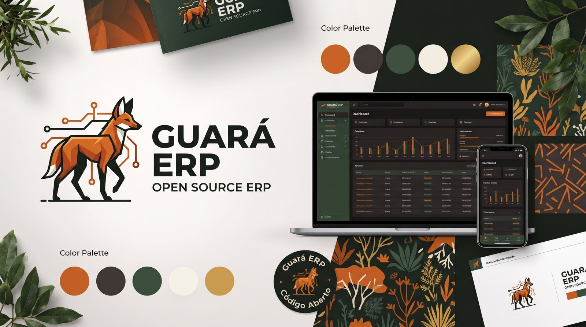

# Identidade visual — Guará ERP

O **lobo-guará** (*Chrysocyon brachyurus*) é o maior canídeo da América do Sul e símbolo do Cerrado.
No logotipo, ele aparece em estilo geométrico, ligado a trilhas de circuito: natureza brasileira e
tecnologia integradas, como o ERP integra as áreas da empresa.



## Paleta de cores

| Cor | Hex | Uso no sistema |
|---|---|---|
| Laranja guará | `#C35F23` | Cor principal: botões, links, destaques, item ativo do menu |
| Marrom terra | `#403734` | Textos de apoio e contornos |
| Verde cerrado | `#3C4D3D` | Botões de confirmação, entradas no fluxo de caixa |
| Creme | `#F4F0E5` | Fundo do selo e do cartão de login, textos sobre fundo escuro |
| Dourado | `#CA9C4F` | Filete do selo, títulos dos grupos do menu, subtítulos |
| Verde mata (fundo) | `#1F2620` / `#222721` | Menu lateral e fundo da tela inicial |

As cores estão definidas como variáveis CSS (`--guara-*`) em `static/css/erp.css`. Elas valem para
os temas claro e escuro.

## Arquivos

| Arquivo | Uso |
|---|---|
| `guara-logo-transparente.png` | Logotipo em alta resolução (1603 px), fundo transparente, para fundos claros |
| `guara-selo.png` | Selo circular (1024 px): logo sobre creme com aro dourado, legível em qualquer fundo e em tamanhos pequenos |
| `../../static/img/guara-logo.png` | Logotipo 512 px usado pela aplicação |
| `../../static/img/guara-selo.png` | Selo 512 px usado no menu lateral e na tela de login |
| `../../static/img/favicon.ico`, `favicon-32.png`, `apple-touch-icon.png`, `icon-192.png` | Ícones da aba do navegador, da tela inicial do celular e do PWA |
| `../../static/img/fundo-cerrado.webp` / `.jpg` | Ilustração do Cerrado usada como fundo da tela inicial (1920 px) e, esmaecida, no menu lateral |
| `painel-identidade.jpg`, `mockup-workspace.jpg` | Referências de aplicação da marca |

## Regras de uso

- Em **fundos escuros**, use o **selo**: as patas pretas do lobo somem sobre fundo escuro.
- Respeite uma margem livre ao redor do logo de pelo menos 10% da sua largura.
- Não distorça, não gire e não troque as cores do lobo.
- Tamanho mínimo: selo com 24 px; logotipo completo com 64 px.

## Como o fundo do logo foi removido

O script `scripts/identidade/remover_fundo.py` remove só as regiões de **branco puro** (o fundo
externo, o vão entre as patas e o miolo dos "nós" do circuito). Os tons **creme** do animal
(orelhas, peito e ponta da cauda) são mantidos. As bordas são suavizadas e o branco misturado nelas é removido.

```bash
python scripts/identidade/remover_fundo.py logo-original.jpg docs/identidade/guara-logo-transparente.png
```
